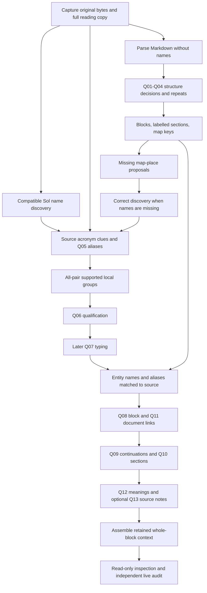

# Design: lore blocks and entity association

Status: implementation design; no application changes or live feature verdict are claimed.

## Overview and boundaries

Implement [requirements R01–R18](requirements.md) through the existing document domain, saved artifacts, and `process-document` workflow. Use [source precedence and reconciliations](scope-ledger.md) throughout. The user's instruction removes clone checks; no clone configuration or calls are needed.

The output is a source-local package: original source, layout, candidate/alias decisions, qualified typed local entities, mentions, context links, meaning notes, raw responses, and review evidence. Canonical storage and Q14–Q20 remain deferred. A local entity ID is a reproducible association key, not a permanent canonical ULID or identity merge.

## Architecture and stage dependencies

The arrows are semantic dependencies, not a requirement for two concurrent document operations. A single document operation processes stages sequentially and durable parents collect all children before advancing. Discovery and structure are logically independent; execute them sequentially in the existing workflow for simpler recovery. Across a capability pass, finish document 01 before 02, through 09. Reuse compatible discovery when starting a later capability; do not make fresh discovery a prerequisite for every repeat or resume.

Map proposals originate from structure. Bold source names can reveal discovery omissions before alias decisions. Later Q08 subjects can refine a map proposal's display name. An unnamed entry may qualify via its source descriptor and exact entry evidence; the generated section/number label remains display metadata. No loop inserts names into a saved Sol answer or qualifies places without Q06/Q07.

## Existing components and narrow additions

| Component | Design change | Requirements |
| --- | --- | --- |
| `discovery/source.ts`, `discovery/artifacts.ts` | Reuse capture, integrity, atomic artifact writes; add one shared character-to-byte utility here or beside source evidence. | R02, R16 |
| `decisions/contracts.ts`, `validation.ts` | Extend the shared contract with template metadata, Noul/Choice answers, source-local action records, and new stage kinds; retain historical variants. | R01, R09, R14, R16 |
| `decisions/catalog.ts` (new) | Pin exact Q01–Q13 template contracts and allowed field-path substitution; verify them against the governing catalog. | R01, R04, R08–R09, R11–R14 |
| `decisions/semantic-input.ts` | Validate manifests against the nine-source allowlist, load approved rules once, and construct named single/batch targets. | R02, R07–R09, R14 |
| `decisions/batching.ts`, `provider.ts`, `operation.ts` | Reuse route checks, shrinking batches, raw-wire retention, retries, and reuse; generalize stage storage and decision validation. | R14–R16 |
| `blocks/read.ts`, `blocks/build.ts`, `blocks/operation.ts` (new) | Markdown read, structure candidate planning, application of saved Q01–Q04, sections, map keys, inspection output. | R03–R06 |
| `aliases/semantic-input.ts`, `groups.ts`, `operation.ts` | Add source acronym scan and catalog Q05 wording; retain all-unordered-pairs coverage and all-member-pair grouping. | R07–R08 |
| `classification/operation.ts` | Produce separate Q06 and Q07 stages and local entity records; extend existing inspection for both stages. | R09 |
| `association/mentions.ts`, `context.ts`, `operation.ts` (new) | Own block/label/table mentions, Q08–Q13 target planning, found sections, notes, and whole-context assembly. | R10–R13 |
| `document/index.ts`, `workflows/process-document.ts` | Export public operations and add capability parents/results while retaining discovery/classification paths. | R01, R15 |
| `workflows/jev-decision-batch.ts` | One shared four-request queue; execute all new stages through the existing child. | R15 |
| `dev/retained-decision-audit.ts` and existing inspectors/verifiers | Extend raw-wire audit for Noul and stage lineage; keep it independent of product validation and assembly. | R16–R18 |

Names follow the existing domain/capability `operation.ts` pattern. Keep each file below 400 lines; split contracts into adjacent descriptive files when necessary, without introducing a second runner or generic service framework. The existing table inventory remains an inspection utility; parser-backed table evidence is shared with association instead of adding another competing Markdown interpretation.

## Decisions and rationale

### D01 — Use the parser specified by the block document

Use `mdast-util-from-markdown`, `micromark-extension-gfm`, `mdast-util-gfm`, `micromark-extension-frontmatter`, and `mdast-util-frontmatter`. The [block document code](../../../Resources/lore-to-blocks.md#the-code) explicitly specifies these capabilities; regex-only splitting cannot preserve nested elements reliably. Verify compatible versions before adding this small parser set. Reuse the AST for labels, lists, tables, quotes, and evidence rather than maintaining a second cell splitter for new association work.

### D02 — One shared catalog decision contract

Extend existing decision execution rather than create a block-specific API client. Exact criteria differ per template; allowed keys belong to the pinned template, not one global type-choice enum. Historical formats remain explicit readable variants. New templates and new policy hashes prevent replaying old `same_referent`/combined-type answers as catalog results.

### D03 — Composite source components

The proposal's one `start/end` range is adequate for many blocks but cannot represent Q04 `both` without either joining two paragraphs or accidentally including intervening text. Store one block with ordered original source components and an optional convenience envelope. The envelope is not citation evidence if it contains gaps. The same exact URL component can belong to both adjacent blocks. `neither` keeps the URL in section metadata; it does not introduce an unapproved sixth lore-block kind.

### D04 — Recall-first entity/block pairs

Plan Q08 for the Cartesian product of qualified local entities and lore blocks within a document. The catalog requires possible entity/block pairs and includes clear pronouns; restricting questions to literal hits would lose subjects. This bounded nine-document approach uses the existing batch planner and no retrieval model. Reuse known Q08 answers; if future scale requires a candidate filter, its recall needs separate evidence before adoption.

### D05 — No source-origin or example exclusions

Enable optional Q13 notes by default for inspection, with a pinned switch permitting omission. Q13 has no effect on qualification/link actions. Q12 records meaning per entity occurrence/passsage without deleting example context. Whole tables can be associated by Q08/Q10/Q11; mention evidence keeps exact rows and headers. Context is evidence for later questions, not a claim-support verdict.

### D06 — Explicit provisional and supported actions

Use an exploratory policy to obtain inspectable proposals while thresholds are calibrated. Initial Noul yes/no suggestions use the block proposal's 0.5 dividing point, with exactly 0.5 unresolved; the existing Q05 0.90 settings remain a named legacy comparison, not independent corroboration. Never label exploratory decisions as production-supported or canonical. Supported execution uses a pinned, source-reviewed per-template policy and repeats where required. This separates numerical experimentation from product semantics.

## Data and evidence contracts

All new artifact records include `contract_version` and source/configuration lineage. Names below are proposed application fields; the catalog controls wire fields and answer labels.

| Record | Required fields and invariants |
| --- | --- |
| Source | `document_id`, original relative source path, `sha256`, `byte_length`, retained reading-copy path; one of the nine approved documents |
| Source component | `start_byte`, `end_byte`, exact `text`, role; bytes decode exactly to text; nonempty ranges align with valid UTF-8 boundaries |
| Parsed item | Stable source-local ID, kind, source components, AST role, ordered list markers and entry ranges, title/map-question candidate flags |
| Block | Stable ID, kind `paragraph/quote/list/entry/table`, ordered source components, section ID, originating item IDs; entry keeps original map number |
| Section | Stable ID, kind `labelled/unlabelled/found`, limits, ordered block IDs, exact label/note/link/image components; empty sections are retained |
| Map key | ID, section, entries `{number, block_id}`, image reference or `null`, ambiguity findings; each entry retains a separate place proposal |
| Place proposal | Entry ID, source-backed descriptor/names, display label, naming basis `bold/subject/section_number`, discovery/qualification lineage and outcome |
| Candidate/group | Original Sol records, exact source name evidence, member IDs, Q05 pair IDs and results; display labels never become literal source names |
| Local entity | Stable ID derived from document and source-backed candidate/group lineage, seven-choice type, names, aliases, Q06/Q07 decisions, source evidence; no cross-document identity |
| Mention | ID, exact surface/range, candidate entity IDs, block/label position, optional table row/cell/header ranges or speaker framing |
| Question target | Template ID/version, target ID, complete named inputs, upstream decision IDs/hashes, expected answer type and criteria |
| Decision | Question/target IDs, raw Choice or Noul answer, exact response reference/hash, requested and served route, action, policy version, findings, source/upstream hashes |
| Link | Entity ID, scope `block/section/document`, exact target ID, Q08/Q09/Q10/Q11 evidence, outcome, and expanded ordered block IDs |
| Context | Entity ID, union of ordered block IDs, deduplicated source components, all contributing links, mention meanings and origin notes; no context cap |
| Stage manifest | Operation/document/stage IDs, producing contracts, source/candidate/rules/catalog/policy/config hashes, dependency hashes, batch/request hashes, timestamps |
| Stage result | Stage status, action mode, counts, missing/invalid/unresolved IDs, findings, artifact references, reuse/live evidence; no full-pipeline success claim |

Source-local IDs are derived from document identity, source hash, record role, original source ranges, and candidate lineage as appropriate. Use the existing SHA-256 helper; no new ID dependency is needed. Blocks remain stable for the same source, components, and layout policy. Entity IDs remain stable across retries of unchanged input and differ from future canonical IDs.

### Offset conversion and component assembly

mdast offsets and JavaScript regex indices are UTF-16 code-unit offsets. Resolve a valid offset `i` as `Buffer.byteLength(source.text.slice(0, i), 'utf8')`, rejecting offsets inside a surrogate pair. Confirm each resulting byte slice equals its exact source text. Do not normalize CRLF, smart quotes, BOM, or punctuation in the retained source.

Ordinary adjacent introduction/list and quote/speaker joins include their original separators when contiguous. Where labels, notes, or shared URLs create gaps, keep multiple components rather than citing an envelope across unrelated material. Derived context rendering can add display separators, but saved source text and citation ranges remain exact. Duplicate/overlapping components in a context union are counted once; the underlying block and link provenance remain separate.

### Mention matching

Reuse the proposal's longest-first, case-insensitive Unicode-boundary behavior. Deduplicate equivalent matching patterns while retaining every original candidate/member ID. A textual overlap rule selects source surface spans, not entity identity: attach all plausible accepted entity IDs to a span and ask entity-specific Q08. Match labels and table cells as evidence records; labels suggest subjects, never bypass Q10/Q11. Use AST cell ranges and headers, preserving escaped pipes and whole rows.

## Request construction and typed validation

Single-target state contains `complete_source`, `source_sha256`, `source_byte_length`, and `target`. Q06/Q07 also contain the full approved `entity_rules`. Alias state carries source-backed name records and clues, with no association-owned mentions required. Q13 contains no entity target. Include `null` explicitly where the catalog specifies missing neighbors/map notes.

For batches, use `state.targets` with deterministic IDs. A question such as Q08 replaces `target.block` and `target.entity` with their full target-specific paths. Keep the exact remainder of question wording, guidance, type, and criteria. A shared entity record may be referenced by multiple questions through an unambiguous path. Do not rely on IDs to explain what the model must decide.

Persist a question-target ledger before dispatch. The response ID set must equal the batch's planned question IDs; duplicate/missing/unexpected IDs fail validation. Validate each answer against its own template:

- Noul: `type: "noul"`, finite `noul` in [0,1], no required/invented confidence.
- Choice: `type: "choice"`, allowed chosen label, exact criteria-key probability map with finite values in [0,1], finite confidence in [0,1], probability sum within pinned rounding tolerance. Preserve the existing 0.02 sum tolerance initially and record it explicitly.

Choice confidence derives from its probabilities; record it separately for fidelity, but do not multiply it into probability or call it a second independent test. Verify formula consistency within documented route rounding tolerance; investigate discrepancies rather than silently rewriting values. [TypeSafe confidence](https://docs.typesafe.ai/confidence) and [Noul contract](https://docs.typesafe.ai/primitives/noul) confirm these distinct shapes. The [OpenRouter Decisions reference](https://openrouter.ai/docs/api/api-reference/alphadecisions/submit-a-decisions-request) defines the route; live requests still verify installed SDK serialization.

Use `client.alpha.decisions.create({ decisionsRequest })`. SDK `provider.allowFallbacks` becomes HTTP `allow_fallbacks`; inspect the captured outbound request, not merely the pre-serialization object. Retain HTTP-200 error envelopes and failure metadata before making retry decisions.

## Structure application

Read preliminary labelled sections from deterministic labels/breaks. Build Q01 targets from emphasized short lines; Q02 from paragraphs directly before lists; Q03 from out-of-sequence ordered lists or lists with section notes/images; Q04 from bare URLs and exact neighbors. A final label does not acquire unrelated following text; preserve explicit empty context and the resulting uncertainty.

Resolve Q01 and its repeats first, then rebuild section limits before constructing Q02–Q04 targets. Apply supported structural decisions in original source order. Consecutive labels are one label group. A list introduction remains with a normal list; for a supported map split, retain its introduction as its own whole paragraph so it is not duplicated into every entry. Every entry remains whole with its written number. Changed boundaries invalidate affected later targets.

Q04 `both` attaches one URL component to both neighbors. `before/after` requires the chosen neighbor within the section. `neither` retains standalone section context. Unclear/unstable placement uses an explicitly provisional next-block attachment, else section context, with the unresolved finding visible. An out-of-section or nonexistent selected neighbor is unresolved; do not redirect a supported choice to a different neighbor silently.

An image reference is metadata only; Jev receives written map notes, not pixels. An entry's key can attach to one unambiguous section image later using unchanged text lineage; missing or multiple possible images remain visible as unattached/ambiguous records. No text model rerun is required merely to fill a matching map reference.

## Alias and entity stages

Retain current all-unordered-pairs alias coverage. Extend the existing clue function with full-source acronym scanning, dotted forms, written expansions, and both initials rules. For a pair found by acronym evidence, use the catalog's acronym wording with expansion as `name_a` and acronym as `name_b`; ordinary pairs use general Q05. Ask one wording per pair, retaining all clues. Source scan omissions trigger discovery correction; they do not mutate the saved names-only output.

Q05 results form supported all-pair groups. Conflicting groups stay unresolved. The candidate/group is then supplied to Q06 with the full entity rules, excluding any importance/page threshold. Save `yes/no/unclear` and action separately. Only a supported `yes` feeds ordinary Q07. Q07 contains seven choices and no `not_an_entity`. A mixed referent rejected as unclear at Q06 remains inspectable; do not split it secretly to force a type.

Exploratory calibration may propose groups and types under a clearly labelled trial policy to inspect the chain; these are not supported local entities. Freeze the final policy and regenerate affected stages before evaluating supported association. All rules are pinned from the existing approved definition source, including applicable capture constraints; do not rewrite the ontology table in this feature.

## Association and context assembly

1. After saved Q06/Q07 decisions supply local entities, find mention spans using all supported names/aliases.
2. Plan Q08 for every local entity/block pair and Q11 for each local entity; these share known inputs and may batch independently.
3. For each positive Q08 subject, plan Q09 for neighboring blocks of the same input section. Extend runs consecutively until false/unresolved/boundary. Cache a known entity/adjacent-block answer rather than repeat it for overlapping runs.
4. Q10 evaluates every entity/labelled-section pair and proposed found sections with their full block sets. Found sections require a supported whole-section judgment before whole-section expansion. Several overlapping subject runs are allowed; do not rewrite labelled section boundaries.
5. Q12 evaluates each entity occurrence's containing passage, initially its whole block plus exact occurrence and framing. This preserves distinct mixed uses instead of treating every occurrence in a document as one example/fact label. Supported pronoun-only links also receive a passage meaning record.
6. Q13, if enabled, runs once per block, not once per entity. Save its answer as a source note.
7. Union direct blocks, supported section expansions, and supported document expansions. Sort by source order, keep full block boundaries, deduplicate shared source components, and retain the link provenance. Section metadata accompanies expanded context; it is never a separate canonical fact.

Negative or unresolved Q08 links remain in the decision ledger without attaching context automatically. Q12/Q13 never prune attached text. Failed grouping/repeat checks drop only the proposed expansion; supported direct links persist. Context can be empty for rejected/unresolved candidates, which remain inspectable separately.

## Action policies and checks

`decision-policy.json` names the template version, policy mode, per-question yes/no or Choice thresholds, tie/unclear behavior, repeat requirements, calibration evidence, and numerical tolerances. It is part of the configuration hash.

**Calibration method:** for each question family, use documents 01–06 for tuning and 07–09 for final evaluation, maintaining the same exact catalog wording. Build policy handling before the first capability and calibrate its template actions during that capability's live review, before advancing to dependent supported execution. A source reviewer derives diagnostic expected answers and byte-linked explanations from the full sources. Sweep candidate thresholds over observed probabilities; select per-template rules that make no source-reviewed unsupported automatic actions on tuning cases, routing remaining uncertain cases to review. This is an implementation policy, not a new ontology rule. Save errors, missed links, unresolved counts, cases where no usable threshold exists, and missing evaluation coverage for a template. Do not promise population accuracy from a small corpus.

Freeze that policy before final documents. If final evaluation exposes semantic errors, fail the evaluation and version a new policy; previous evaluation documents then cease to be untouched evaluation data. Obtain new independent review cases before making a new held-out accuracy claim. All nine documents still receive ordered live corpus coverage under the final policy, using compatible saved evidence where allowed.

**Repeatability:** structural Q01–Q04 and expansion Q09–Q11 (plus Q08 when used to seed a found subject) receive one explicit fresh Jev call with identical serialized state/questions and pinned settings. Retain a repeat artifact separate from retry and reuse records. Require agreement of labels/actions rather than exact floating-point equality. Unstable structure uses R05 fallback; unstable subject/continuation expansion is dropped with its finding. Q08 direct links remain governed by their own action policy. No clone check runs.

**Structure agreement:** compare subjects with literal labels and bold entry names where those clues actually identify the same target. They are diagnostics, not automatic alias/qualification/subject truth. A contradictory proposed expansion is kept unresolved; lack of an explicit clue is not itself failure. Report the denominator and unavailable clues; never extrapolate marked-text agreement into unmarked-text accuracy.

**Semantic review:** review the full sources independently of model confidence and repeats. Reviewers identify meaning errors with exact evidence; correcting a prompt/contract/policy regenerates dependent machine results. No reviewer answer is imported into product decisions.

## Orchestration, errors, and reuse

Extend `ProcessDocumentInput` with typed capability inputs for structure and association, retaining classification callers. Capability stage names and output directories identify their own result; a stage-complete result cannot claim that canon/wiki delivery occurred. Public operations live under `document/index.ts`; orchestration coordinates them without implementing source semantics.

Extend the batch input once with a versioned stage directory/reference rather than create an adapter around `classificationDirectory`. Update all owned callers together. Historical manifest parsing stays a real reader of the historical contract; new execution always uses the catalog contract. Keep the existing `classify` positional paths and resume flags; old runs remain inspectable and changed-contract execution requires a new operation.

The shared Jev child retains one deployment-wide `"jev-decisions"` concurrency group of four and per-stage/batch exclusion. Pin batch maxima initially at the existing 50 for aliases and 10 for other questions, then shrink using live endpoint metadata and the existing conservative serialized-byte bound plus overhead. Record that bound separately from actual token usage; do not label bytes as measured tokens. Preflight validates route capacity for the complete request. An oversized single target fails with diagnostics.

| Scenario | Required behavior |
| --- | --- |
| Invalid UTF-8, changed source, broken span | Stop before dispatch/action, save integrity findings |
| Missing catalog input or mismatched target path | Fail target planning; no partial implicit inputs |
| Wrong IDs/type/options/numbers/model/provider | Retain wire response, fail batch, no actions |
| Retryable transport/provider envelope | Existing Hatchet retries only, with retained attempts and route |
| Authentication, billing, or size failure | Diagnose; no route substitution or truncation |
| Unclear/marginal answer or failed repeat | Retain unresolved action; apply only specified structural fallback |
| `AbortError` during durable waits | Propagate interruption; resumed work reuses valid saved batches |
| Missing batch or stage result | Save partial findings, fail stage, stop document sequence |
| Changed question/rules/policy/upstream result | New operation and affected downstream invalidation |
| Same inputs and intact raw response | Revalidate and reuse with explicit no-network receipt |

## Artifacts and commands

Continue storing under the producing discovery iteration. Add `structures/<operation-id>/` and `associations/<operation-id>/`, while retaining `classifications/<operation-id>/` for catalog Q05–Q07 and historical evidence. Each stage includes `source.md`, `manifest.json`, `endpoint-preflight.json`, `batches/`, `decisions.json`, `validation-findings.json`, and `result.json`. Structure adds `items.json`, `layout.json`, `layout-view.md`; association adds `entities.json`, `mentions.json`, `links.json`, `meaning-notes.json`, `map-place-proposals.json`, and `context-view.md`. Retain source hashes and upstream artifact references rather than copying unrelated runs.

Add narrowly scoped `npm run blocks`, `npm run associate`, and their read-only `inspect:*` / `verify:*` counterparts, with explicit source/upstream paths and new/resume mode. Keep existing commands. A corpus option runs all nine documents sequentially through the same capability/domain operations in one embedded deployment; it does not start nine independent engines. A structure-only capability accepts source input without requiring discovery. Association requires compatible structure and Q05–Q07 inputs.

## Verification and requirement mapping

| Area | Meaningful deterministic checks | Required live evidence | Requirements |
| --- | --- | --- | --- |
| Source/layout | Unicode/CRLF/BOM boundaries; paragraph/list/table/quote integrity; tags; label-only sections; Q04 all choices and missing neighbors; map markers/images | Actual structure requests and repeats, inspected layout across nine sources | R02–R06 |
| Catalog/decisions | Exact text/criteria/input maps; Noul and per-template Choice; batch target isolation; invalid envelopes and probabilities | Served Jev wire contracts, single vs batch calibration cases | R01, R14–R16 |
| Candidates/entities | UCR/dotted/all-word initials; multiple expansions; uncertain all-pair groups; Q06 gate and seven-choice Q07 | Full-source alias, qualification/type results and reviewed omissions | R07–R09 |
| Association | Shared names, pronouns, multi-subjects, labels, cells/rows, mixed examples, copied text, found-section boundaries, union deduplication | Actual Q08–Q13 outcomes and independent source review | R10–R13 |
| Operation/recovery | Compatible reuse, dependency invalidation, repeat vs reuse distinction, interruption propagation | Same-deployment four-request bound, 30-second retry evidence, interrupted resume, zero new calls on unchanged resume | R15–R17 |
| Completion/preservation | Traceability, historical readers, source/ontology/command audit | Ordered nine-document results, semantic and independent operational verdicts | R01, R18 |

Use existing `node:test`, TypeScript checks, and build; no new test framework. Write focused regression checks for contract and semantic edge cases, not a test for each private helper. Live evidence is mandatory for feature completion. Fresh final model evidence must be distinguishable from same-input reuse and repeats. Unit checks and retained structural audit do not prove semantic correctness.
