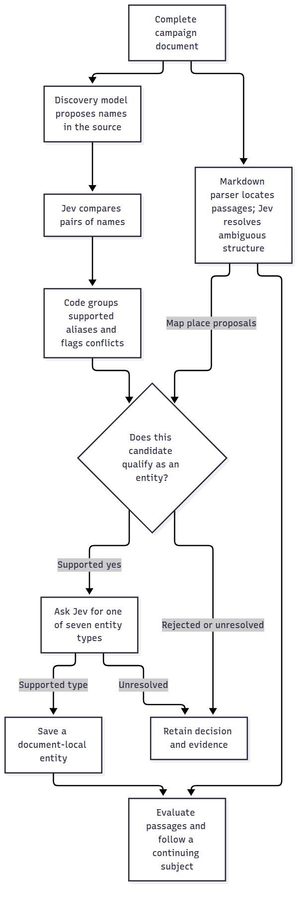

# Adventurers Pub

I built an LLM workflow to turn a Dungeon Master's campaign notes into a record of who and what each passage describes. The eventual product is a source-backed wiki. The working part shown here is the path from a Markdown document to candidate names, document-local entities, and the passages associated with them. [Product specification](Resources/specification.md#L5-L11) · [Entity output](src/domains/document/classification/catalog-operation.ts#L552-L580) · [Passage association](src/domains/document/association/operation.ts#L187-L235)

One sentence in the notes calls a group of sailors “Apolloite (aka Lathanderan).” Another describes the people of a city as “followers of Apollo (nee Lathander).” A search for similar names turns up all four. A useful wiki needs two identities here. If the workflow merges the sailors with their god, later readers can no longer tell who worships whom. [The sailors](Resources/Lore/01-unified-church-of-the-realms.md#L1-L4) · [The deity](Resources/Lore/01-unified-church-of-the-realms.md#L30-L32)

**[Read the engineering case study →](Resources/portfolio/case-study.md)** It follows that mistake from a live model response through a prompt change, a 1,540-pair evaluation, and a controlled test of wording and context. It includes the questions, the scores, and a check you can run without credentials.

## Where the workflow makes decisions



[Editable Mermaid source](Resources/portfolio/diagrams/document-workflow.mmd)

The arrows show data dependencies across capability runs. On the supported classification path, an answer changes which question the system asks next. During passage association, a positive subject decision can open another question about the following block, even when it uses a pronoun. The workflow can follow that subject until it runs out of supported continuations or reaches the section boundary. [Classification gate](src/domains/document/classification/catalog-operation.ts#L125-L129) · [Continuation planner](src/domains/document/association/planning.ts#L290-L333) · [Durable workflow](src/workflows/process-document.ts#L125-L154)

## What the runs showed

| Question | Observed result |
| --- | --- |
| Did model decisions change the work performed? | In a six-document classification trial, 412 discovered names yielded 21,618 pairwise alias questions. The workflow withheld 57 groups with conflicting identity evidence, asked 284 qualification questions and 229 type questions, and emitted 220 local records. These counts measure routing and output volume. [Per-document counts](Resources/portfolio/classification-runs.json#L2-L7) |
| Did the alias prompt improve? | At a fixed 75% acceptance threshold, the earlier configuration recovered 15 of 21 predeclared aliases and falsely linked 4 of 16 deliberately distinct pairs. The frozen configuration recovered 20 of 21 and falsely linked 0 of 16. It still missed the explicit alias between the two follower names. [Reviewed pairs](Resources/portfolio/reviewed-pairs.json) · [Comparison and scoring rule](Resources/portfolio/case-study.md#test-the-frozen-prompt) |

## Try it locally

With Node 24, run these from the repository root. The tests exercise model-answer validation, provisional versus supported decisions, and the stopping rule for passage association using local fixtures. [Node version](.nvmrc) · [Decision tests](src/domains/document/decisions/validation.test.ts#L18-L69) · [Continuation test](src/domains/document/association/association.test.ts#L365-L383)

```bash
npm ci
node --import tsx --test src/domains/document/decisions/validation.test.ts src/domains/document/association/association.test.ts
```

For an offline look at the model outputs themselves, run the [case study's score check](Resources/portfolio/case-study.md#reproduce-the-comparison). To run live discovery, classification or the local prompt playground with your OpenRouter account, see [running and inspecting the pipeline](Resources/running-the-pipeline.md). The longer-term design for cross-document knowledge, claims and wiki publication is in the [product specification](Resources/specification.md) and its [workflow diagrams](Resources/document-workflow-diagrams.md).
