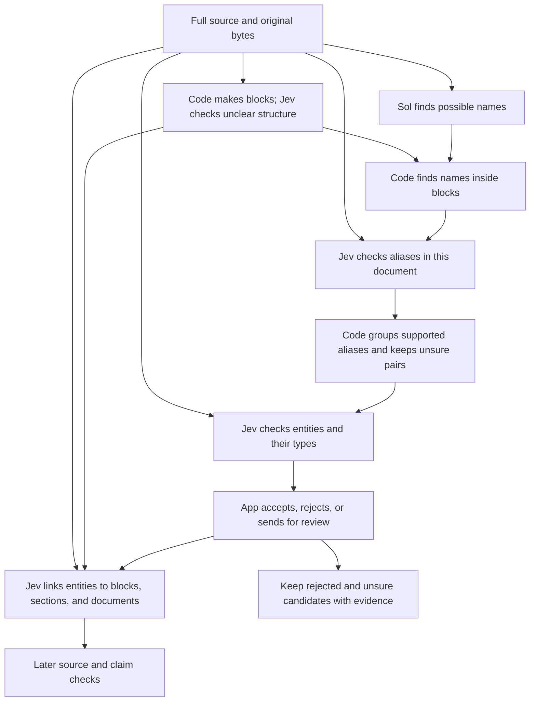
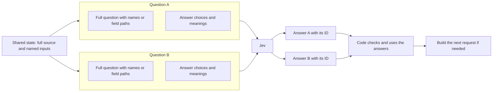
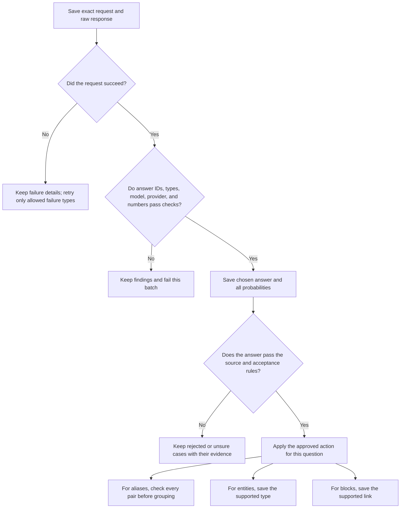

# Jev decision request guide

Research date: **October 4, 2026**.

**Give Jev the full source, one clear question at a time, and clear answer choices.** Jev returns answers and probabilities. Code checks the results and decides what to accept, reject, or send for review. A result can have the right format and still be wrong. ([TypeSafe guide](https://docs.typesafe.ai/concepts/how-to-build-with-system-one))

Use this order: **Sol finds names → make blocks → group aliases → check entities → link entities to blocks**. Each step keeps the original text and evidence. Checks of source meaning must receive the full source. For identity checks across documents, include the full earlier sources that support the possible match. ([Source rules](specification.md#L55))

## 1. Use clear words and questions

Aim for a sixth- to eighth-grade reading level in questions, answer descriptions, and explanations. Use short sentences and common words. Keep exact names, source quotes, API field names, and approved entity types when they are needed for accuracy.

| Word | Meaning |
| --- | --- |
| **Entity** | A specific creature, place, group, item, event, quest, or idea that fits our definitions. |
| **Candidate** | A possible entity that needs to be checked. |
| **Alias** | Another name for the same entity, such as a short name or nickname. |
| **Acronym** | A name made from initials, such as UCR. Matching initials can suggest an alias, but they do not prove it. |
| **Block** | A source paragraph, list, table, quote, or map entry kept as one unit. |
| **Claim** | Something the source says, including a belief, rumor, example, or denial. |
| **Probability** | Jev's estimate for an answer, from 0 to 1. For example, 0.90 means 90%. |
| **Review range** | Answers that are too uncertain for the app to use on its own. |

Use named inputs and ask directly about them. Avoid a task such as “Apply the rules to this pair.” Ask “In this document, is UCR an acronym for Unified Church of the Realms?” The wording must explain the task even without the question ID. This follows the vendor's advice to use clear questions and direct field names. ([Question design](https://docs.typesafe.ai/primitives/advanced), [known weak spots](https://docs.typesafe.ai/model-jaggedness/jev-1.13))

## 2. Choose the answer type

| Type | Use it for | What Jev returns |
| --- | --- | --- |
| **Choice** | One answer from a set of clear options. | The chosen answer, each option's probability, and confidence. The probabilities add up to one. |
| **Noul** | One yes/no question. | `noul`: the probability of yes. There is no separate confidence field. |
| **Score** | A level on a scale with written descriptions. | The average level, each level's probability, and confidence. Levels start at zero. |

Choice allows up to 255 options. Define each option so it has a distinct meaning. Use `unclear` when the source may not settle the question. Choice is useful for alias checks and entity types. ([Choice](https://docs.typesafe.ai/primitives/choice))

Noul asks one question whose answer is yes or no. A value near 0.5 means Jev is unsure. To link a block to several entities, ask a separate Noul question for each entity. Choosing one entity from a list would force a single winner. ([Noul](https://docs.typesafe.ai/primitives/noul))

Score uses 2–10 levels. Describe each level in plain words. The average is not a probability. For example, a score of 1 could mean all weight is on level 1, or an even split between levels 0 and 2. Read the full result. A score must not become an extra rule about whether an entity deserves a page. ([Score](https://docs.typesafe.ai/primitives/score), [capture rules](specification.md#L64))

## 3. Ask the questions in this order



Making blocks does not depend on the list of names. Code can make the blocks and find the name matches before alias checks. Each later step must use saved inputs from the steps it depends on. ([Block inputs](lore-to-blocks.md#L13), [saved input rules](specification.md#L499))

### Find names with Sol

Sol should find possible names across all seven entity types. Keep names as written in the source. Keep aliases, short names, and acronyms as separate candidates at this step. Favor recall when a name might qualify. Sol must supply missing candidates; Jev can only judge the candidates it receives. ([Discovery rules](../src/domains/document/discovery/v31/prompt.md#L1), [model roles](specification.md#L487))

### Make blocks

Code should find clear paragraphs, lists, tables, quotes, and headings. Ask Jev about unclear structure. Give each question the full source, the exact target text, and nearby text. These questions build on the block proposal. ([Structure questions](lore-to-blocks.md#L55))

| Question | What Jev needs | Answer and action |
| --- | --- | --- |
| **Is this line a title for the text that follows?** | The line, following text, and section limits. | Noul. A supported yes makes the line a section label. |
| **Does this paragraph introduce the next list?** | The paragraph and list with source positions. | Noul. A supported yes keeps them in one block. |
| **Do these numbers label places on a map?** | The list, nearby text, and any written map description or notes. | Noul. A supported yes keeps each map entry and its number. |
| **Which block should get this link?** | The link and blocks on each side. | Choice: before, after, neither, or unclear. Keep unclear cases for review. |

Define what happens at the start and end of a document. Jev reads text only, so map questions need written descriptions or notes. It cannot inspect map pixels. A map entry may reveal a missing place candidate. Send it through discovery and entity checks before creating an accepted entity. ([Text inputs](https://docs.typesafe.ai/concepts/state), [map proposal](blocks-to-entity.md#L39), [discovery boundary](specification.md#L487))

### Group aliases

Ask one direct question for each pair chosen for an alias check. The request must include the full source, both names, all their source matches, and any useful name clues. Shared words or matching initials alone do not prove a link. ([Alias design example](https://docs.typesafe.ai/cookbooks/entity_alignment))

| Question | Choice answers | Meaning |
| --- | --- | --- |
| **In this document, are these two names aliases for the same entity?** | `same_entity`, `different_entities`, `unclear` | Both names identify one entity, identify different entities, or cannot be settled from the source. |
| **In this document, is UCR an acronym for Unified Church of the Realms?** | The same three answers. | Judge how the acronym is used in the full document. The text need not spell out its full name if the context makes the alias clear. |

The acronym question is a clearer version of the alias question for that kind of pair. Do not ask both versions unless the second question has a separate purpose. Option names are supplied by us; they are not fixed Jev vocabulary. Both option names and descriptions affect the question. ([Choice contract](https://docs.typesafe.ai/primitives/choice))

Code should group aliases only when the links pass the chosen acceptance rules. Require support for every pair within a group. Keep unsure names separate, with their evidence. Checking an alias link is different from deciding whether the candidate fits an entity type. ([Group rule](../src/domains/document/aliases/groups.ts#L3), [entity rules](specification.md#L92))

### Check entities and their types

Give Jev the full source, the candidate or alias group, all its names and source matches, and the approved entity definitions. Use the seven definitions exactly. Do not ask whether the candidate is important enough to keep. ([Entity definitions](specification.md#L92), [capture rules](specification.md#L64))

| Question | Answer and action |
| --- | --- |
| **Does this candidate name a specific entity that fits one of our seven definitions?** | Noul, or Choice with yes/no/unclear. Keep unsure cases for review. |
| **Which entity type fits this candidate?** | Choice: `Creature`, `Location`, `Organization`, `Item`, `Event`, `Quest`, or `Concept`. Ask this after the first check passes. |

A single Choice can also combine these checks by adding `not_an_entity` to the seven types. Compare the two approaches on reviewed examples before picking one. If the two-question approach needs the first answer to set the second question's inputs, use a later request. ([Choice](https://docs.typesafe.ai/primitives/choice), [question independence](https://docs.typesafe.ai/primitives))

An example or quote may name an entity without proving that an event happened. A rumor must remain a rumor. Keep the source's speaker, limits, doubts, and denials when checking claims. If an alias group seems to mix entities, send it for review rather than quietly changing its members. ([Faithful claims](specification.md#L71))

### Link entities to blocks

Use the entity ID, all its aliases, the full source, and the target text. Ask each question for one named entity. A block, section, or document can be about several entities. ([Association rules](blocks-to-entity.md#L50))

| Question | What Jev needs besides the full source | Answer and use |
| --- | --- | --- |
| **Is this block about this entity?** | The block, entity ID, and aliases. | Noul per entity. Link the block when the answer passes the chosen rules. |
| **Does this block keep talking about this entity from the previous block?** | Both blocks, the entity, and section limits. | Noul per entity. Suggest keeping the blocks in one section. |
| **Is this section about this entity?** | The label, all section blocks, limits, and entity. | Noul per entity. Link the section. |
| **Is this document about this entity?** | The full document and entity. | Noul per entity. Link the document. |
| **Is this passage an example, or does it report an actual action or fact?** | The passage, named entity, and nearby text. | Choice: example, reported fact, mixed, or unclear. Save that meaning with later claims. |
| **Is this passage copied from another work, or does it introduce copied text?** | The passage and nearby text. | An optional note about where the text came from. Keep the supplied text. |

**A block link does not prove every claim in that block.** Claims still need their own source checks. Keep full table rows and headers, list context, quotes, and speakers. Copied text must not be dropped merely because it came from another work. These rules preserve the meaning and authority of the supplied source. ([Source authority](specification.md#L48), [claim support](specification.md#L71))

### Later source checks

Use the same clear-question pattern for later checks. Identity and article checks must receive the full documents that support the decision. Their final model choice must follow the project design and pass checks on the needed task. ([Full sources](specification.md#L55), [model roles](specification.md#L547))

| Question | Required inputs and answer |
| --- | --- |
| **Does the source support this exact claim?** | Claim, entities, full source, and evidence. Choice: supported, contradicted, or not enough evidence. Include who said it, doubts, denials, and time. |
| **Does the source state this relationship between these two entities?** | The proposed link, both entities and types, allowed link rule, and full source. Code checks allowed types and direction. |
| **Does the source state this trait about this entity?** | Entity, proposed trait, time if given, and full source. Ask separately about each trait so several traits can be supported. |
| **Does this date describe when the claim is true, or when the event happened?** | Date wording, linked claim or event, and full source. Use clear choices. Code converts supported dates; keep rough and relative dates. |
| **Are this new candidate and this saved entity the same entity?** | Both records and all full supporting documents. Choice: same, different, or unclear. |
| **Does this new claim change an old fact, add a fact, describe another time, or conflict with it?** | Both claims, full sources, source order, and dates. Define distinct options and keep old evidence. |
| **Which allowed article section best fits this passage?** | Accepted passage, entity type, and allowed sections, including `Other`. Keep the passage if its section is unclear. |
| **Do the full cited sources support this exact article sentence?** | Sentence, citations, saved claims, and full sources. Decide whether it needs revision. |

These checks must follow the source's wording. They do not judge whether the DM's claim sounds believable in some other setting. Code must handle math, byte positions, allowed relationship rules, and source order. ([Claims](specification.md#L71), [relationships](specification.md#L135), [dates](specification.md#L170), [updates](specification.md#L186), [article support](specification.md#L257))

## 4. Build the request

| Field | What it holds |
| --- | --- |
| `model` | The chosen Jev model. |
| `provider` | The allowed provider and fallback rule. |
| `state` | The full source, project rules, names, entities, blocks, and source positions needed by the questions. |
| `questions` | A map of question IDs to questions. |
| `instructions` | The full question, named inputs, and any short guidance. |
| `criteria` | What each allowed answer means. |

Objects with named fields are valid for state and instructions. Jev does not see the question-map ID. It does see the question's instructions and answer definitions. Put every needed name and condition inside those fields or point directly to named fields in state. ([API](https://docs.typesafe.ai/api), [structured questions](https://docs.typesafe.ai/primitives/advanced))



Each question reads the shared state and its own instructions and answer rules. **It cannot read another question's answer in the same request.** Batch questions when their inputs are already known. If an alias or entity answer changes a later question's inputs, save it and build a later request. ([Question independence](https://docs.typesafe.ai/primitives))

### Alias request example

The full source below is made up for this example. Send the JSON to `POST https://openrouter.ai/api/alpha/decisions`, with `Authorization: Bearer <OpenRouter key>` and `Content-Type: application/json`. Direct TypeSafe requests use `https://api.typesafe.ai/v1/systemone` and a TypeSafe key. ([OpenRouter request guide](https://openrouter.ai/docs/guides/community/jev))

```json
{
  "model": "typesafe/jev-1.13",
  "provider": {"only": ["typesafe"], "allow_fallbacks": false},
  "state": {
    "complete_source": "The Unified Church of the Realms is a religious organization. This document calls that organization UCR.",
    "names": {
      "full_name": "Unified Church of the Realms",
      "acronym": "UCR"
    }
  },
  "questions": {
    "ucr_alias": {
      "type": "choice",
      "instructions": {
        "question": "In `complete_source`, is `names.acronym` an acronym for `names.full_name`?",
        "guidance": "Check how the document uses these names. Matching initials alone is not enough."
      },
      "criteria": {
        "same_entity": "Both names are aliases for the same entity in this document.",
        "different_entities": "The names identify different entities in this document.",
        "unclear": "The document does not settle the alias link, or one name has conflicting uses."
      }
    }
  }
}
```

A real request must also carry the saved source hash, the project rules, candidate records, and original source positions required by that step. Keep those checks in code. Save the exact request and raw response before using the answers. ([Evidence records](specification.md#L499))

### Block request example

Send a later request when entity checks have supplied the entity and alias group. Give it the full source again. This second example uses the same made-up source. The entity ID and block are also example inputs.

```json
{
  "model": "typesafe/jev-1.13",
  "provider": {"only": ["typesafe"], "allow_fallbacks": false},
  "state": {
    "complete_source": "The Unified Church of the Realms is a religious organization. This document calls that organization UCR.",
    "entity": {
      "id": "example-church",
      "name": "Unified Church of the Realms",
      "aliases": ["UCR"]
    },
    "block": "This document calls that organization UCR."
  },
  "questions": {
    "block_about_entity": {
      "type": "noul",
      "instructions": "In `complete_source`, is `block` about `entity.name`, using its name, aliases, or a clear pronoun?",
      "criteria": {
        "true": "The block talks about this entity.",
        "false": "The block does not talk about this entity."
      }
    }
  }
}
```

To ask how much a block focuses on an entity, an optional Score question can use three levels: “The block does not talk about this entity,” “The block briefly mentions this entity while talking about something else,” and “The block mainly talks about this entity.” Supply the descriptions as a `criteria` array. This is a scale for focus, not a rule for accepting entities. ([Score format](https://docs.typesafe.ai/primitives/score))

### SDK field names

For the OpenRouter SDK, use `client.alpha.decisions.create({ decisionsRequest })`. The SDK field is `allowFallbacks`; HTTP JSON uses `allow_fallbacks`. Do not copy the HTTP name into the SDK object without changing it. The request uses `model`, `state`, and `questions`, rather than chat `messages`. ([SDK request](../node_modules/@openrouter/sdk/esm/models/decisionsrequest.d.ts#L17), [provider fields](../node_modules/@openrouter/sdk/esm/models/providerpreferences.js#L62))

## 5. Read answers and choose what to do

A Choice answer has a chosen label, each option's probability, and confidence. A Noul answer has `noul`, the probability of yes. Jev does not return a written reason or generated citations. If you need more detail, ask a separate, clear question about a specific point. Do not treat extra model answers as proof. ([Choice answers](https://docs.typesafe.ai/primitives/choice), [Noul answers](https://docs.typesafe.ai/primitives/noul), [output limits](https://openrouter.ai/docs/guides/community/jev))

**Choice confidence comes from the option probabilities. It is not a second, separate check.** The formula is `c = (pmax − 1/n) / (1 − 1/n)`. Here, `pmax` is the highest probability and `n` is the number of options. With three options and a highest probability of 0.90, confidence is `(0.90 − 1/3) / (1 − 1/3) = 0.85`. Choose limits with that link in mind. Noul has no separate confidence field. ([Confidence](https://docs.typesafe.ai/confidence))

Save the chosen answer separately from the app's action. Jev may pick an answer while still being unsure. Code should keep that case for review. Acceptance limits must come from reviewed examples for each question type. Do not assume that 0.90 is the right cutoff for every task. ([Building with System One](https://docs.typesafe.ai/concepts/how-to-build-with-system-one))



Code must check the allowed model and provider, expected question IDs, answer types, number ranges, and probability totals. Invalid answer formats should stop the batch. Retry only failure types covered by the approved retry policy. Keep errors even when HTTP reports success. All of these are format and process checks; source review still decides whether the meaning is right. ([Jev contract](https://docs.typesafe.ai/api), [retry rules](specification.md#L280))

## 6. Keep the full source and check the design

TypeSafe lists two limits for Jev 1.13: state plus all questions must fit within 64k tokens; state plus the longest question must fit within 32k. OpenRouter lists a 32k limit. Tokens are small pieces of text a model reads. Use the checked limit for the route being called. If the full source will not fit, reduce the batch or fail the step. Do not quietly cut the source. ([Model limits](https://docs.typesafe.ai/models), [OpenRouter model](https://openrouter.ai/typesafe/jev-1.13), [full-source rule](specification.md#L55))

Use original UTF-8 byte positions for source evidence. Count from zero, include the start, and leave out the end. Character positions can differ from byte positions. A matching name or quote does not by itself prove its meaning. Keep the full table, list, quote, and speaker context. ([Evidence rules](specification.md#L536), [quote checks](https://docs.typesafe.ai/cookbooks/citation_check))

Before reusing an answer, check that the source, questions, options, model settings, and input records still match. Save the model version and whether the answer was reused. Do not assume a general OpenRouter caching feature supports the Decisions route. ([Saved input rules](specification.md#L499), [OpenRouter cache routes](https://openrouter.ai/docs/guides/features/response-caching))

Use this checklist when checking the proposed questions. A reviewer must read the full source and supply the expected answers. Keep truly unclear cases unclear. Use different documents for tuning and final review.

| Check | What to compare or save |
| --- | --- |
| **Plain wording** | Compare clear questions with other wording on reviewed examples. Include acronyms such as UCR. |
| **Options** | Change the order and use clear answer descriptions. Save every probability and app action. |
| **Batches** | Ask the same questions alone and in batches, with the full source. |
| **Source meaning** | Include aliases, shared names, tables, quotes, examples, rumors, denials, and relative dates. |
| **Acceptance limits** | Compare probabilities with reviewed accuracy. Count wrong links, missed entities, and cases sent for review. |
| **Source size** | Check the full source, actual token use, and size failures. |
| **Live behavior** | Run the chosen questions through the real service and review the results before calling them complete. |

Repeated answers show stability. Agreement with another model shows agreement. Neither proves the answer is right. Separate questions can make the same mistake, so their errors are not automatically independent. Clear wording is a design choice that still needs evidence from source review and live runs. ([Question design](https://docs.typesafe.ai/concepts/how-to-build-with-system-one), [review rules](specification.md#L301))
