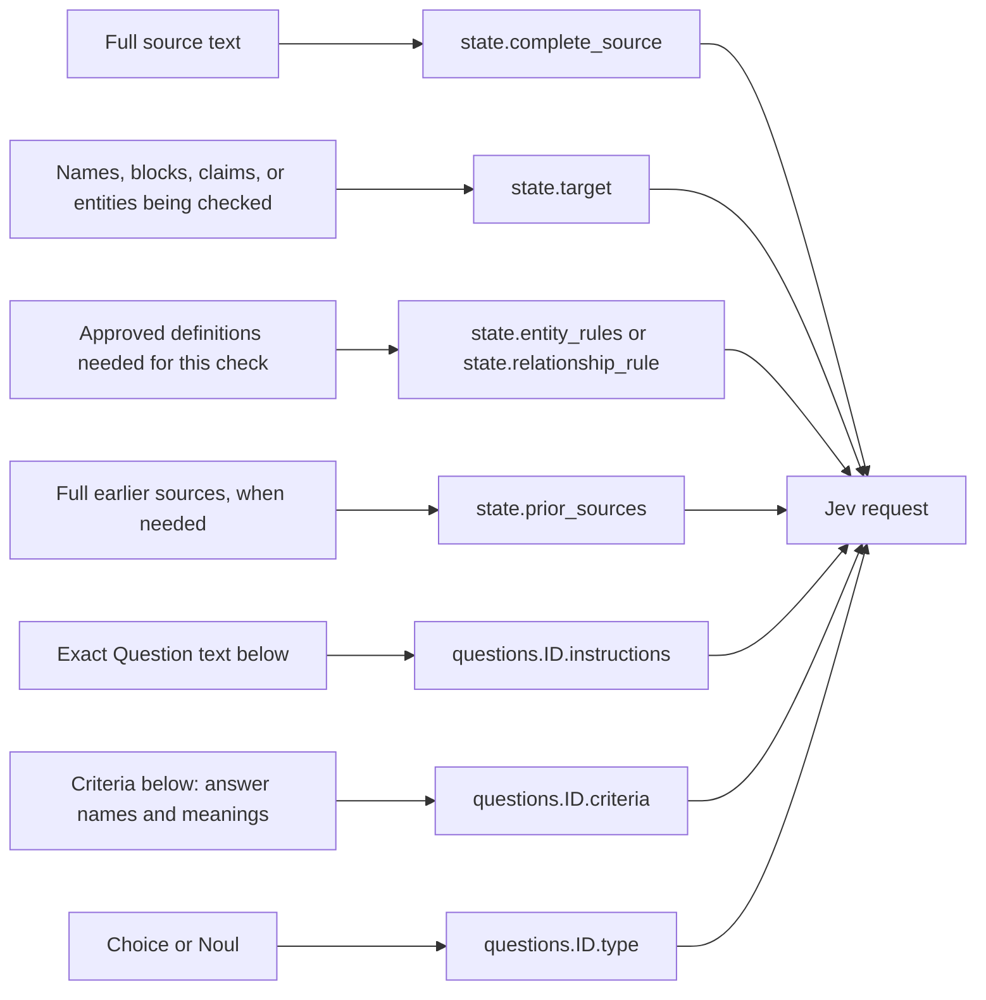
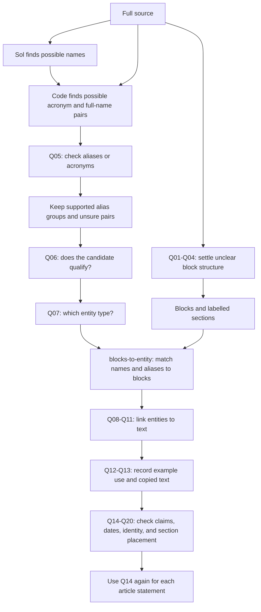
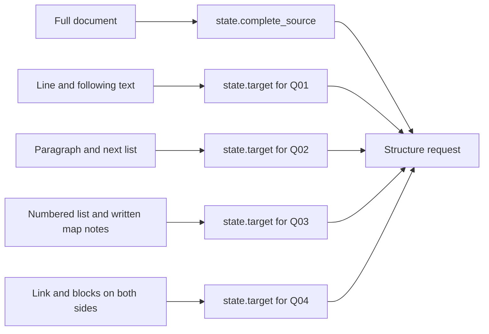
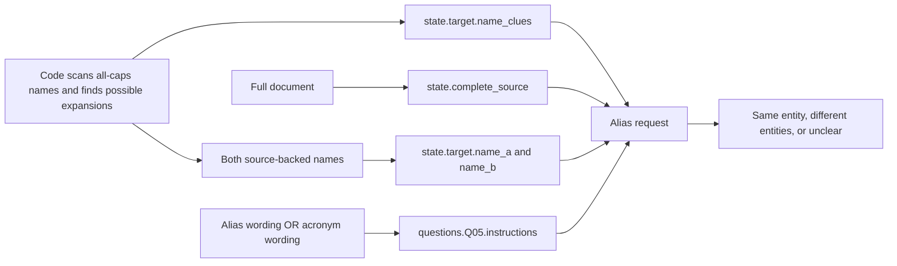
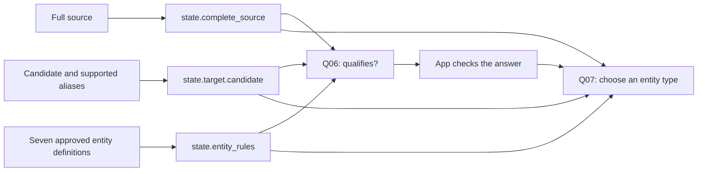
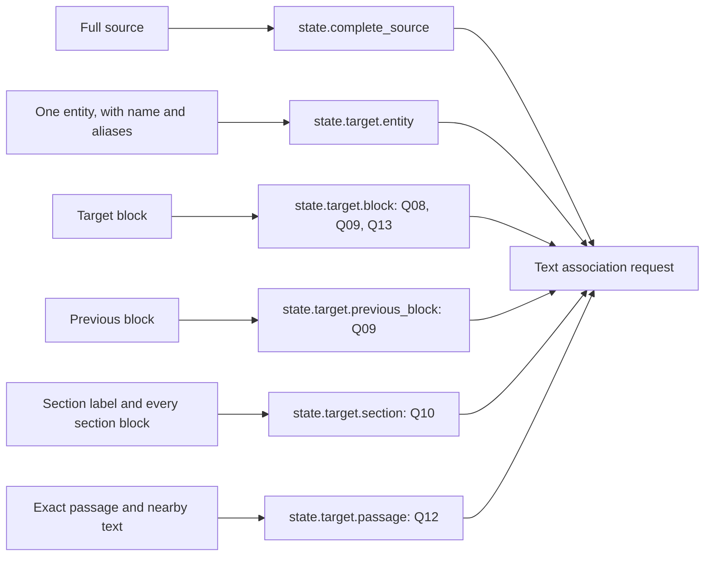
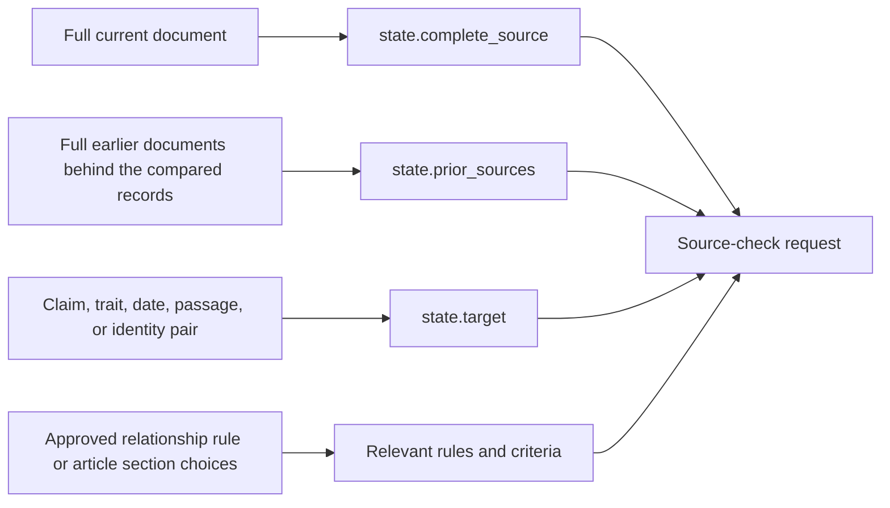
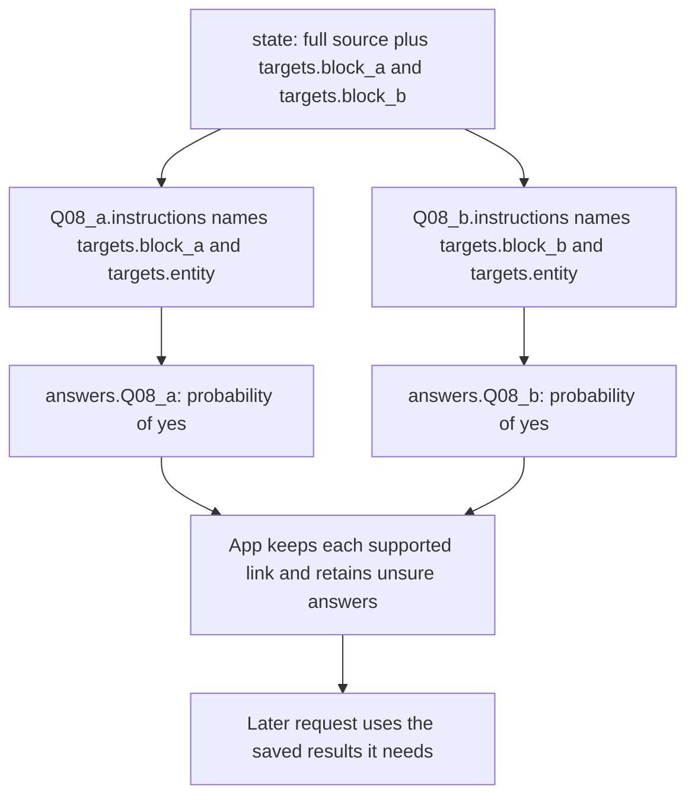

# Jev question catalog

**Proposed questions for the intended system · October 4, 2026**

There are **20 question templates** below: 13 for document structure, aliases, entity checks, and block links; 7 for later source checks. The article check uses Q14 again. Q05 has a separate wording for acronyms.

The text after **Question** is the exact text for `instructions`. The answers after **Criteria** go in `criteria`. The listed inputs go under `state.target`. Every request also gets `state.complete_source`: the full, unchanged source document. These field names and question choices are proposed application inputs. ([Request fields](https://openrouter.ai/docs/api/api-reference/alphadecisions/submit-a-decisions-request), [complete-source rule](specification.md#L55))

## Where the content goes



`choice` means one answer from the listed options. `noul` means a yes/no question; Jev returns the probability of yes. The question ID is a label for finding the answer. Put the full question in `instructions`. ([Choice](https://docs.typesafe.ai/primitives/choice), [Noul](https://docs.typesafe.ai/primitives/noul), [question IDs](https://docs.typesafe.ai/api))

## The question order



Sol and the code scan supply candidates. Jev judges the supplied pairs and choices. Block links and source notes do not remove text from the complete source. Examples, quotes, tables, and copied passages keep their wording and meaning. ([Capture rules](specification.md#L64), [source authority](specification.md#L48))

| Step | Responsibility |
| --- | --- |
| Find names | Supply possible names from the full source. |
| Make blocks | Split the source into blocks and labelled sections. |
| Associate aliases | Judge whether names belong to the same entity, including acronyms. |
| Verify entities | Decide whether a candidate qualifies and which type fits. |
| `blocks-to-entity` | Find name mentions in blocks, keep their locations, and associate blocks, sections, and documents with entities. |

## A. Make blocks — Q01–Q04

Ask these when the structure is unclear. A missing neighboring block is `null`. A map question gets written map notes or descriptions; Jev receives text. ([Text state](https://docs.typesafe.ai/concepts/state))



The diagram shows four possible target shapes. In a single-target request, use the shape for the question being asked.

### Q01 — Title

**Question:** In `complete_source`, is `target.line` a title for `target.following_text`?  
**Inputs:** `line`, `following_text`, `section_limits`.  
**Type:** `noul`. **Criteria:** `true`: The line labels the text that follows. `false`: The line is part of the body text, or does not label the following text.

### Q02 — List introduction

**Question:** In `complete_source`, does `target.paragraph` introduce `target.next_list`?  
**Inputs:** `paragraph`, `next_list`, `section_limits`.  
**Type:** `noul`. **Criteria:** `true`: The paragraph tells the reader what the next list covers. `false`: The paragraph and list stand apart.

### Q03 — Map labels

**Question:** In `complete_source`, do the numbers in `target.list` label places on a map?  
**Inputs:** `list`, `nearby_text`, `map_notes`. Keep missing map notes as `null`.  
**Type:** `noul`. **Criteria:** `true`: The numbers identify places on a map. `false`: The numbers serve another purpose, such as list order, or the text does not establish map labels.

### Q04 — Link placement

**Question:** In `complete_source`, which neighboring block does `target.link` belong with?  
**Inputs:** `link`, `previous_block`, `next_block`, `section_limits`.  
**Type:** `choice`. **Criteria:** `before`: The link belongs with the previous block. `after`: It belongs with the next block. `both`: It belongs with both. `neither`: It stands alone. `unclear`: The source does not settle its placement.

## B. Associate aliases — Q05

**Code first:** Scan the full source for words with at least two capital letters and no lowercase letters, such as UCR. Also keep dotted forms such as U.C.R. Keep the original spelling. All-caps words are possible acronyms; capitalization alone does not prove one.

For each possible acronym, code checks names already found in the source:

1. Look for a written expansion, such as **Unified Church of the Realms (UCR)** or **UCR (Unified Church of the Realms)**.
2. Compare the acronym with the full name's initials. Try all words, then omit **a, an, the, of, and, in, for, to**. Keep which rule matched.
3. For **Unified Church of the Realms**, the second rule gives **U + C + R = UCR**.
4. Keep every matching full name. If several match, keep each possible pair. If none match, keep the acronym as unresolved.
5. Send each possible pair to Q05 with the acronym wording and `target.name_clues`. Send a missed name back through candidate discovery and qualification.

Code finds possible alias links before the Jev request. Jev checks which links the source supports. Do not create a full name that never appears in the source, or accept a pair from matching initials alone. Other kinds of aliases still use the general Q05 wording. ([Source-backed names](specification.md#L127))



### Q05 — Alias identity

**Question:** In `complete_source`, are `target.name_a` and `target.name_b` aliases for the same entity?  
**Inputs:** `name_a`, `name_b`, `name_clues`. Jev checks how both names are used in the full source.  
**Type:** `choice`. **Criteria:** `same_entity`: Both names name one entity in this document. `different_entities`: The names name different entities. `unclear`: The source does not settle the link, or a name has conflicting uses.

**Guidance:** Use the names' meaning in the full source. Shared words or matching initials alone do not prove an alias. The source does not have to spell out the full name if its use of the names makes the link clear.

**Acronym wording, used instead of the general wording:** In `complete_source`, is `target.name_b` an acronym for `target.name_a`?

For the UCR check, `name_a` is **Unified Church of the Realms** and `name_b` is **UCR**. Keep the same three criteria. This directly asks Jev to judge the acronym link.

## C. Verify entities — Q06–Q07

Both questions get the full source, the candidate's names and supported aliases, and the approved entity definitions. Q07 is used after Q06 supports keeping the candidate. These are separate judgments: an alias link alone does not qualify an entity. ([Entity definitions](specification.md#L92))



### Q06 — Entity qualification

**Question:** In `complete_source`, does `target.candidate` name one specific entity that fits `entity_rules`?  
**Inputs:** `candidate` with all supported names. Also supply `state.entity_rules` with the full approved definitions.  
**Type:** `choice`. **Criteria:** `yes`: The candidate names one specific entity that fits an approved definition. `no`: It is generic content or does not fit any approved definition. `unclear`: The source does not settle its identity or qualification, or the candidate mixes different entities.

**Guidance:** A mention is enough to consider a qualifying entity. Do not require importance, a long description, or enough material for an article. Preserve examples, beliefs, denials, and quotes as written.

### Q07 — Entity type

**Question:** In `complete_source`, which type in `entity_rules` fits `target.candidate`?  
**Inputs:** The same candidate and full approved definitions as Q06.  
**Type:** `choice`. The criteria use the seven names below, with their full approved definitions as the values. These brief descriptions identify the choices; they do not replace the definitions sent to Jev.

| Choice | Meaning |
| --- | --- |
| `Creature` | An individual being, including a deity. |
| `Location` | A place at any scale. |
| `Organization` | A group with a collective identity. |
| `Item` | A specific object that meets the capture rules. |
| `Event` | A happening that meets the approved Event rules. |
| `Quest` | An objective the party pursues. |
| `Concept` | A nameable idea, era, religion, law, tradition, or phenomenon. |

## D. blocks-to-entity — Q08–Q13

This step owns matching names and aliases to blocks and keeping each mention's source location. It starts from the blocks, labelled sections, and entity names supplied by the earlier steps. These records support association and evidence inspection; they are not extra inputs to alias checks or entity verification. ([Association inputs](blocks-to-entity.md#L19))

`target.entity` contains its ID, type, supported name, and aliases. A block contains its exact text, source range, and kind. Sections contain their labels, limits, and every block. Tables include their headers and whole rows; quotes include their speakers. ([Faithful evidence](specification.md#L71))



### Q08 — Block link

**Question:** In `complete_source`, does `target.block` talk about `target.entity`, using its name, an alias, or a clear pronoun?  
**Inputs:** `entity`, `block`, `section_label`, `nearby_blocks`.  
**Type:** `noul`. **Criteria:** `true`: The block discusses or mentions this entity. `false`: It does not discuss or mention this entity. A shared name with a different entity does not count.

Ask once for each possible entity/block pair. Several entities can receive the same block. Example use is still a mention; Q12 records what that mention means.

### Q09 — Continued subject

**Question:** In `complete_source`, does `target.block` keep talking about `target.entity` from `target.previous_block`?  
**Inputs:** `entity`, `previous_block`, `block`, `section_limits`.  
**Type:** `noul`. **Criteria:** `true`: Both blocks discuss this entity, and the later block continues the discussion. `false`: The later block changes subject, or the link to this entity is not established.

### Q10 — Section link

**Question:** In `complete_source`, is `target.entity` a subject of `target.section`?  
**Inputs:** `entity`, `section` with its label, limits, and all blocks.  
**Type:** `noul`. **Criteria:** `true`: The section as a whole discusses this entity. `false`: The entity is only mentioned in passing, or the section does not discuss it.

### Q11 — Document link

**Question:** Is `target.entity` a subject of `complete_source` as a whole?  
**Inputs:** `entity`. The full document is already in `state.complete_source`.  
**Type:** `noul`. **Criteria:** `true`: The document as a whole discusses this entity. `false`: The entity is only mentioned in passing, or the document does not discuss it.

### Q12 — Example or assertion

**Question:** In `complete_source`, does `target.passage` use `target.entity` in an example, make an assertion about it, or do both?  
**Inputs:** `entity`, `passage`, `nearby_text`, `speaker` if given.  
**Type:** `choice`. **Criteria:** `example`: The passage uses this entity only in a made-up example or a hypothetical case. `assertion`: It makes a claim about this entity, including a reported belief, rumor, or denial. `both`: It includes both example use and an assertion. `unclear`: The source does not settle which use applies.

An assertion keeps its speaker, doubts, denial, and time. An example does not establish that the example's action happened. Neither answer removes the passage.

### Q13 — Copied text note

**Question:** In `complete_source`, is `target.block` copied from another work, an introduction to copied text, or neither?  
**Inputs:** `block`, `nearby_blocks`, `source_note` if given. No entity input is needed.  
**Type:** `choice`. **Criteria:** `copied_text`: The block is presented as text taken from another work. `introduction`: The block introduces text taken from another work. `both`: It contains copied text and its introduction. `neither`: The source presents it as neither. `unclear`: Its origin is not settled.

This is an optional source note. Every answer keeps the supplied text available for entity and claim checks. ([Source authority](specification.md#L48))

## E. Later source checks — Q14–Q20

Each check gets the full current source. When a check compares documents, `state.prior_sources` contains each full earlier source with its document ID. Evidence quotes and source ranges point into those texts. They do not replace them. ([Complete sources](specification.md#L55))



### Q14 — Claim support

**Question:** Do `complete_source` and any `prior_sources` support `target.claim` exactly, including its speaker, doubts, denial, and time?  
**Inputs:** `claim`, `entities`, `evidence`. Include any full earlier sources cited by the claim.  
**Type:** `choice`. **Criteria:** `supported`: The sources support the claim's full meaning and limits. `contradicted`: The sources state something incompatible with the claim. `not_enough_evidence`: They do not establish the whole claim. `conflicting_sources`: They contain both support and incompatible assertions that must be kept visible.

**Article check:** Use this same question for each proposed article statement. Set `target.claim` to that statement and supply every full source behind its citations. ([Statement support](specification.md#L258))

### Q15 — Relationship support

**Question:** Does `complete_source` support `target.relationship` between `target.subject` and `target.object`, with the meaning given in `relationship_rule`?  
**Inputs:** `subject`, `object`, `relationship` with its direction, limits, and time; `evidence`. Also supply `state.relationship_rule` with the approved predicate definition.  
**Type:** `choice`. **Criteria:** `supported`: The source supports this exact relationship and its limits. `contradicted`: It states an incompatible relationship or denial. `not_enough_evidence`: It does not establish the relationship. `conflicting_assertions`: It states both support and an incompatible assertion.

Code checks allowed types and direction. A denial stays a claim; it does not become a positive relationship. ([Relationship rules](specification.md#L135))

### Q16 — Trait support

**Question:** Does `complete_source` support `target.trait` about `target.entity`, with the stated limits and time?  
**Inputs:** `entity`, `trait` with its value, limits, and time; `evidence`.  
**Type:** `choice`. **Criteria:** `supported`: The source states this trait about this entity with those limits. `contradicted`: It states an incompatible trait or denial. `not_enough_evidence`: It does not establish the trait. `conflicting_assertions`: It states both support and an incompatible assertion.

Ask separately for each trait. An appearance does not establish identity; an unstated trait remains blank. ([Trait rules](specification.md#L83), [identity and appearance](specification.md#L109))

### Q17 — Date meaning

**Question:** In `complete_source`, what does `target.date_text` date in relation to `target.claim_or_event`?  
**Inputs:** `date_text`, `claim_or_event`, `passage`, `speaker` if given.  
**Type:** `choice`. **Criteria:** `event_time`: When the linked event happened. `claim_period`: When a linked claim about a state or trait applies. `statement_time`: When someone said or wrote the statement. `multiple`: The wording gives the date more than one of these roles. `unrelated`: It dates something else. `unclear`: The date's role is not settled.

Code converts supported dates. Rough or relative wording stays rough or relative unless the source establishes an exact date. ([Date rules](specification.md#L170))

### Q18 — Identity across documents

**Question:** Do `target.new_candidate` and `target.saved_entity` name the same entity in `complete_source` and `prior_sources`?  
**Inputs:** `new_candidate`, `saved_entity` with their names, aliases, types, and evidence. Include all full earlier documents supporting the saved identity.  
**Type:** `choice`. **Criteria:** `same_entity`: The source uses identify one entity. `different_entities`: They identify different entities. `unclear`: The full sources do not settle the identity, or a name has conflicting uses.

**Guidance:** Matching names or titles alone do not prove identity. ([Identity rules](specification.md#L127))

### Q19 — New and earlier claims

**Question:** How does `target.new_claim` relate to `target.earlier_claim` in `complete_source` and `prior_sources`?  
**Inputs:** `new_claim`, `earlier_claim`, `entity`, `evidence`, stated time periods, and document order. Supply the complete earlier sources.  
**Type:** `choice`. **Criteria:** `same_fact`: It repeats the same fact with the same limits and time. `adds_detail`: It adds compatible information. `updates_fact`: It states a correction or replacement for the same fact and period. `different_time`: Both can hold because they describe different periods. `conflict`: They are incompatible for the same period, without a clear correction. `unclear`: Their relationship is not settled.

Code applies document order after this check. Newer assertions take precedence for the same fact while earlier evidence remains. Omission alone does not remove an earlier fact. ([Accumulated knowledge](specification.md#L186))

### Q20 — Article section

**Question:** Which allowed section best fits `target.passage` about `target.entity`?  
**Inputs:** `entity` with its type; `passage`, `supported_claims`, `evidence`. Include every full source behind the passage and claims.  
**Type:** `choice`. Use the names in the matching row as criteria keys. Set their values to `null`, so Jev uses each section name. Add `Other` with this value: **The passage does not clearly fit one allowed section.** The section names are the approved choices. ([Names as criteria](https://docs.typesafe.ai/primitives/choice))

| Entity type | Criteria keys, in addition to `Other` |
| --- | --- |
| `Creature` | Overview, History, Appearance, Relationships, Possessions |
| `Location` | Overview, Geography, Notable Features, Inhabitants, History |
| `Organization` | Overview, Goals, Structure, Holdings, History |
| `Item` | Overview, Description, Properties, History, Whereabouts |
| `Event` | Overview, Background, Account, Participants, Aftermath |
| `Quest` | Overview, Objectives, Progress, Outcome |
| `Concept` | Overview, Description, History, Significance |

Use the approved section list for that type. Do not offer `Notable Events` for extracted passages; publication builds that section from Event links. Section placement never discards the passage. ([Section rules](specification.md#L233), [Event links](specification.md#L266))

## A complete acronym request

This is a small, invented document that shows the full request shape. In a real request, replace its text with the entire document and supply the proposed name pair and any code-found acronym clues. The example is not a model result.

Send this JSON as the body of `POST https://openrouter.ai/api/alpha/decisions`. ([HTTP request](https://openrouter.ai/docs/api/api-reference/alphadecisions/submit-a-decisions-request))

```json
{
  "model": "typesafe/jev-1.13",
  "provider": {"only": ["typesafe"], "allow_fallbacks": false},
  "state": {
    "complete_source": "The Unified Church of the Realms is a religious organization. This document calls that organization UCR.",
    "target": {
      "name_a": "Unified Church of the Realms",
      "name_b": "UCR",
      "name_clues": [{"kind": "initials_match", "words_used": ["Unified", "Church", "Realms"], "initials": "UCR"}]
    }
  },
  "questions": {
    "Q05": {
      "type": "choice",
      "instructions": {
        "question": "In `complete_source`, is `target.name_b` an acronym for `target.name_a`?",
        "guidance": "Use the names' meaning in the full source. Shared words or matching initials alone do not prove an alias. The source does not have to spell out the full name if its use of the names makes the link clear."
      },
      "criteria": {
        "same_entity": "Both names name one entity in this document.",
        "different_entities": "The names name different entities.",
        "unclear": "The source does not settle the link, or a name has conflicting uses."
      }
    }
  }
}
```

## Several questions in one request

Questions in one request share `state`, but each is judged on its own. When another answer must first supply the names, groups, or accepted entities, put the next question in a later request. ([Independent questions](https://docs.typesafe.ai/primitives), [shared request](https://docs.typesafe.ai/patterns/fan-out))



For a batch, use `state.targets` with clear names for each target. Replace the `target` paths in each question with that target's full path. For example: **In `complete_source`, does `targets.block_a` talk about `targets.entity`, using its name, an alias, or a clear pronoun?** Both blocks can receive yes; there is no forced choice between them.

These are proposed question texts and request layouts. They have not been evaluated in live Jev calls.
