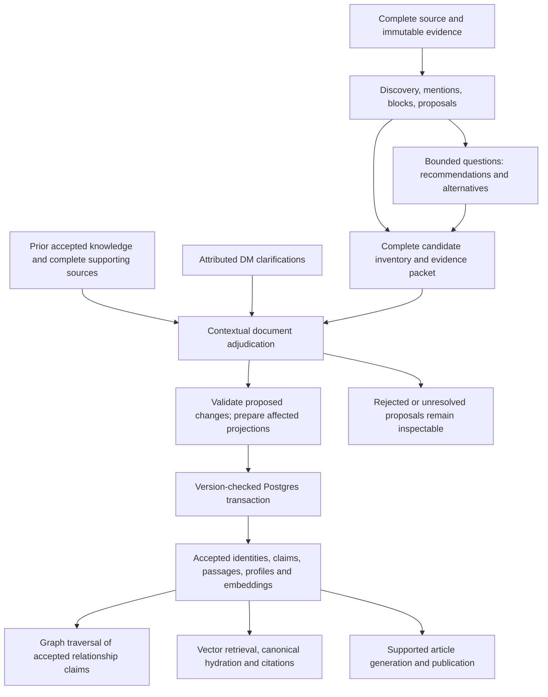

# Document-to-knowledge adjudication: change plan

**Status:** Proposed design, 2026-10-08. This document describes changes to implement; it does not amend the governing specification or establish live completion.

## 1. Goal and scope

Use bounded questions to organize evidence, identify noise, and recommend interpretations. Let a contextual LLM adjudicate what a document contributes to accumulated knowledge before the application commits that contribution to Postgres.

The **document-to-knowledge handoff is an authority boundary**: “the source may mean this” becomes “this is our accepted understanding, with these sources and qualifications.” Both sides belong in Postgres; storing a proposal does not make it canonical. Search reads committed understanding, which ingestion updates through an inspectable, versioned operation.

Judge the design by faithful, useful campaign knowledge. When a question or rule produces the wrong outcome, reconsider its wording, timing, or purpose before tuning a cutoff. The user supplied these evaluation requirements in this conversation:

| Requirement | Intended result |
| --- | --- |
| Apollo, Lathander, and Dawnfather denote the deity; Apolloite and Lathanderan denote its followers. | Two identities, with aliases within each identity; supported worship relationships have distinct endpoints. |
| “late DR1400’s movement” is enough to form an entity, whether or not it has an official name. | Retain the referent using a descriptive name; classification uncertainty must not erase it. |
| I5/I6 may involve spelling mistakes. | Explicitly consider spelling variants alongside contextual evidence. |

These are user requirements, not conclusions derived from scores. Runtime use of DM clarifications needs attributed source records; expected test answers must remain separate.

| Scope | Changes or constraints |
| --- | --- |
| Required | Advisory semantic questions; complete candidate coverage; contextual final adjudication; stable identities and cited claims; coherent vector/graph search over committed knowledge. |
| Preserve | Original sources, raw proposals/answers, historical readers, public command names, shared domain operations, pinned provider configuration, and the seven entity types and relationship vocabulary. |
| Replace | Early semantic cutoffs and complete pairwise alias agreement as final admission authority; exclusion of whole referent groups merely because some links remain unsettled. |
| Explicit design extension | Attributed DM clarification inputs; accepted identity with pending classification; structured document adjudication and its transaction contract. |
| Defer | General manual editing, query-time re-adjudication, a separate graph database, and asynchronous indexing infrastructure. Article composition remains a later projection with its own support check. |

## 2. Why the existing gates need to change

Current groups require supported links between every pair. Unapplied positive links mark affected groups conflicted, excluding them from qualification; typing then receives only policy-eligible qualification answers. See [group construction][groups], [qualification exclusion][qualification], and [typing eligibility][typing].

The retained answers illustrate why a numerical cutoff cannot supply the missing distinction:

| Pair | User's intended identity interpretation | Recorded `same_entity` weight |
| --- | --- | --- |
| Apolloite / Lathanderan | Same followers | [0.99][right-score] |
| Apolloite / Lathander | Followers and deity are different | [0.99][wrong-score] |

Pair names are retained in [the first target][right-target] and [the second target][wrong-target]. A rule of `weight >= cutoff` treats these equal weights alike. Semantic adjudication must distinguish the referents.

The audited operation reports `full_product_status: "not_run"`: the evidence concerns source-local classification. [Retained result][result]

## 3. Proposed flow



The document domain prepares evidence; the entity domain adjudicates and persists knowledge; the document workflow coordinates them. Reuse the [three-domain ownership][domains] and [planned identity/reconciliation stage][reconciliation].

### Change the questions' responsibilities

| Component | Proposed responsibility |
| --- | --- |
| Source/parser validation | Enforce byte ranges, hashes, schema, and reference integrity. An invalid pointer cannot support acceptance; preserve its proposal and findings. |
| Q01–Q04: uncertain structure | Recommend framing; retain original components and alternatives so a questionable join cannot hide meaning. |
| Q05: identity | Recommend same/different/unclear with contextual reasons. Distinguish aliases from followers, members, occupants, and other related referents; explicitly consider possible spelling mistakes. |
| Q06: qualification | Assess whether a specific referent is present, independently of whether all names are resolved or an article can be written. |
| Q07: type | Recommend an approved type, with an explicit classification-unclear outcome. That outcome is processing state, not an eighth entity type. |
| Q08–Q13: association/framing | Gather evidence for provisional candidates, including unresolved ones. Preserve quotes, examples, tables, attribution, and competing block associations. |
| Q14–Q20: assertions, dates, identity | Recommend source-faithful interpretations for final reconciliation. Finished article support remains a separate publication requirement. |
| Final adjudicator | Resolve interacting recommendations together; accept, reject, or retain uncertainty with cited reasons. |

Version the [catalog/order][catalog] and [question definitions][questions]. Replace the exclusions before adjudication so it receives the candidates those exclusions currently remove.

Distinguish standalone mentions from substrings inside another name. Reuse [word-boundary/context machinery][mentions], retaining original slices; the [current candidate scanner][substring] records literal substrings.

### Filter noise without losing recovery

Provide a compact inventory of **every candidate**: names, references, recommendation, and uncertainty. Prioritize meaningful/conflicting evidence; summarize repetitive answers while retaining the raw records.

Likely rejections receive little space but remain recoverable. Unasked pairs are untested. Alias chains inform contextual adjudication; automatic transitive merging and complete pairwise agreement no longer decide admission.

Start with one document adjudication. For context limits, reduce redundant recommendations and the prior-identity shortlist; keep required sources complete and fail visibly if they cannot fit.

## 4. Adjudication contract

| Input | Required content |
| --- | --- |
| Current source | Complete text, source ID/hash, original-byte citation map, document order, and pinned processing configuration. |
| Candidate inventory | Original names/IDs, occurrence-level context, proposed roles/types, blocks, claims, dates, and retained passages. Keep discovery output untouched. |
| Recommendations | Compact positive/negative/unclear findings, conflicting alternatives, selected weights, question versions, and raw-answer references. |
| Prior knowledge | Relevant canonical IDs, aliases, accepted assertions, observed versions, and complete prior sources supporting the identity candidates. Retrieval scores are leads. |
| Campaign clarification | Exact attributed DM text, captured time, target scope, and explicit precedence. Extend the [current campaign-input rule][campaign-input] deliberately. |

The model returns a **structured proposed change set**, using candidate IDs and temporary entity references. The application resolves or allocates permanent IDs and performs writes.

| Output | Required content |
| --- | --- |
| Candidate dispositions | Every candidate maps to an accepted referent, rejection, or pending outcome; alias/group decisions include cited reasons. |
| Identity actions | Match existing, create new, or remain unresolved. Existing-record merges/splits require explicit actions, affected references, and source support. |
| Qualification and classification | Separate existence, identity uncertainty, and type uncertainty. A descriptive name is sufficient when the referent is supported. |
| Claims/passages | Subject/object references, faithful value or predicate, polarity, attribution, qualifications, stated period, and verified evidence. |
| Reconciliation | Which assertions add knowledge, revise the same fact/period, or remain inconsistent; retain earlier support. |
| Audit/provenance | Source/configuration/input hashes, observed knowledge versions, model/prompt/schema versions, recommendation overrides, and concise decision reasons. |

A source-backed omission found by the adjudicator must become a separately recorded supplemental proposal, not a rewrite of discovery output. Version this deliberate extension to the current discovery contract.

Check coverage, references, citations, approved types/predicates, redirects, and state freshness. Structural validation complements semantic review. Bound schema/reference repair under the pinned retry policy; persist residual uncertainty rather than retrying indefinitely.

## 5. Postgres: stable knowledge and rebuildable search

Reuse the [proposed lore schema][schema]. Extend its contracts where necessary; do not create a parallel knowledge store.

| Proposed table group | Role after the change | Required contract change |
| --- | --- | --- |
| `SOURCE_DOCUMENTS` | Immutable document and attributed campaign-input evidence. | Specify clarification metadata/precedence and citation coordinates. |
| `CANDIDATES` | All proposals, including likely noise and supplemental findings. | Preserve origin, validation findings, disposition, and adjudication linkage. |
| `DECISIONS` | Advisory answers plus final adjudication records. | Retain purpose, structured input/output, reasons, candidate references, observed entity versions, base/applied knowledge revision, and application status. |
| `ENTITIES` | Permanent identity, preferred name, aliases through cited claims, and merge redirects. | Separate qualification from classification: permit an accepted identity with nullable type and explicit classification-pending state. |
| `CLAIMS`, `PASSAGES` | Accepted assertions and supporting source material, including qualifications/history. | Define multi-candidate/multi-span lineage and final acceptance references; retain superseded support. |
| `ENTITY_CURRENT` | Current accumulated profile derived from accepted evidence. | Bind every field and summary to support and the entity's canon version. |
| `ENTITY_EMBEDDINGS` | Semantic retrieval of supported entity profiles. | Add a projected canon-version link alongside model and input hash; define the exact embedded text contract. |
| `ARTICLES` | Supported publication derived from knowledge. | Serve current pages only when their support/canon version matches; retain older versions as historical publications. |

**Identity stability:** Renames, aliases, and resolved types keep the same ID. Merges retain redirects across name lookup, vector hits, and graph endpoints. Splits record claim reassignment and retain former decisions. Extend [the stable-identity contract][identity].

**Uncertainty:** Unresolved identity stays a proposal. An accepted referent with unsettled type remains searchable by ID/name and supported description; typed filters and edges requiring that type wait. Preserve source-expressed uncertainty as qualified information, distinct from extraction uncertainty.

**Accumulated understanding:** Reconcile by document order and referent/fact/period. Preserve history, negation, and contradictions; omissions do not erase prior claims. Follow [accumulated-knowledge rules][history], explicitly revising rules that conflict with campaign meaning.

| Consumer | Search contract |
| --- | --- |
| Vector | Embed supported profiles with aliases and faithful qualifications. Retrieve entity IDs, resolve redirects, and hydrate current claims/passages/citations. A similarity score never establishes truth or identity. |
| Graph | Traverse accepted relationship claims using canonical endpoints and the approved vocabulary. Select effective claims for the requested temporal scope; retain historical/negative claims without fabricating positive edges. See [relationship polarity][polarity]. |
| Hybrid result | Return one consistent knowledge snapshot, canonical IDs/versions, and supporting citations. Ordinary queries consume stored adjudication rather than changing it. |

## 6. Commit knowledge and search together

Use synchronous publication for the first implementation: prepare affected profiles and embeddings outside the write transaction, then atomically install the accepted changes and their search data.

```mermaid
sequenceDiagram
    participant I as Ingestion / entity domain
    participant M as Adjudicator and embedding services
    participant P as Lore Postgres
    I->>P: Read committed knowledge; retain input and observed versions
    I->>M: Complete evidence packet
    M-->>I: Proposed changes
    I->>I: Validate; resolve IDs; reconcile claims and prepare profiles
    I->>M: Embed prepared supported profiles
    M-->>I: Embeddings with input hashes and target versions
    I->>P: Begin short transaction; lock/check base versions and retry key
    alt Input state remains current
        I->>P: Write accepted identities/claims and aligned profiles/embeddings
        I->>P: Record applied knowledge revision; commit
    else Stale state or conflicting retry
        I->>P: Roll back; retain diagnosable proposal
    end
```

Keep network calls outside the transaction. If embedding preparation fails, retain the proposal and previous searchable knowledge. Serialize canonical writes through one transaction-scoped writer lock; compare the recorded base knowledge revision and affected entity versions, including changes since identity retrieval. A mismatch requires refreshed context and reconsideration.

Derive the application key from source, configuration, adjudication input, and purpose. Record base/applied knowledge revisions with the final application decision; advance the knowledge revision once per applied change set and each affected entity version once per material change. Same-input retries reuse results without duplicate claims or extra increments. Specify SQL uniqueness and revision storage before migrations.

Postgres transactions provide all-or-none visibility of these writes. Multiple queries in a hybrid request should use one read-only `REPEATABLE READ` snapshot; default `READ COMMITTED` can observe different commits between statements. [Transactions](https://www.postgresql.org/docs/16/tutorial-transactions.html) · [Isolation](https://www.postgresql.org/docs/16/transaction-iso.html)

Graph traversal reads relational claims in that snapshot; any later graph index stays derived. Articles follow knowledge commit, with support/version checks controlling publication and completion. Article retries resume from committed knowledge.

## 7. Implementation sequence

| Step | Concrete work | Reviewable exit condition |
| --- | --- | --- |
| 1. Align the governing design | Amend specification, catalog/order, workflow diagrams, relevant feature/execution ledgers, and affected library guides. Replace incompatible gate rules; document the scope ledger, new contracts, and preserved behavior. | One consistent authority model; campaign examples test intent rather than obedience to old rules. |
| 2. Source-local pilot | Reuse retained discovery/answers to build the complete packet; revise Q05–Q07 and mention framing; add a structured adjudication operation through existing document/domain paths. | Document 01 demonstrates recoverable low-score candidates and coherent deity/follower separation, with every disposition traceable. |
| 3. Canonical handoff | Persist adjudicated identities, claims, relationships, dates, and passages; implement pending classification, clarification input, reconciliation, and retry/version checks through shared domain operations. | Ordered documents reuse prior identities and retain evidence; interruptions cannot create duplicate or partial canon. |
| 4. Search consistency | Prepare supported profiles/embeddings; commit them with accepted changes; hydrate vector/graph results in one snapshot. | Search is stable across aliases, renames, redirects, failures, and subsequent document updates. |
| 5. Publication and acceptance | Integrate supported articles through the same workflow. Review each capability across the corpus using valid prior-document state. | Fresh end-to-end evidence and independent inspection establish completeness and preserved behavior. |

Reuse [request construction][requests], [workflow orchestration][workflow], mention/evidence validation, and the entity persistence boundary. Version changed payloads and preserve historical readers.

Before paid calls, pin and verify the adjudicator's model/route/effort, schema, budget, context limit, and repair policy; [model assignment remains open][model-choice]. Finalize clarification precedence, pending-type SQL, merge/split behavior, and transaction/revision keys before implementation.

## 8. Acceptance evidence

| Scenario | Required outcome |
| --- | --- |
| Apollo family | Exactly the deity identity and follower identity, with the supplied aliases; no follower/deity merge. |
| Movement | Retained qualified referent with a descriptive name; uncertain type is visible, not a reason to erase it. |
| Lloth/Lolth; Gruumush/Gruumsh | Spelling-mistake hypotheses explicitly assessed against context; accepted alias decisions keep original spellings and citations. |
| Unified Church / UCR; Thor/Talos | Redundant unsettled links or an early qualification score do not prevent contextual adjudication of supported identities. |
| Pantheon headings | Inspect the actual names and meanings for I7/I8; distinguish a heading label from its referent without a blanket heading rejection. |
| Weak/strong recommendations | A correct weak recommendation can be accepted and a wrong strong recommendation rejected; override reasons cite evidence. |
| History, uncertainty, negation | Preserve periods, qualifications, earlier claims, and contradictory source statements; graph polarity matches the source. |
| Rename, merge, retry, stale state | Stable IDs/redirects; no duplicate acceptance; stale proposals cannot apply; rollback preserves the previous searchable snapshot. |
| Vector plus graph | The same snapshot yields matching canonical IDs/versions and source support; pending/rejected material cannot masquerade as accepted fact. |

Use the [complete church source][church] and recorded user requirements for the pilot. The unrelated Marvel cases stay outside this diagnostic review; a runtime content-exclusion rule would be a separate product change.

Measure omissions, wrong merges, duplicates, unsupported claims/edges, unresolved outcomes, citations, cost, and latency at the **final output**. Retain exact commands and source-linked findings. Success is faithful knowledge, not a selected-score target.

Completion requires regression checks, real required services, source-to-result inspection, and independent preservation review under [project instructions][agents] and [live acceptance requirements][acceptance]. This request delivers the plan.

[groups]: ../src/domains/document/aliases/groups.ts#L72
[qualification]: ../src/domains/document/classification/qualification-inputs.ts#L75
[typing]: ../src/domains/document/classification/catalog-operation.ts#L125
[right-target]: ../.kiro/execution/AP-28/live/fresh/discovery-inputs/01/classifications/2f4d605b-3b0f-4cfa-a6cf-fc36c1551686/aliases/catalog-v1/decisions.json#L22793
[wrong-target]: ../.kiro/execution/AP-28/live/fresh/discovery-inputs/01/classifications/2f4d605b-3b0f-4cfa-a6cf-fc36c1551686/aliases/catalog-v1/decisions.json#L25725
[right-score]: ../.kiro/execution/AP-28/live/fresh/discovery-inputs/01/classifications/2f4d605b-3b0f-4cfa-a6cf-fc36c1551686/aliases/catalog-v1/decisions.json#L22833
[wrong-score]: ../.kiro/execution/AP-28/live/fresh/discovery-inputs/01/classifications/2f4d605b-3b0f-4cfa-a6cf-fc36c1551686/aliases/catalog-v1/decisions.json#L25770
[result]: ../.kiro/execution/AP-28/live/fresh/discovery-inputs/01/classifications/2f4d605b-3b0f-4cfa-a6cf-fc36c1551686/result.json#L5
[domains]: specification.md#L367
[reconciliation]: specification.md#L417
[catalog]: Jev%20question%20catalog.md#L31
[questions]: ../src/domains/document/decisions/questions.ts#L98
[mentions]: ../src/domains/document/association/mentions.ts#L22
[substring]: ../src/domains/document/decisions/semantic-input.ts#L73
[campaign-input]: specification.md#L85
[schema]: specification.md#L428
[identity]: specification.md#L126
[history]: specification.md#L179
[polarity]: specification.md#L163
[requests]: ../src/domains/document/decisions/request.ts#L19
[workflow]: ../src/workflows/process-document.ts#L207
[model-choice]: specification.md#L547
[church]: Lore/01-unified-church-of-the-realms.md#L2
[agents]: ../AGENTS.md#L23
[acceptance]: specification.md#L322
