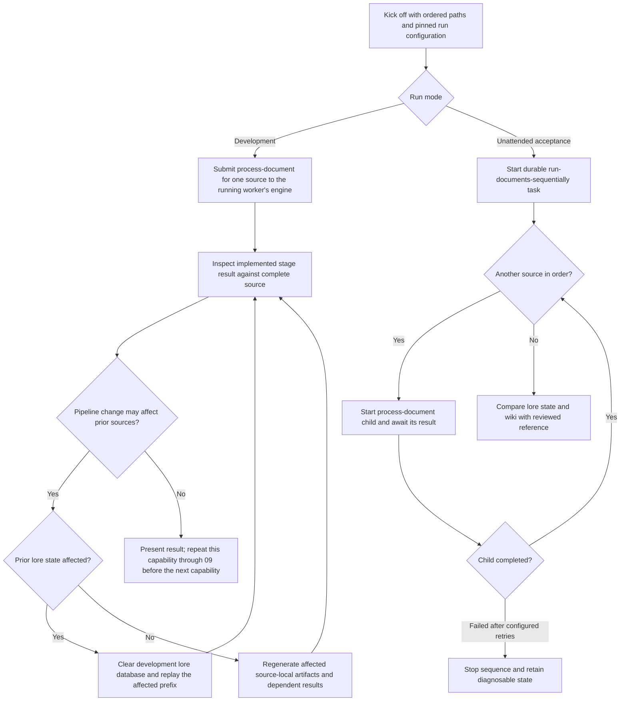
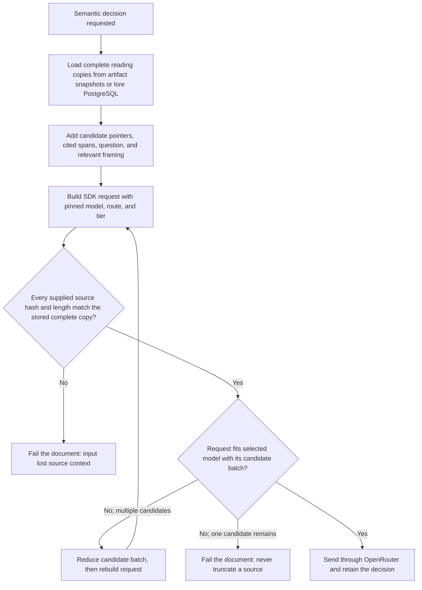
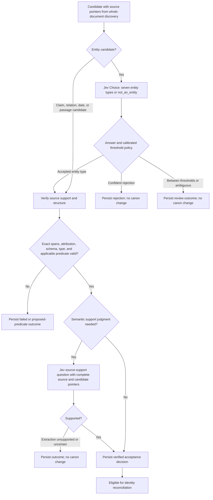
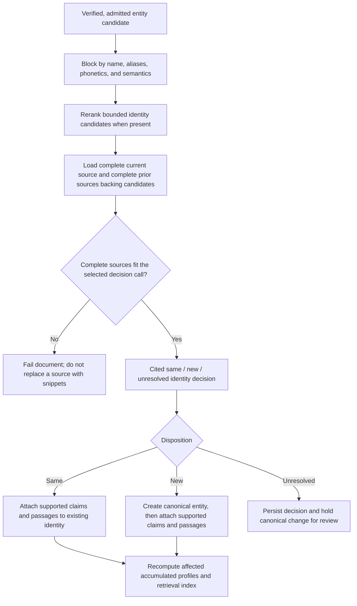
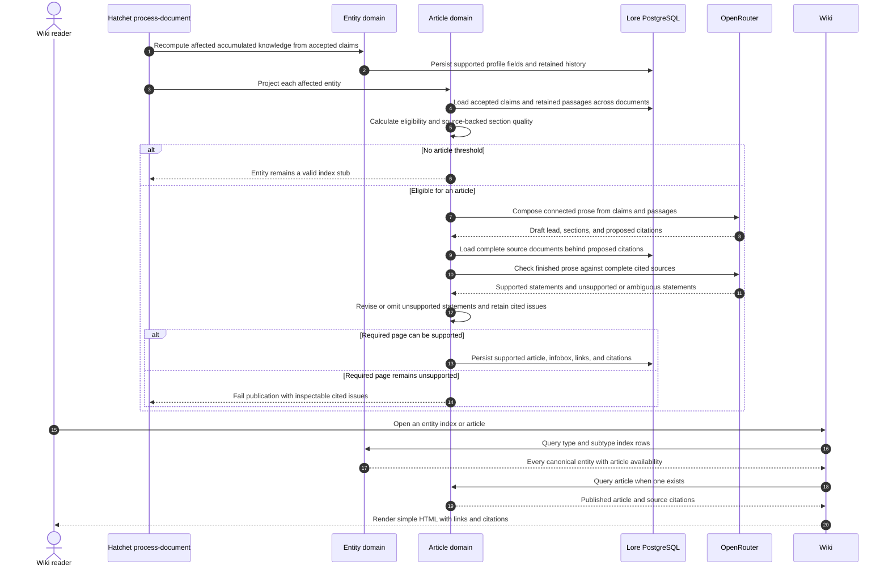
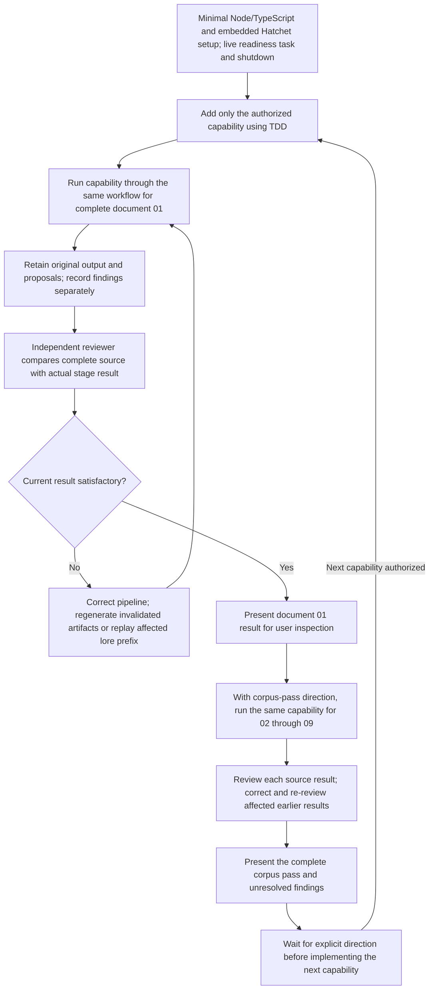
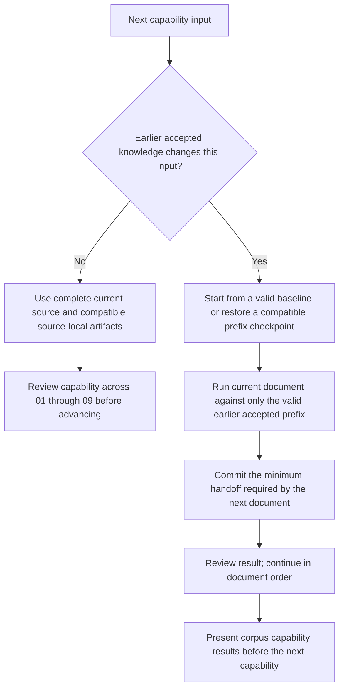

# Document workflow: information and decisions

**Status:** Visual companion to [specification.md](specification.md). The specification contains the approved requirements, technical design, and open decisions. These seven views explain that design; implementation advances through the user-inspected increments in TECH-005. Update affected views when an agreed design changes, preserving the linked requirement IDs.

The complete Markdown file is the source unit. A candidate's spans are citation pointers, not a shortened model input. Start with minimal Node/TypeScript setup including embedded Hatchet, a worker, and one live readiness task. Embedded Hatchet uses bundled operational PostgreSQL, not a documented SQLite backend; follow the [local embedded reference](Technical/skills/hatchet-cli/references/local-dev-embedded.md). Then add discovery to the same Hatchet document workflow and retain immutable source/response/proposal/decision artifacts in files. Add the separate lore PostgreSQL database when canonical persistence needs it. Hatchet coordinates the document, entity, and article domain ports as each becomes necessary. Run configuration pins each role's model, route, tier, applicable reasoning effort and structured-output schema/version, and prompt/question versions. From the first paid discovery request, extraction uses user-selected `openai/gpt-6-luna` with high reasoning effort, strict JSON Schema output, and the Hatchet-owned OpenAI Flex/Flex/standard policy (at least 30 seconds from a retryable failure to the next attempt). Disable overlapping SDK retries. Aggregate Luna development/test/parsing spend stays below $5 through the [shared spending policy](first-ten-tasks-execution-plan.md#openai-flex-and-the-luna-spending-limit); unspecified model roles remain D-003. See [TECH-001](specification.md#tech-001-technology-and-model-assignments) for the request contract. Current knowledge means accumulated understanding, including history and uncertainty. Source-support checks verify faithful identification and extraction of the supplied facts, rather than judging campaign truth.

Within one source-local Jev stage, a durable Hatchet parent pins the candidate/batch manifest, fans out reusable decision children, and collects all terminal results. A shared queue admits at most four active Jev requests. Each request carries the complete source; discovery, dependent stages, and documents remain sequential. The document 01 increment retains type choices, confidence, and option probabilities without canonical writes.

```mermaid
flowchart LR
    INPUT[Retained source and candidate names] --> ALIAS[Hatchet document-local alias questions]
    ALIAS --> GROUPS[Retain decisions and build supported provisional groups]
    GROUPS --> PARENT[process-document: durable classification parent]
    PARENT --> MANIFEST[Pinned bounded batches]
    MANIFEST --> CHILD[Hatchet Jev children: maximum four active]
    CHILD --> RAW[Retain request and raw response per attempt]
    RAW --> VALIDATE[Validate answers, confidence, and probabilities]
    VALIDATE --> COLLECT[Collect every child and check candidate coverage]
    COLLECT --> INSPECT[Inspectable classification proposals]
```



## 1. How a run reaches each document

Governed by [OPS-001](specification.md#ops-001-one-behavior-in-development-and-unattended-processing), [VER-001 through VER-003](specification.md#ver-001-development-review-against-complete-sources), and [TECH-003](specification.md#tech-003-workflow-decisions-and-publication). The CLI retains the previous Publican command tree and arguments as defined in TECH-003, adding commands as their capabilities become available. From document 01 discovery, development submits `process-document` to the same embedded instance that runs the worker. Later service launchers share its definitions and domain operations. Review each capability across `01` through `09` before advancing. Source-local passes use file artifacts; once prior canonical knowledge changes inputs, each document uses the valid accepted prefix. Add the durable corpus runner when needed. The unattended acceptance run starts one durable sequence task with the ordered list `01` through `09`; it starts the same document workflow for each item and awaits its result before starting the next. Hatchet supports [awaited child spawning](https://docs.hatchet.run/v1/child-spawning) and [durable task checkpoints](https://docs.hatchet.run/v1/durable-tasks). Database and provider calls occur inside the document workflow, not inside the durable sequence task.



The final comparison concerns source hashes and citations, entity identities and claims, relationships, review outcomes, indexes, and supported article content. Generated IDs, timestamps, workflow IDs, and cost telemetry are excluded; equivalent supported prose need not be word-for-word identical. See the complete comparison scope in [VER-003](specification.md#ver-003-fresh-unattended-acceptance-using-the-same-requirements).

## 2. One document through the three domains

Governed by [TECH-002](specification.md#tech-002-one-package-and-three-domain-ports), [TECH-003](specification.md#tech-003-workflow-decisions-and-publication), and [OPS-002/003](specification.md#ops-002-user-controlled-pinned-ai-configuration). This sequence shows data handoffs; each box does not require a separate Hatchet task. D-002 discovery uses one complete-source Luna call for proposals across all seven locked types; Jev owns later entity admission. Preserve the original response and proposals before recording validation findings. The diagram below shows the eventual complete persisted workflow. Build it incrementally through the same domain operations and workflow: early source-local stages use file artifacts in place of the lore writes shown. Return after the authorized capability, review it for `01` then `02`–`09`, and obtain direction before the next capability. Initial development runs stages and model requests one at a time; candidate checks may be batched within a single request. Concurrency requires an explicit design change. All Luna requests use the pinned Hatchet-owned Flex/Flex/standard policy; other substitutions are prohibited. TECH-005 uses valid database checkpoints or fresh builds for deliberate lore resets, with safe same-input retries; exact write/finalization contracts remain D-005/D-008. Stop affected workflows before restoration and start a new run afterward.

```mermaid
sequenceDiagram
    autonumber
    actor Caller as CLI or sequence task
    participant H as Hatchet process-document
    participant D as Document domain
    participant DB as Lore PostgreSQL
    participant OR as OpenRouter
    participant E as Entity domain
    participant A as Article domain

    Caller->>H: Start source path, order, pinned run configuration
    H->>D: Capture complete source
    D->>DB: Store complete source, offset map, hash, and processing provenance
    H->>D: Discover source-backed candidates
    D->>DB: Load complete normalized source
    D->>OR: One Luna discovery call with complete source and pinned settings
    OR-->>D: Potential entities across seven types and associated discovery material
    D->>DB: Preserve original response and proposals before validation
    D->>D: Validate structure and evidence; retain unresolved proposals
    D->>DB: Store separate validation findings and verified spans
    D-->>H: Inspectable discovery result
    H-->>Caller: Current-stage artifacts for independent review and user inspection
    Note over Caller,H: Development returns at its authorized step; review that step across 01-09 before the next
    H->>D: Admit entity candidates and verify support
    loop Bounded candidate batches with complete source
        D->>OR: Batched Jev admission or source-support questions with complete source and pointers
        OR-->>D: Answer, option probabilities, confidence or support result
        D->>DB: Persist decisions, including rejection and uncertainty
    end
    D->>OR: Bounded Jev questions about proposed assertions and relationships, with complete source
    OR-->>D: Source-supported relationship meaning or retained uncertainty
    D->>DB: Persist relationship decisions and evidence
    D->>D: Check offsets, source quotes, schema, types, predicates, and attribution
    H->>E: Reconcile only eligible verified candidates with source access
    E->>DB: Retrieve bounded identity candidates and their source documents
    E->>OR: Rerank bounded identity candidates
    OR-->>E: Ranked shortlist
    E->>OR: Make cited identity decision with complete relevant sources
    OR-->>E: Same identity, new identity, or unresolved decision
    E->>DB: Persist identities, accepted claims, passages, and accumulated profiles
    H->>A: Refresh affected article projections
    A->>DB: Read reconciled claims, passages, and supporting sources
    A->>OR: Write connected article prose and check support
    OR-->>A: Supported prose, citations, or issues to revise or flag
    A->>DB: Persist eligible, supported article versions
    H-->>Caller: Complete when lore state and publication are inspectable
```

Rejected and uncertain extraction candidates remain inspectable. Accepted information must faithfully identify and express the supplied source assertions. Retain older assertions and their citations when a newer document revises the same fact; same-document inconsistencies remain attributed. A source's expressed uncertainty is itself capture material, rather than a reason to reject its assertion. These boundaries follow [CAP-002](specification.md#cap-002-faithful-assertions-and-evidence), [KNOW-001 through KNOW-003](specification.md#know-001-current-means-the-latest-accumulated-understanding), and [TECH-004](specification.md#tech-004-complete-proposed-schema-and-persistence-rules).

## 3. The semantic-context gate

Governed by [SRC-003](specification.md#src-003-complete-context-for-semantic-decisions) and [TECH-003](specification.md#tech-003-workflow-decisions-and-publication). Precise spans serve citation and deterministic offset checks. They do not determine how much text a semantic model sees. For admission and claim support, the model receives the complete document being processed. For cross-document identity, it also receives complete prior documents supporting the bounded identity candidates. Candidate batches can shrink; source documents cannot be silently shortened. Article support likewise receives complete cited sources under WIKI-005.



Retrieval snippets and evidence cards are navigation aids only. Discovery uses one response under D-002; exact proposal/request/response shapes remain D-005 for the authorized stage; inspect actual SDK inputs and verify the full-source guard during extraction development under TECH-005 and [VER-001](specification.md#ver-001-development-review-against-complete-sources).

## 4. From discovered candidate to canonical lore

Governed by [ENT-001](specification.md#ent-001-locked-entity-definitions), [CAP-001/002](specification.md#cap-001-broad-capture-and-generic-content-boundary), [REL-001/002](specification.md#rel-001-closed-relationship-vocabulary-and-source-support), and [OPS-003](specification.md#ops-003-inspectable-discovery-and-decisions). Jev answers bounded questions against supplied candidates; it does not discover missing entities. A [Choice response](https://docs.typesafe.ai/primitives/choice) includes selected option, probabilities, and confidence. Draft questions from the requirements and examples during implementation. Separate accept/reject/review routing is specified in OPS-003; calibrate numerical thresholds through live review. DM mention establishes importance within the defined capture boundary; no extra significance gate applies.



An accepted claim retains its origin candidate, acceptance decision, and verified original-document spans. A passage can retain narrative context that does not fit one structured claim. A missing candidate is a discovery problem, rather than a Jev rejection. Support means that the extraction reflects the document; it does not screen the assertion's credibility, imported origin, or fictional status. See [SRC-002](specification.md#src-002-supplied-content-is-authoritative) and [TECH-004](specification.md#tech-004-complete-proposed-schema-and-persistence-rules).

## 5. Identity resolution across documents

Governed by [ENT-003](specification.md#ent-003-stable-source-backed-identities), [SRC-003](specification.md#src-003-complete-context-for-semantic-decisions), and [TECH-003](specification.md#tech-003-workflow-decisions-and-publication). Search and reranking form a bounded shortlist; neither is the identity decision. The final decision uses cited context from complete source documents. An empty shortlist does not by itself prove that a candidate is a new entity.



Claims about different periods can coexist as history. When a newer document revises the same fact about the same referent, its assertion wins in accumulated understanding while the older assertion and provenance remain stored. Same-document inconsistencies remain attributed; sentence order is not document precedence. Approximately 1515 imposes no knowledge cutoff. See [TIME-001](specification.md#time-001-explicit-source-dates-and-periods), [KNOW-001/002](specification.md#know-001-current-means-the-latest-accumulated-understanding), and D-006 for reconciliation contracts.

## 6. Article projection and wiki display

Governed by [WIKI-001 through WIKI-006](specification.md#wiki-and-articles), [TECH-002](specification.md#tech-002-one-package-and-three-domain-ports), and [TECH-003](specification.md#tech-003-workflow-decisions-and-publication). The entity domain owns canonical identity and accumulated profiles. The article domain owns eligibility, coherent prose, citations, and support checking. The wiki renders index rows for every canonical entity; a row links to a page only when an article exists.



The article may paraphrase and connect supported material into encyclopedia-style prose. Each factual statement must trace to exact source spans. A required eligible page that cannot pass source-support checking produces inspectable publication failure; the run cannot claim success. Reader-facing display during failed updates remains out of scope. See [WIKI-004/005](specification.md#wiki-004-supported-infoboxes-and-readable-prose) and [SCOPE-001](specification.md#scope-001-preserve-the-nine-document-milestone-boundary).

## 7. Development one capability across the corpus

Governed by [TECH-005](specification.md#tech-005-development-sequence-and-acceptance-handoff), the [roadmap](roadmap.md), and the [discovery execution plan](first-ten-tasks-execution-plan.md). First verify minimal project setup with embedded Hatchet, a worker, one readiness task, and clean shutdown. Then add one-call discovery and review `01` followed by `02`–`09` before Jev admission. Admission, relationship evaluation, and support each have their own corpus pass. Add only the code/configuration needed for the current increment. The independent `gpt-6.1-sol` high reasoning reviewer compares actual artifacts with complete sources; it does not replace Jev product decisions. Retain raw output before validation, including partial or invalid responses. Hatchet-owned retries and shared spending checks apply from the first paid discovery request.



At every capability, review begins with the available output. Evidence defects can prevent acceptance while remaining visible for discovery review; unimplemented downstream stages are not prerequisites.

The state boundary concerns semantic inputs, not whether a file is stored in a database. Canonical identity lookup is the first planned dependency on earlier accepted knowledge. Continue corpus passes when possible, using checkpoints or ordered rebuilds that give each document the correct prefix. If the next document needs the current one's identity/evidence/index update, complete that smallest handoff before advancing. Knowledge and article capabilities use the same rule; article work reviews affected entities at each document boundary rather than inventing an article per source.



The complete deployed pipeline still receives integrated review and a fresh unattended acceptance run with new calls. Reuse of compatible stage artifacts is development evidence, not acceptance replay.

## Open design decisions and live calibration

The full decision register lives in [specification.md](specification.md#open-questions-for-development). Resolve these diagram-related contracts when their development stage needs them:

Source-local development retains compatible machine-generated artifacts in files. Once lore state matters, the design uses valid database checkpoints or fresh builds for deliberate resets, retains needed diagnostics externally, and preserves safe retries. Multiple processing versions inside one database are deferred. Discovery uses one Luna response per document/iteration followed by independent review and user inspection across all nine; Jev admission, relationship evaluation, and support are subsequent corpus passes. Remaining decisions:

- D-005: one-call discovery request/response, file-backed artifact packaging and lineage-preserving lore transfer, candidate/evidence payloads, and separate validation findings.
- D-003: remaining writer, article-support, and final-identity model assignments; numerical confidence calibration.
- D-004: calibrate the proposed long-running document/request budgets in TECH-003; define batching, retries, and inspectable failures. Batch size changes candidates per call; it never shortens source documents.
- D-007/008: article contracts deferred until article development; retry-safe persistence/publication resolved at the relevant stage.

Calibrate numerical values through the live development process after agreeing the design. Confidence routes decisions and does not establish correctness. Acceptance requires the same behavior in reviewed and unattended runs, complete-source inputs, retained provenance, and all required supported pages.
