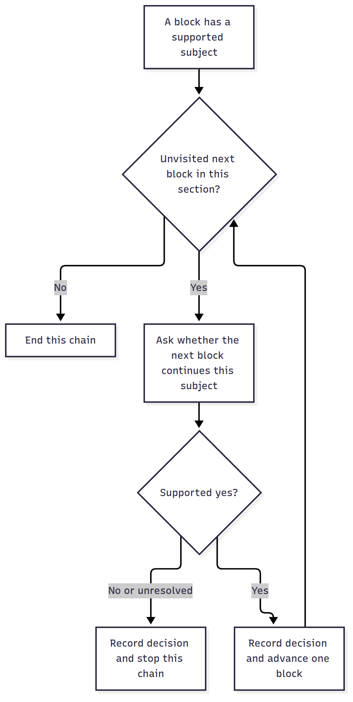
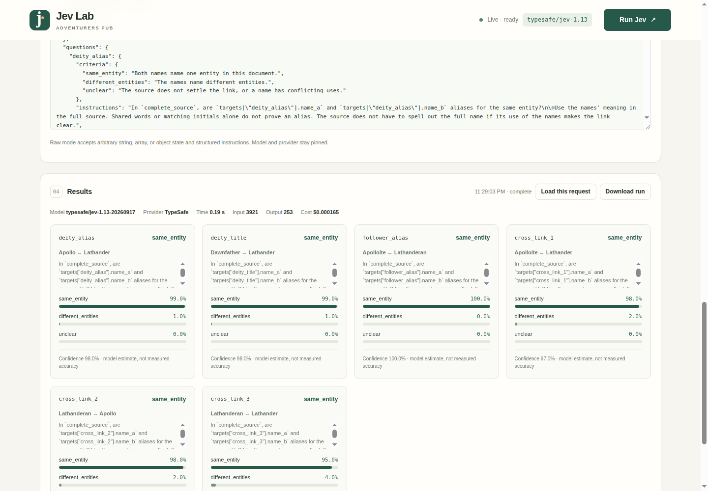

# How I built and evaluated a workflow that reads campaign lore

In Adventurers Pub, deciding that two names belong to the same entity changes which passages someone will eventually read together. I wanted to be able to answer three questions about any such decision. What did the source say? What exactly did the model see? What did the workflow do with the answer? I built the extraction pipeline and a separate prompt playground around those questions. [Source contract](../../src/domains/document/discovery/source.ts#L10-L57) · [Decision policy](../../src/domains/document/decisions/policy.ts#L48-L83) · [Playground](../../src/dev/jev-playground/server.ts#L67-L79)

## Give each model a decision it can own

| Engineering decision | Why I made it | How it works |
| --- | --- | --- |
| Ask a discovery model to propose names in source wording | A missed nickname never reaches the alias check. Asking for types or relationships during discovery would force a decision before the candidate had been examined. | I narrowed a broad extraction prompt to a list of name strings. The current instructions explicitly cover tables, names inside longer names and separately used acronyms. [Prompt evolution tests](../../src/domains/document/discovery/discovery-v25-v31-contract.test.ts#L93-L145) · [Current prompt](../../src/domains/document/discovery/v31/prompt.md#L19-L33) |
| Use code for source locations and Jev for ambiguous meaning | Code can verify where a paragraph starts. Whether a preceding line introduces a list, or whether two names refer to one being, requires reading. | The parser builds a layout. Jev gets a bounded question, its target and the complete source. If the input is too large, the batch planner reduces the number of questions. [Structure questions](../Jev%20question%20catalog.md#L62-L105) · [Request and batch builder](../../src/domains/document/decisions/request.ts#L12-L69) |
| Give the workflow an unresolved outcome | A mistaken merge can affect every member of an alias group. I wanted the system to retain the candidates and say what prevented it from proceeding. | The policy checks the answer distribution and any required repeat. A supported alias group needs pairwise evidence. Conflicting groups can be withheld while independent groups proceed. [Policy](../../src/domains/document/decisions/policy.ts#L60-L83) · [Grouping](../../src/domains/document/aliases/groups.ts#L48-L102) · [Conflict-routing test](../../src/domains/document/classification/catalog-operation.test.ts#L23-L87) |
| Put remote decisions in durable Hatchet child tasks | A transient provider failure should cost a retry of the affected batch. A resumed document should keep usable work and evidence of failures. | The shared task limits concurrency, serializes attempts for the same batch and retries eligible errors. The parent checks saved results against the input manifest and dispatches pending batches. [Child task](../../src/workflows/jev-decision-batch.ts#L10-L40) · [Resume and dispatch](../../src/workflows/process-document.ts#L274-L318) |

### A decision that changes the next question

A passage can introduce a character by name and refer to her as “she” in the next paragraph. I made the association stage follow that subject one block at a time. The diagram shows the supported-policy path. In exploratory runs, a provisional positive can also trigger the next question. The model judges whether the subject continues. Code tracks which questions have already been asked, enforces section boundaries, and saves each round and its decisions. This is an implemented branch of the association workflow. The measured six-document trial below covers the earlier classification stages. [Planner](../../src/domains/document/association/planning.ts#L286-L333) · [Round records and stop condition](../../src/domains/document/association/operation.ts#L236-L272)



[Editable Mermaid source](diagrams/subject-continuation.mmd)

The same distinction between judgment and action matters when creating records. In one live trial across documents 01–06, the system withheld 57 conflicting groups before qualification. Of 284 qualification questions, 229 led to type questions and 220 produced local records. A local record carries the source hash, names, evidence, and both decision IDs. The counts show how many records passed the policy. Source review is a separate test of whether those records are right. [Run excerpts](classification-runs.json#L2-L7) · [Record construction](../../src/domains/document/classification/catalog-operation.ts#L552-L580) · [Offline recount](score-results.mjs#L8-L18)

For one of those 220 records, follow *Waterdeep*. The source says the church was consecrated there. Qualification returned yes and opened the type question. Jev selected Location. The record links back to both decisions and gives two byte ranges for the name. You can verify the first one against the original file with `node -p "require('node:fs').readFileSync('Resources/Lore/01-unified-church-of-the-realms.md').subarray(826,835).toString()"`. It prints `Waterdeep`. [Record and actual model answers](waterdeep-record.json) · [Source passage](../Lore/01-unified-church-of-the-realms.md#L4)

## Diagnose a confident mistake

The screenshot shows a live Jev Lab run. Read the third and fourth cards together. Jev gave **100%** to linking *Apolloite* with *Lathanderan*, which agrees with the sailors passage. It also gave **98%** to linking *Apolloite* with *Lathander*, which would merge the followers with the deity. I built the playground to display the actual request, competing choices, and response side by side so I could investigate errors like this. [Campaign wording](../Lore/01-unified-church-of-the-realms.md#L1-L4) · [Deity's former name](../Lore/01-unified-church-of-the-realms.md#L30-L32) · [Playground UI](../../src/dev/jev-playground/web/index.html)



For a controlled wording test, I used *Apollo / Lathanderan*. The baseline already said to distinguish a deity from its followers. The change was to ask what each expression denotes **as used in the sentence**, and to make the grammatical cue explicit. In this sentence, the religious adjective modifying “sailors” describes their affiliation. I held the source, target, table and model fixed. The runner screened each variant, repeated promising ones, and reversed the answer order as a final check. [Exact baseline and selected question](wording-trial.json#L2-L18) · [Fixed inputs](../../src/dev/jev-playground/iterate-alias-example.ts#L14-L27) · [Stopping rule](../../src/dev/jev-playground/iterate-alias-example.ts#L81-L93)

| Same target, fresh request | Probability assigned to “different entities” |
| --- | --- |
| Reconstructed baseline | 76% |
| Grammatical-role wording | 92%, 96%, 94% |
| Same wording, reversed choice order | 93% |

All eight attempts chose “different entities,” including the baseline. The change made that answer stronger and repeatable on the tuning case. The screenshot used a different request and pair orientation, so its 98% error is a diagnostic example outside this comparison. [Eight recorded answers](wording-trial.json#L19-L134)

## Test the frozen prompt

I froze the selected wording and evaluated every unordered pair among 56 campaign names in the first document. That meant `56 × 55 / 2 = 1,540` single-question requests. The runner varied the target while preserving the full document, and it kept the expected labels outside the request. All 1,540 responses validated. The reported provider charge for this run was about $0.35. [Run summary](frozen-run.json#L2-L10) · [Evaluation runner](../../src/dev/jev-playground/evaluate-alias-pairs.ts#L13-L33)

| At a 75% score for “same entity” | Earlier configuration | Frozen configuration |
| --- | ---: | ---: |
| Recovered aliases among 21 predeclared positives | 15 | 20 |
| False links among 16 predeclared distinct pairs | 4 | 0 |
| Recovered aliases after source review expanded the inventory to 29 | 16 | 24 |

The first two rows answer the question we could score before the run. The third adds eight links identified during later source review. Only those reviewed comparisons have labels. The earlier configuration also used a different request setup, so the table measures the change in the evaluated system as a whole. [Reviewed pairs and both scores](reviewed-pairs.json) · [Threshold totals](frozen-run.json#L20-L28) · [Original review method](../document-01-alias-decisions.md#L20-L30)

The frozen prompt still gave *Apolloite / Lathanderan* only 47% for “same entity,” despite the explicit “aka.” Fixing the god–follower confusion had left a real follower alias unresolved at the acceptance threshold. That miss is why I tested wording and context separately. [Pair result](reviewed-pairs.json#L10) · [Source sentence](../Lore/01-unified-church-of-the-realms.md#L2)

## Separate the effect of wording from the effect of context

I crossed two changes in a four-condition experiment. One change told the model to distinguish a name from a generic reference such as “the county.” The other supplied marked occurrences of each expression in the source and identified occurrences embedded in a longer name. All four conditions still received the complete document. I ran 73 selected pairs from two documents twice per condition, reversing the order of conditions in the second round. The same model served all 584 calls. Of the 73 pairs, 68 had a reference judgment used for scoring. [Experiment construction](../../src/dev/jev-playground/prepare-alias-context-experiment.ts#L9-L55) · [Run metadata](context-design.json) · [Pair-level scores](context-trials.json)

Each cell shows **round 1 / round 2**. These are direct pair decisions before any group merging. For this experiment I counted a link at or above 75%, a separation at or below 15%, and an unresolved result in between. A correct decision counts either a correct link or a correct separation. [Scoring calculation](score-results.mjs#L32-L47)

| What changed | Correct decisions out of 68 | Wrong decisions | Unresolved |
| --- | ---: | ---: | ---: |
| A · Original wording and context | 35 / 36 | 2 / 2 | 31 / 30 |
| B · Naming rule | 39 / 34 | 1 / 0 | 28 / 34 |
| C · Marked occurrences | 39 / 40 | 2 / 2 | 27 / 26 |
| D · Naming rule and marked occurrences | 37 / 40 | 0 / 0 | 31 / 28 |

Marked occurrences helped Jev resolve additional pairs in both rounds. They also strengthened one mistaken link. For *County / County of Swordmount*, the original gave 89% in each round and marked occurrences alone gave 93% and 94%. Adding the naming rule brought it down to 71% and 70%, where it went to review. The combined setting made zero wrong automatic decisions on this selected sample, while leaving 31 and 28 unresolved. I would carry that setting forward to a held-out test. Both rounds used the same selected names. [Direct scores](context-trials.json) · [County source](../Lore/02-county-of-swordmount.md)

I also tried expanding each occurrence window to its whole paragraph, list or table. In that follow-up, I evaluated the groups formed by connecting overlapping accepted links and used a 25% separation cutoff. The short windows produced 49 and 50 correct automatic outcomes out of 68. The expanded context produced 48 and 45, with three wrong outcomes in one round and two in the other. I kept the narrower context as a candidate. Changing the context or the grouping rule changes what has to be measured. [Follow-up counts and cutoffs](paragraph-trial.json#L2-L5) · [Grouping used by the application](../../src/domains/document/aliases/groups.ts#L72-L102)

## How I used agents to review the pipeline

I wrote a separate development workflow to check semantic quality. It assigns one reviewer per document. Each reviewer gets the complete source and saved model answers and must return question IDs, quotations with byte offsets, expected meanings, and missing coverage. The six reviews can run in parallel. The calibration agent runs only when every reviewer returns a usable result. It can report insufficient evidence for a threshold. That makes the decision to advance inspectable, just like a decision inside the extraction pipeline. [Review assignments and requirements](../../.bb/workflows/ap28-source-review.js#L7-L27) · [Gate and calibration task](../../.bb/workflows/ap28-source-review.js#L28-L40)

## What I would build next

The experiments exposed a cost to the current grouping rule. One questionable alias can hold a whole group out of qualification. My proposed next step is to give a contextual model the competing interpretations, the complete source, and attributed campaign rulings before committing knowledge across documents. I would evaluate that design on untouched documents, measuring false merges, missed aliases, and how often it defers. The implemented workflow and the results above end at document-local decisions. Cross-document adjudication, database publication and wiki articles belong to the next stage. [Proposed adjudication design](../document-to-knowledge-adjudication-plan.md#L3-L26) · [Current capability boundary](../../.kiro/specs/lore-block-entity-association/requirements.md#L5-L9)

## Reproduce the comparison

From the repository root, run the following with Node. It reads the included JSON and prints the classification totals, the earlier and frozen alias scores, and all eight rows of the controlled comparison. No credentials or model calls are needed.

```bash
node Resources/portfolio/score-results.mjs
```

The evidence files are compact exports of retained runs. The wording trial contains the actual question texts and eight responses. The frozen comparison includes the predeclared judgments, later reviewed positives, both sets of link scores, and a run-level summary. The controlled experiment includes all 73 pairs and their eight probabilities. The original classification and experiment directories are local run artifacts. [Scorer](score-results.mjs) · [Request builder](../../src/domains/document/decisions/request.ts#L12-L32) · [Repository retention rules](../../.gitignore#L9-L13)
