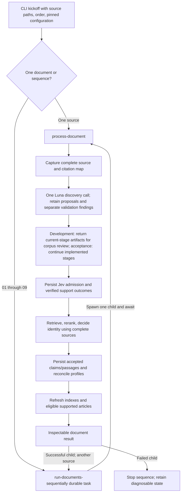
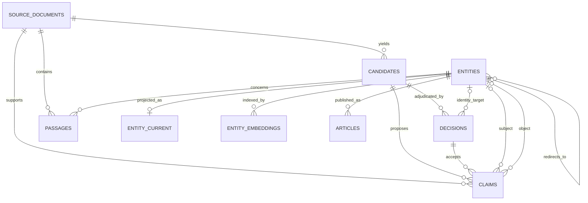

# Adventurers Pub: complete v0.1.0 specification

**Status:** Product requirements and the technical design, including selections described as proposed, are approved. Implementation proceeds in user-authorized increments under TECH-005. The [roadmap](roadmap.md) defines stage-by-stage corpus review; the [candidate-discovery execution plan](first-ten-tasks-execution-plan.md) defines the first increment. Each completed stage is presented for user inspection before the next stage begins. Resolve open contracts when the authorized stage needs them.

**Purpose:** Turn the nine complete Dungeon Master documents into a trustworthy campaign knowledge base and readable wiki. Accuracy means identifying, relating, and presenting what the documents say correctly, with source evidence. The system does not judge whether their content is fact or fiction within the campaign.

## Authority and decision status

Read [AGENTS.md](../AGENTS.md) for agent conduct, then this document for the complete project specification: requirements, technology selections, domain boundaries, workflows, schema, verification, and open questions. The nine linked lore files are the source data. [Document workflow diagrams](document-workflow-diagrams.md) provide seven visual views of the design and link back to the governing requirement IDs here. Update affected diagrams when an agreed design changes; this specification defines the behavior and decision status.

The ontology, including Creature Type/Subtype, relationship vocabulary, article sections, and eligibility rules defined here are locked. Changes require explicit user approval. A requirement ID is stable; examples explain its rule and do not establish additional campaign facts. Verification describes evidence of satisfaction, not permission to change behavior to obtain a passing result.

## Glossary

| Term | Meaning |
| --- | --- |
| Source document | One complete supplied Markdown file, including headings, tables, lists, quotations, and narrative. |
| Claim | An assertion captured from a source, with its subject, meaning, evidence, and any expressed attribution, qualification, negation, or time. Acceptance establishes faithful capture and identification, not an independent judgment of campaign truth. |
| Entity | A specific campaign referent classified into one of the seven defined types. A mention is not automatically a separate identity. |
| Generic game content | Basic rules, generic creature categories, and mundane background items. These do not require standalone entities merely because they are mentioned. A specific campaign individual or object can qualify even when its underlying kind is ordinary. |
| Current knowledge | The latest accumulated understanding from all processed documents, including known history and uncertainty. It is not a view restricted to facts true at an in-world cutoff date. |
| Newer document | A document later in the supplied processing order. For this milestone, `09` is newer than `08`, through `01`. In-world dates describe claims; they do not establish document precedence. |
| Projection | A derived profile, edge, index, infobox, summary, or article built from retained knowledge and evidence. Rebuilding it does not rewrite its sources. |
| Review outcome | An inspectable extraction, classification, identity, or support issue. It does not turn the source document into untrusted fiction. |
| Development review | Inspection used to check and improve the system. Reviewed and unattended runs implement the same product requirements. |

## Scope and sources

### SRC-001 Complete ordered source corpus

- **Requirement:** The system must process the following nine complete documents in numeric order and preserve their original bytes, source identity, content hash, reading copy, and the mapping needed for exact original-source citations.
- **Definitions:** Each file is one extraction unit of free-form DM writing, not an instance of a required input schema. Headings, tables, lists, tags, dialogue, and narrative are source context, not mandatory structure. Processing preserves that context; normalization must remain traceable to the original.
- **Examples:** A table row is interpreted with its column headings and surrounding document; it is not an independent extraction document.
- **Verification:** Compare captured originals and reading copies with every supplied file; verify source hashes, order, complete coverage, and citation mapping.

| Order | Complete document |
| --- | --- |
| `01` | [Unified Church of the Realms](Lore/01-unified-church-of-the-realms.md) |
| `02` | [County of Swordmount](Lore/02-county-of-swordmount.md) |
| `03` | [Laeral Silverhand, the Shadowfell, and Winterhaven](Lore/03-laeral-silverhand-decline-of-magic.md) |
| `04` | [Ridur's Tale](Lore/04-ridurs-tale.md) |
| `05` | [Beic](Lore/05-beic-god-of-merchants.md) |
| `06` | [Factions and Organizations](Lore/06-factions-and-organizations.md) |
| `07` | [The Netherese Civil War](Lore/07-the-netherese-civil-war.md) |
| `08` | [Pantheon Refresh](Lore/08-pantheon_refresh.md) |
| `09` | [A Gazetteer of the Realms](Lore/09-a-gazetteer-of-the-realms.md) |

### SRC-002 Supplied content is authoritative

- **Requirement:** The system must capture the assertions in the supplied documents as facts as we know them, without screening their credibility, fictional status, imported origin, or agreement with published setting lore.
- **Definitions:** Preserve what each assertion actually says, including speakers and qualifications. Source-support verification checks that the extraction expresses the document correctly. Supplied quotations and imported excerpts are not excluded through a separate campaign-adoption test.
- **Examples:** A source's statement that someone proposes a transformation is captured as a proposal; it does not establish a completed transformation. Both statements would be authoritative if supplied.
- **Verification:** Inspect assertions throughout each complete document, including dialogue and excerpts; confirm that issues concern identification, meaning, or evidence rather than deciding whether the DM's content is true.

### SRC-003 Complete context for semantic decisions

- **Requirement:** Every semantic admission or claim-support decision must receive the complete current source document. Cross-document identity decisions must also receive the complete prior documents supporting the bounded identity candidates.
- **Definitions:** Here, current source means the file being processed, not an in-world date. Evidence cards and retrieval snippets are pointers, not replacements for source text. Before each semantic call, verify the supplied document text, hash, and length against its complete retained reading copy: the immutable artifact snapshot during source-local development under TECH-005, and the stored copy once lore persistence is introduced.
- **Examples:** Reduce a candidate batch when necessary. If one candidate and its required complete sources cannot fit the selected model, fail the document rather than truncate a source.
- **Verification:** Inspect actual SDK inputs at admission, support, and identity boundaries in development and unattended runs; compare each supplied source's text, hash, and length with the retained complete copy for that stage.

## Capture and identification

### CAP-001 Broad capture and generic-content boundary

- **Requirement:** The system must capture campaign-specific entities and assertions mentioned by the DM. The mention establishes importance; no additional significance threshold or page threshold may restrict extraction.
- **Definitions:** Generic game content does not require standalone entities. A specific referent must still fit ENT-001; broad capture does not add entity types or force every phrase into an entity. Information that does not become a standalone entity remains available in its source context and retained claims or passages.
- **Examples:** A named goblin is a campaign individual; a generic reference to goblins does not automatically create one. A specific campaign object can qualify despite having an ordinary underlying kind.
- **Verification:** Review the complete sources for missed referents and assertions; inspect exclusions against the generic-content boundary and defined types, independently of article eligibility.

### CAP-002 Faithful assertions and evidence

- **Requirement:** Captured claims must identify the correct subject, attribute or relationship, value or object, and expressed qualification, negation, attribution, and time. Each accepted claim must retain document identity, verified exact spans and quote, extraction model and prompt version, and its acceptance decision.
- **Definitions:** Source-expressed uncertainty is part of the assertion and does not itself justify rejection. Uncertainty about whether the system identified or extracted it correctly is a separate review issue. An unsupported extraction is an assertion the system has not correctly grounded in the supplied text.
- **Examples:** A statement that an organization is not a member of an alliance cannot become a positive membership edge. A quoted belief retains its speaker and wording or supported paraphrase.
- **Verification:** Resolve every accepted claim's cited original-source ranges and compare its full meaning with the document, including table, list, and quotation framing.

### CAP-003 Retain narrative and unmodeled detail

- **Requirement:** The system must retain useful source passages and concrete assertions even when their information has no dedicated field, uncertain section placement, or no supported graph predicate.
- **Definitions:** Narrative context and linked mention ranges remain independent of article prose. Appearance, motives, personality, history, transformations, capabilities, and behavior are capture material, not merely infobox fields.
- **Examples:** A personality passage can contribute cited article prose without adding a scalar personality column. Rewriting an article does not remove the original passage.
- **Verification:** Compare retained material and articles with meaningful source passages; check that field availability, section placement, and article rewrites do not erase evidence.

### CAP-004 Supported optional information and campaign inputs

- **Requirement:** Optional attributes must be populated only from document support or explicit campaign inputs for player role and divine status. Unstated values remain blank; explicit Unknown remains distinguishable from unstated.
- **Definitions:** Basic game knowledge and external setting material cannot supply absent individual traits, identities, relationships, or dates. Source-stated characteristics are captured even when they are game-related. Explicit campaign inputs must retain provenance.
- **Examples:** Identifying a creature as a dragon does not supply an unstated breath weapon. A source-stated ability is captured. PC status is not inferred from a title or occupation.
- **Verification:** Follow each populated field to its supporting claim or allowed campaign input; confirm that no defaults or external lore silently fill gaps.

### ENT-001 Locked entity definitions

- **Requirement:** Canonical entities must use exactly the seven types and supported attributes below.
- **Definitions:** Creature Type and Subtype are distinct from entity type. `Other` in attribute vocabularies or article sections is not an eighth canonical entity type. Item significance is governed by CAP-001, not an additional importance judgment.
- **Examples:** A deity is an individual Creature. A city is a Location. Borderline Event material is retained for inspection without inventing a new type or discarding its assertions.
- **Verification:** Inspect classifications across the whole corpus against the table, including accepted, rejected, and uncertain candidates; require explicit approval for ontology changes.

| Entity type | Meaning and supported attributes |
| --- | --- |
| `Creature` | Individual beings, including player characters and deities. Optional `type`: broad creature category, such as Humanoid or Dragon; optional `subtype`: most specific supported kind within it, such as Elf or Green dragon. Optional `vital_status`: Alive, Dead, Undead, Missing, Imprisoned, Transformed, Unknown. Occupations and other repeatable details are claims. PC/NPC and divinity are separate from Type/Subtype. |
| `Location` | Places at any scale. Optional `location_type` and `settlement_size`: free text. |
| `Organization` | Groups with a collective identity. Optional `org_type`: Government, Guild, Religious, Military, Noble House, Criminal, Other; `scope`: Local, Regional, Continental, Planar. |
| `Item` | Significant discrete objects under CAP-001. Optional `item_type`: Artifact, Document, Relic, Gear, Other. |
| `Event` | A happening in time. Optional `event_type` and short `outcome`: free text. Create an Event when named by the source, or when multiple participants and a stated date or period exist; review borderline cases. |
| `Quest` | Objectives the party pursues. Optional `status`: Rumoured, Active, Completed, Failed, Abandoned. |
| `Concept` | Other nameable ideas, eras, religions, laws, traditions, or phenomena. Optional `concept_type`: free text. |

### ENT-002 Creature identity and extraction coverage

- **Requirement:** Creature Type and Subtype must describe identity rather than temporary appearance, occupation, age, player role, or divine status. Repeatable characteristics, broader groupings, transformations, and classifications must retain their supporting claims and any expressed timing.
- **Definitions:** The following leads describe information to inspect for capture. They are prompts to inspect source support, not mandatory fields, a candidate filter, additional page criteria, or a new closed ontology.
- **Examples:** Appearance as an elf does not by itself establish Elf identity. Chromatic may remain a broader grouping claim when Green dragon is the supported subtype.
- **Verification:** Review Creature evidence using the leads; check identity versus appearance, repeatable facts, time-qualified changes, and absence of inferred species defaults.

| Capture leads | Source information to look for |
| --- | --- |
| Names and identity | Names, epithets, Type, specific Subtype, broader kind, ancestry, origin, age, life stage, appearance, forms, life state. |
| Roles and relationships | Occupations, classes, titles, duties, explicit PC role, homes, travels, affiliations, faith, family, patrons, possessions. |
| Characteristics and narrative | Size, languages, senses, movement, abilities, weaknesses, equipment, goals, temperament, choices, deeds, and change over time. |
| Humanoids and dragons | Ancestry or species and culture; dragon lineage, broader grouping, age category, breath, alternate forms. |
| Celestials, fiends, and elementals | Rank, allegiance, plane; elemental affinity and manifestation. |
| Undead, constructs, and giants | Former identity, origin, form; maker, material, purpose, autonomy; giant kind and social role. |
| Divine individuals | Rank or status, portfolio, symbol, worshipers, manifestations. |

### ENT-003 Stable, source-backed identities

- **Requirement:** Entities must have permanent ULID identities, entity type, supported canonical names, aliases, and a canon version. Identity merges must be source-backed and retain redirects rather than reuse IDs; redirects must not form self-links or cycles.
- **Definitions:** Retrieval and reranking discover candidates; their scores and an empty shortlist do not establish identity. Formatting normalization is allowed, but expanding a name into absent words is not. Preserve rejected and unresolved decisions for inspection.
- **Examples:** `#MatronofDeath` may normalize to `Matron of Death`. Two beings sharing a name or title are not merged solely on that match.
- **Verification:** Trace every merge or same-identity decision to current and prior source evidence; inspect aliases, distinct referents, permanent IDs, redirects, and unresolved outcomes.

## Relationships and time

### REL-001 Closed relationship vocabulary and source support

- **Requirement:** Canonical edges must use the following predicates with compatible subject and object types and supporting source assertions. Preserve defined qualifiers, symmetry, and inverse labels for traversal and display.
- **Definitions:** Inverses are not additional extracted predicates. Co-occurrence does not establish a relationship. `associated_with` is a supported last resort; track its use for possible future vocabulary review.
- **Examples:** Mentioning a person and a city in one document does not establish residence. A supported membership assertion uses `member_of` and retains any stated rank.
- **Verification:** Inspect every edge's evidence, types, direction, qualifiers, and temporal meaning against this table; detect invented co-occurrence edges and vocabulary expansion.

| Predicate | Subject → object | Inverse or qualifier |
| --- | --- | --- |
| `located_in` | Creature, Location, Item, Organization → Location | `contains` |
| `headquartered_in` | Organization → Location | `headquarters_of` |
| `member_of` | Creature, Organization, Location → Organization | `has_member`; `rank` |
| `leads` | Creature → Organization, Event | `led_by` |
| `serves` | Creature, Organization → Creature, Organization | `served_by`; `relation` |
| `sponsors` | Creature, Organization → Organization | `sponsored_by` |
| `allied_with` | Organization, Creature → Organization, Creature | Symmetric |
| `hostile_to` | Organization, Creature → Organization, Creature | Symmetric |
| `family_of` | Creature → Creature | Symmetric; `relation` |
| `worships` | Creature, Organization → Creature, Concept | `worshipped_by` |
| `possesses` | Creature, Organization, Location → Item | `held_by` |
| `created` | Creature, Organization → Item, Concept, Location | `created_by` |
| `participated_in` | Creature, Organization → Event | `had_participant`; `role` |
| `occurred_at` | Event → Location | `site_of` |
| `concerns` | Quest → Creature, Location, Item, Organization, Concept | `subject_of` |
| `quest_giver_for` | Creature, Organization → Quest | `given_by` |
| `resulted_in` | Event, Quest → Event, Quest | `resulted_from`; causal |
| `associated_with` | Any → any | Symmetric last resort |

### REL-002 Retain information outside a positive edge

- **Requirement:** A source-supported relationship lacking a defined predicate must remain captured as a `proposed_predicate` review item and supporting material without entering the canonical graph. Negative relationships must remain source claims or prose without fabricated positive edges.
- **Definitions:** Capture completeness and graph admission are different obligations. These outcomes do not permit adding predicates or dropping the underlying information.
- **Examples:** A statement that a duchy is not an alliance member is retained without a positive `member_of` edge.
- **Verification:** Inspect negative assertions and proposed-predicate outcomes against complete sources; verify retained evidence and absence of unapproved graph predicates.

### TIME-001 Explicit source dates and periods

- **Requirement:** Dates and periods must be captured only when the source states them, with original wording and exact citations. Preserve unambiguous normalized Calendar of Harptos values, signed years, and the source form `YYYY.MM.DD`; retain approximate and relative wording when no exact value is established.
- **Definitions:** The date of a statement and the period it describes are distinct. Approximately 1515 is campaign context, not permission to supply missing dates. Temporal `before`, `after`, offsets, and similar relations do not become graph edges or a constraint solver.
- **Examples:** A lecture date does not replace the ancient date of the event discussed. `Several years ago` remains wording unless the source itself establishes an exact value.
- **Verification:** Inspect explicit dates, periods, quotes, normalization, and contradictory date claims; confirm that tense, narrative order, and external lore do not invent absolute dates.

## Accumulated knowledge

### KNOW-001 Current means the latest accumulated understanding

- **Requirement:** Profiles, infoboxes, indexes, summaries, and articles must derive from the latest accumulated knowledge across processed sources, including supported history and expressed uncertainty.
- **Definitions:** Current does not mean only facts true around 1515. Source-qualified historical claims remain historical; blank, explicit Unknown, and unresolved extraction or source ambiguity must remain distinguishable where applicable.
- **Examples:** Learning a battle's ancient date adds to current knowledge. A past leadership claim remains part of an entity's history after a successor is documented.
- **Verification:** Inspect cumulative results for arbitrary in-world date cutoffs, lost history, invented present-tense claims, and fields without source support.

### KNOW-002 Newer documents take precedence without erasing evidence

- **Requirement:** When a newer document revises earlier information about the same referent and fact, the latest understanding must use the newer assertion while retaining the earlier assertion, source, and citation.
- **Definitions:** Apply supplied document order, not workflow retry time or an in-world cutoff. Assertions about different periods can describe history rather than revisions. New information augments knowledge; omission alone does not erase prior information. Preserve incompatible assertions within one document without inventing an ordering rule to resolve them.
- **Examples:** A newer statement that Bob replaced Alice establishes Bob's leadership and retains Alice's previous leadership. A newer account of an older event retains that event's stated date. [Pantheon Refresh](Lore/08-pantheon_refresh.md) describes both seventeen members and eighteen gods: retain both counts and their framing; sentence order within one file does not establish newer-document precedence.
- **Verification:** Trace cross-document revisions to precedence order and both sources; verify cumulative additions, retained history, and inspectable same-document inconsistencies.

### KNOW-003 Preserve the rebuildable evidence record

- **Requirement:** Complete sources, proposals, decisions, accepted assertions, and retained passages must remain inspectable independently of derived profiles, edges, indexes, infoboxes, summaries, and articles. Rebuilding a projection must preserve the underlying evidence.
- **Definitions:** Every populated derived field must trace to its supporting claims or explicitly allowed campaign input. Knowledge provenance belongs to the lore record; workflow execution state does not replace it.
- **Examples:** Rewriting an article or refreshing an index preserves rejected candidates, older assertions, passages, and original-source citations.
- **Verification:** Rebuild projections from the retained record and compare meaning and support; inspect evidence before and after rebuilds and rewrites.

## Wiki and articles

### WIKI-001 Complete indexes and correct article links

- **Requirement:** Every extracted canonical entity must appear in its type index and applicable subtype index. Entities with articles must link to those articles; entities without articles must remain visible as index stubs.
- **Definitions:** Identity reconciliation determines canonical entities; rejected or unresolved proposals are inspectable outcomes, not automatically canonical index rows. Creature subtype grouping uses supported classification.
- **Examples:** A sparsely documented Creature remains indexed even when it has no eligible article.
- **Verification:** Compare canonical entities with all type/subtype index rows, page availability, links, and correct stubs across the cumulative corpus.

### WIKI-002 Locked article eligibility and quality rating

- **Requirement:** An entity must receive an article when all eligibility fields listed below for its type are populated from sources, or its quality rating reaches 1. Additional optional fields, extraction leads, and infobox rows must not expand the eligibility test.
- **Definitions:** The tables below are authoritative. A supported occupation claim satisfies Creature occupation without requiring a scalar column. Quality measures source-backed section material; generated verbosity cannot increase it. `Overview` counts; `Notable Events` does not.
- **Examples:** One qualifying source-backed section is sufficient even if eligibility fields are incomplete. A short source cannot qualify solely because a writer expands it to 100 words.
- **Verification:** Inspect each eligibility result, supporting fields, source material, and rating; verify required articles and prevent extra field requirements.

| Entity type | Eligibility fields |
| --- | --- |
| `Creature` | `type`, `subtype`, `vital_status`, `occupation` |
| `Location` | `location_type`, `settlement_size` |
| `Organization` | `org_type`, `scope` |
| `Item` | `item_type` |
| `Event` | `event_type`, `outcome` |
| `Quest` | `status` |
| `Concept` | `concept_type` |

| Quality rating | Sections clearing the 100-word source-backed bar |
| --- | --- |
| 0 | None |
| 1 | One |
| 2 | Two |
| 3 | Three or more |

### WIKI-003 Locked sections and retained short material

- **Requirement:** Articles must use the ordered sections below, plus `Other` for material whose section is uncertain. A section earns a heading at 100 words of source-backed material; shorter material folds into `Overview` for display while remaining stored and cited.
- **Definitions:** Section assignment cannot discard information. `Other` is a retention section. The exact reproducible counting convention belongs in the technical design and must preserve the locked threshold and generated-verbosity exclusion.
- **Examples:** A brief Appearance passage can appear in Overview while retaining its Appearance assignment and citations in the evidence record.
- **Verification:** Inspect section order, source-backed counts, folding, `Other` material, and preserved citations across article rewrites.

| Entity type | Ordered sections |
| --- | --- |
| `Creature` | Overview, History, Appearance, Relationships, Notable Events, Possessions |
| `Location` | Overview, Geography, Notable Features, Inhabitants, History, Notable Events |
| `Organization` | Overview, Goals, Structure, Holdings, History, Notable Events |
| `Item` | Overview, Description, Properties, History, Whereabouts |
| `Event` | Overview, Background, Account, Participants, Aftermath |
| `Quest` | Overview, Objectives, Progress, Outcome |
| `Concept` | Overview, Description, History, Significance |

### WIKI-004 Supported infoboxes and readable prose

- **Requirement:** Eligible articles must have a connected, encyclopedia-style lead and body composed from reconciled claims and retained passages across documents, with a compact infobox of selected supported information.
- **Definitions:** The infobox is not a list of physical database columns and does not replace narrative. Repeatable roles and relationships may supply concise rows. Paraphrases, combinations, and transitions must add no new lore; quotations retain attribution when exact wording matters.
- **Examples:** A Creature article can explain personality, history, and transformations in prose while summarizing occupations and affiliations in its infobox.
- **Verification:** Read articles against complete sources for coherent prose, source fidelity, retained nuance, correct history, attribution, and supported infobox rows.

### WIKI-005 Statement support before publication

- **Requirement:** Every factual statement in an article must map to exact source spans with nearby citations. Finished prose must receive a source-support check before publication; unsupported or misidentified statements must be revised, omitted, or flagged for correction.
- **Definitions:** This check validates the writer's fidelity to supplied content, not whether the campaign claim is true. It receives the complete cited source documents and the source-integrity checks required by SRC-003. Required eligible pages must be supported; publication failure cannot be reported as successful completion. Reader-facing behavior during failed updates is outside scope.
- **Examples:** A writer cannot turn a recorded proposal into an accomplished event. Correcting prose leaves the underlying proposal and its source evidence intact.
- **Verification:** Trace article statements, infobox facts, and citations to original text; inspect actual support-check inputs and outcomes, corrections, and any incomplete required page.

### WIKI-006 Event cross-references and source mentions

- **Requirement:** `Notable Events` must be built from Event cross-references during publication, reusing each Event's source-backed lead sentence. It receives no extracted source passage and does not contribute to quality rating. Retained mention ranges must support correct article links.
- **Definitions:** Cross-references derive from accepted relationships and canonical identities. An entity receives an article link only when its article exists; source co-occurrence alone does not establish Event participation.
- **Examples:** A supported participant can receive an Event cross-reference without copying the Event's original passages into Notable Events extraction.
- **Verification:** Inspect cross-reference support, reused leads, linked identities, actual page availability, and exclusion from extraction passages and rating.

## Operation and verification

### OPS-001 One behavior in development and unattended processing

- **Requirement:** Development and unattended runs must use the same document-processing behavior. Documents must complete sequentially before the next begins; a failed document stops the sequence with diagnosable state. Repeated attempts must be safe, and changed source or processing configuration must not be mistaken for an already completed extraction.
- **Definitions:** The `process-document` and `run-documents-sequentially` interfaces and their responsibilities are recorded under TECH-003. The CLI triggers and inspects the same workflow. Documents and dependent stages execute sequentially. Discovery retains one active model request. The authorized source-local Jev decision design fans out bounded batches through Hatchet with at most four active Jev requests in one deployment; a durable parent collects all child results before continuing. Further concurrency requires an explicit design change.
- **Examples:** Reviewing document 03 does not enable a different extraction policy. Retrying a failed attempt does not create duplicate accepted knowledge or silently skip changed processing inputs.
- **Verification:** Inspect direct and sequential run inputs/results, document order, retry behavior, CLI handoffs, committed knowledge, publication artifacts, and failed sequence outcomes.

### OPS-002 User-controlled pinned AI configuration

- **Requirement:** The user-controlled model, provider route, service-tier attempt policy, reasoning effort, structured-output schema/version, and prompt/question versions must be pinned for a run and retained with each processed document's source hash. Validate their compatibility before kickoff and check responses against the configured route and tier. Failures must not silently substitute models, providers, or more expensive tiers. Aggregate Luna spending for development, testing, and parsing the nine-document corpus must remain below US $5, including probes, charged failures, retries, and reruns. Use one shared budget across runs, reserve a conservative charge bound before each attempt, reconcile actual billing, and stop before another call could exhaust the limit; keep the accounting outside lore-reset state.
- **Definitions:** TECH-001 lists the proposed technologies and model assignments. Unspecified assignments and concrete request contracts appear in the open-question register. Retries preserve the selected configuration, including the user-authorized Flex/Flex/standard schedule: two total Flex attempts, followed by one standard attempt after retryable failures, with at least 30 seconds from each retryable failure to the next attempt. This is the only authorized tier escalation; other failures do not authorize substitutions.
- **Examples:** A retryable Flex capacity failure follows the recorded Flex/Flex/standard policy; the standard attempt is skipped if its maximum charge does not fit the remaining Luna budget. No unrecorded or additional tier escalation is allowed. Changing a model does not silently change its route or tier.
- **Verification:** Compare configured and served model/route/tier, actual outbound reasoning effort and structured-output schema/version, prompt/question versions, per-document provenance, retries, and provider failure outcomes. Do not infer served reasoning effort from response quality or token counts.

### OPS-003 Inspectable discovery and decisions

- **Requirement:** Discovery must retain entity, mention, alias, claim, relationship, explicit-date, and passage candidates with evidence. Admission, identity, and support decisions must remain inspectable, including rejection and uncertainty; retain Jev answers, option probabilities, confidence, question version, and candidate evidence.
- **Definitions:** Missing candidates are discovery failures rather than rejections. Preserve the original discovery response and all proposed candidates before deterministic validation, with validation findings recorded separately. Invalid or ambiguous evidence remains inspectable as an unresolved proposal; only verified evidence may support an accepted claim. Separate calibrated acceptance/rejection thresholds route classification; between-threshold decisions do not automatically enter canon or block the workflow.
- **Examples:** An uncertain type decision is retained for inspection without fabricating a canonical classification or discarding the source. A shortlist score alone does not authorize a merge.
- **Verification:** Compare complete sources with discovered and missed material; inspect accepted, rejected, and unresolved decisions and their supporting inputs. Threshold values and questions are defined in design and calibrated in development.

### OPS-004 Fresh database baseline

- **Requirement:** v0.1.0 must have a fresh Drizzle schema baseline beginning at migration file 0 with no prior migration history.
- **Definitions:** The fresh baseline is required for this milestone; it does not authorize resetting an existing environment or implementing only a subset of the proposed schema.
- **Examples:** A narrow database used for a proof does not substitute for the required lore persistence design.
- **Verification:** Inspect migration history and the deployed schema against the agreed technical design and every required knowledge and publication behavior.

### VER-001 Development review against complete sources

- **Requirement:** Once the complete pipeline is implemented and document `01` processing is satisfactory, integrated development review must run documents through the live workflow in order, inspecting each cumulative result against its complete source before advancing.
- **Definitions:** Initial development proceeds by pipeline stage as described in TECH-005; this requirement governs the subsequent integrated review. That review covers discovered and missed entities, admitted/rejected outcomes, identities, aliases, claims, edges, dates, citations, retained passages, indexes, eligibility, article support, and readability. It verifies the system and does not create a separate lore authority or processing policy.
- **Examples:** Correct a missed referent in the extraction pipeline rather than importing a manually chosen entity into an otherwise unattended result.
- **Verification:** Retain inspectable live results and actual semantic-call source hash/length evidence; audit database and wiki content against complete documents, not only extracted candidate lists.

### VER-002 Rebuild after changes affecting prior documents

- **Requirement:** When a development change can affect earlier documents, rerun the affected capability and dependent results for every document from `01` through the current development source in order; review the results before advancing. Before lore persistence, regenerate source-local artifacts using only compatible upstream inputs. When the change affects accepted lore state, clear the development database and replay the ordered prefix; review the cumulative state before advancing.
- **Definitions:** Reviewed outputs are development evidence. After completing `09`, save a read-only reference of lore-relevant knowledge and wiki content. The review process does not require a separate labeled-candidate file or imported human decision.
- **Examples:** A changed identity question affecting document 01 requires a cumulative rerun, rather than patching the reviewed knowledge to resemble a preferred output.
- **Verification:** Inspect configuration/change records, source-local artifact regeneration or authorized lore-database rebuilds as applicable, ordered reruns, cumulative review, and the read-only reference.

### VER-003 Fresh unattended acceptance using the same requirements

- **Requirement:** Final acceptance must use a fresh database and one kickoff for `01` through `09`, making new extraction-model and Jev calls in order without human intervention after kickoff or replaying reviewed outputs.
- **Definitions:** Compare stable source and lore meaning with the development reference: source hashes/spans, identities, names, types, aliases, attributes, edges, dates, passages, inconsistencies, review outcomes, indexes, eligibility, article facts, attribution, citations, and section placement. Wording need not be identical; generated IDs, timestamps, workflow IDs, and cost telemetry are excluded. A material difference fails acceptance and requires a pipeline correction and another fresh run.
- **Examples:** Differently worded prose may express the same supported facts. A wrong identity, missed required information, or altered relationship is not excused by completed workflow telemetry.
- **Verification:** Inspect fresh-database provenance, new calls, unattended execution, final durable outputs, and the comparison defined in technical design; confirm the same product behavior as development.

### VER-004 Full live completion and preservation audit

- **Requirement:** Completion must demonstrate all required behavior on live Hatchet, PostgreSQL, and OpenRouter services, with durable inspectable lore and wiki outputs and source citations. Audit both required changes and preservation constraints.
- **Definitions:** Deterministic tests and persistence checks support verification but do not alone establish product correctness. Green checks or a narrow successful run do not override unapproved deletions, semantic changes, interface removals, or architectural substitutions.
- **Examples:** A completed workflow with an unsupported required article or missing index entities does not establish completion.
- **Verification:** Audit every requirement ID against live evidence and the scope ledger; report material gaps and unapproved changes before claiming delivery.

## Scope boundaries and technical handoff

### SCOPE-001 Preserve the nine-document milestone boundary

- **Requirement:** The milestone must remain a player-run wiki fed by the nine supplied DM documents, with indexes and supported eligible articles. The exclusions below must remain outside this milestone unless the user changes scope.
- **Definitions:** Relational relationships and their supported cross-references are in scope. The proposed additional multi-hop graph index follows the working core path. Reader-facing stale-version, fallback-display, or update-failure presentation behavior is deferred; required article support and honest failure reporting remain in scope.
- **Examples:** A need to inspect source evidence does not authorize a conversational Q&A product, DM authoring system, or published-canon validation service.
- **Verification:** Compare design, work scope, and implementation with the required deliverables and exclusions; flag additions lacking explicit authorization.

Excluded: DM authoring tools, general manual entity editing, secrecy tiers, rules/statblock lookup, virtual tabletop features, validation against published canon, session recaps, direct Discord ingestion, images/scans, external scraping, conversational Q&A, multiple campaigns, user accounts, public hosting, mobile apps, real-time sync, temporal constraint solving, and reader-facing behavior during failed updates.

## Technical design

TECH-001 through TECH-005 define the technical design. Technology selections and schema details are proposed for review; confirmed requirements and the specified discovery and database-reset behavior constrain that design. Resolve open questions when the development stage needs their answers. Numerical calibration may refine measured settings during live development without changing requirements.

### TECH-001 Technology and model assignments

| Responsibility | Proposed selection and contract |
| --- | --- |
| Runtime and contracts | Node.js 24 LTS, TypeScript, npm, Zod, `drizzle-zod`; `tsx` for local TypeScript execution and `tsc` for builds. |
| Lore persistence | PostgreSQL 16+, Drizzle, `pg`. Relational source and claim records are authoritative; Hatchet operational state is separate. |
| Orchestration | Hatchet: one reusable `process-document` workflow and one `run-documents-sequentially` durable task that awaits each child result. |
| AI access | OpenRouter for every model call; official `@openrouter/sdk` as the default client for extraction, Jev, embeddings, reranking, and article writing. For structured generation, request strict JSON Schema output and validate responses with Zod; require a provider endpoint supporting the requested parameters. |
| Extraction | User-selected extraction model `openai/gpt-6-luna`, with explicit `reasoning: { effort: "high" }` and strict JSON Schema structured outputs. Do not select a `-pro` slug or enable `reasoning.mode: "pro"`. Only the user decides a model or reasoning-effort change. Every document and retry uses the pinned configuration; a model failure fails the run. |
| Fast decisions | `typesafe/jev-1.13` through OpenRouter's Decisions API for batched, typed, bounded questions about entity admission, source assertions, and relationships among discovered candidates. Jev evaluates the retained Luna proposals against complete sources; it does not discover missing entities. |
| Identity retrieval | Names and aliases with `unaccent`, `pg_trgm`, `fuzzystrmatch`; semantic candidates with `pgvector` and `voyageai/voyage-4`; bounded reranking with `voyageai/rerank-2.5`. Final identity decisions use cited complete sources, never scores alone. |
| Graph traversal | Relational edges derived from reconciled relationship claims. Add `pgGraph` as a derived multi-hop query index after the core ingestion/publication path works; it owns neither identities nor claims. |
| Wiki | Hono on Node.js; server-rendered HTML, one plain CSS file, minimal styling. Display entity indexes, eligible articles, links, and citations. |
| Verification | Node.js `node:test` for deterministic domain rules; PostgreSQL Testcontainers for persistence behavior; live Hatchet, PostgreSQL, and OpenRouter runs for completion. |

Run configuration names model, provider route, service-tier attempt policy, reasoning effort, structured-output schema/version, and prompt/question versions; include these in configuration hashing and source provenance. Luna extraction requests explicitly set `reasoning.effort: "high"`, use `response_format.type: "json_schema"` with `json_schema.strict: true` on Chat Completions (or the equivalent structured-output field on the chosen SDK API), and require supported parameters through `provider.require_parameters: true`. Keep high effort fixed across calls and retries; do not introduce mid-conversation `configuration_update` changes. The exact SDK field mapping and live endpoint compatibility remain D-009/D-011. The user-authorized extraction attempt policy is Flex/Flex/standard: attempts 1–2 set `service_tier: "flex"` and `provider.only: ["openai/flex"]`; attempt 3 sets `service_tier: "default"` and `provider.only: ["openai"]`. Set `provider.allow_fallbacks: false` on every attempt. Hatchet schedules two retries with delays of at least 30 seconds; the shared call handler selects the tier from `ctx.retryCount()`, without an application retry loop. Pin the policy, rather than one tier, in the run configuration; record each actual tier. Verify endpoint availability and supported parameters before paid calls and served provider/tier after responses. Tier selection alone is insufficient when no Flex endpoint exists; allow standard-rate routing only on the authorized third attempt. Enforce the shared below-$5 Luna budget through an operational $4.90 admission ceiling, conservative per-attempt cost reservations, and actual-charge reconciliation; include all development/test probes and retries. See [the execution-plan cost policy](first-ten-tasks-execution-plan.md#openai-flex-and-the-luna-spending-limit) for the accounting method. Validate the configured combination before kickoff and each served response against it; a retryable Flex failure can reach standard only through the authorized, logged third attempt and its standard-price spending gate. A model change does not silently change route or tier. Keep source hash and selected configuration with processing provenance, and Jev answer, option probabilities, confidence, question version, and evidence with each decision. Writer, article-support, and final-identity model assignments are unresolved under D-003; source-local candidate and relationship questions use Jev.

Minimal development setup includes embedded Hatchet and a worker before document processing. Add the shared document-domain discovery operation and OpenRouter dispatch in the next increment; Hatchet coordinates it from the first discovery run. Model, reasoning, structured output, complete-source, provenance, spending checks, and the Hatchet-owned Flex/Flex/standard policy apply from the first paid Luna request. Install and configure additional dependencies only when the current capability uses them.

Technical references: [Node.js releases](https://nodejs.org/en/about/previous-releases), [Hono Node.js adapter](https://hono.dev/docs/getting-started/nodejs), [server-side JSX](https://hono.dev/docs/guides/jsx), [OpenRouter TypeScript SDK](https://openrouter.ai/docs/client-sdks/typescript/overview), [structured outputs](https://openrouter.ai/docs/guides/features/structured-outputs), [Luna](https://openrouter.ai/openai/gpt-6-luna), [GPT-6 reasoning configuration](https://openrouter.ai/docs/cookbook/evaluate-and-optimize/model-migrations/gpt-6#mid-conversation-effort-with-configuration_update), [service tiers](https://openrouter.ai/docs/guides/features/service-tiers), [Jev](https://openrouter.ai/blog/insights/what-is-jev/), [Voyage embeddings](https://openrouter.ai/voyageai/voyage-4), [Voyage reranking](https://openrouter.ai/voyageai/rerank-2.5), and [Choice responses](https://docs.typesafe.ai/primitives/choice). These links identify the proposed dependencies; their current package, API, model availability, and extension compatibility have not been verified. D-011 requires verification before relying on each dependency in live work.

For minimal local setup, use [Hatchet embedded mode](https://docs.hatchet.run/v1/embedded), which bundles operational PostgreSQL; SQLite is not its documented backend. In TypeScript the engine runs as a sidecar, with no Docker, account, or API token required. Verify and pin compatible SDK/embedded engine versions before relying on them. The development launcher starts the worker and submits to the same embedded instance, with clean shutdown; see the retained [local embedded reference](Technical/skills/hatchet-cli/references/local-dev-embedded.md). Add a separate PostgreSQL 16+/Drizzle lore database when canonical persistence needs it; do not use Hatchet operational storage as lore authority. Provision and verify each service as it becomes necessary. Later service/container packaging, credentials, and Coolify topology are separate implementation work, not prerequisites for the first discovery result.

### TECH-002 One package and three domain ports

Use one Node.js package, implementing only the modules the current increment needs. Minimal setup needs the Hatchet worker/launcher and a readiness task. Add the shared document discovery operation and OpenRouter dispatch when implementing discovery; entity/article/wiki modules and lore storage follow when used. Each domain's `index.ts` exports its public operations and types; workflows, CLI, wiki, and other domains use that port instead of private files. Keep queries and prompts beside their domain behavior. Group related code and split files before they approach 500 lines. Do not duplicate domain behavior in workflow orchestration or introduce shims.

| Proposed location | Responsibility and ownership |
| --- | --- |
| `app/cli/` | Trigger and inspect document runs through the same public workflow. Retain the previous `publican` command structure and arguments defined under TECH-003; serialized inputs/results remain D-009. |
| `app/domains/document/index.ts` | Complete sources, normalization/citation mapping, discovery, candidates, admission decisions, evidence and source-support verification; hand off eligible verified results with access to complete sources. |
| `app/domains/entity/index.ts` | Canonical identity, accepted claims/relationships, retained entity passages, reconciliation, accumulated profiles, identity retrieval, index data. No general manual entity editing. |
| `app/domains/article/index.ts` | Eligibility, section quality, connected composition, infoboxes, citations, links, Event cross-references, finished-prose support checks. |
| `app/db/` | Shared Drizzle schema and PostgreSQL client/setup only. |
| `app/workflows/` | Hatchet document workflow, durable sequential runner, worker; coordinate domain ports. |
| `app/wiki/` | Hono routes, server-rendered HTML, plain CSS; query entity index/profile data and existing article data without making lore decisions. |
| `drizzle/`; `Resources/Lore/` | Fresh migration baseline starting at file 0; the nine complete source documents. |

Creature storage separates canonical identity and supported Type/Subtype from repeatable aliases, titles, classes, occupations, homes, affiliations, kinship, patrons, and possessions. The latter are claims, aliases, or relationships with provenance and timing; a concise subset may appear in the infobox. Nullable projected vital status, player role, and divine status retain field support; Unknown differs from unstated. Age, size, languages, senses, movement, abilities, weaknesses, and kind-specific traits use optional typed claims rather than a nullable column for every trait. Appearance, motives, personality, history, transformations, and use of abilities remain cited assertions/passages composed into prose. Never copy generic species traits onto an individual.

The design's presentation references are [Wikipedia infobox guidance](https://en.wikipedia.org/wiki/Wikipedia:Manual_of_Style/Infoboxes) and the [Forgotten Realms Wiki person guide](https://forgottenrealms.fandom.com/wiki/Forgotten_Realms_Wiki%3AHelp-Writing_an_article_about_a_person). This project's Creature represents individuals, including dragons, deities, and PCs; the reference wiki's species-template division and PC exclusion are not project rules. Product authority remains SRC-002 and the locked tables above.

### TECH-003 Workflow, decisions, and publication

The diagram shows the completed workflow. Build it incrementally: first verify embedded Hatchet with a readiness task, then add document discovery and each subsequent authorized capability. The same workflow calls the shared domain operations from the first discovery run; early stages return file artifacts before lore persistence is introduced.

The table describes the complete pipeline with lore persistence. During source-local development, TECH-005 permits immutable file artifacts through the same domain operations and workflow; lore-table writes are introduced before state-dependent identity work.

| Stage | Data flow and decision contract |
| --- | --- |
| Capture | Document domain persists immutable original bytes, normalized complete copy, offset map, source hash, order, and processing configuration in lore PostgreSQL. Repeated attempts are safe; changed processing inputs cannot be mistaken for completed extraction. |
| Discover | One Luna call with the complete source returns potential entities across all seven locked types, mentions, aliases, source assertions, relationship proposals, explicit dates, attribution, and useful passages with proposed evidence. Preserve the original response and persist proposed candidates before evaluating evidence pointers or semantic correctness; record validation findings separately. All discovery material comes from this one response per iteration. Model classifications are proposals; Jev later makes admission decisions. Discovery, independent development review, and user inspection form the first increment. Transport retries follow OPS-002; a new discovery iteration makes one new call under its pinned configuration. Request/response and persistence shapes remain D-005. |
| Link document-local aliases | Before type classification, Jev compares retained candidate names against the complete current source and records same-referent, different-referents, or unclear decisions with confidence, probabilities, question version, and original candidate occurrence evidence. Preserve every original name and ID. Use source-supported provisional referent groups as classification context; unresolved or incompatible referents remain separate. Name resemblance or acronym initials are retrieval clues, never identity proof. This source-local step creates no canonical identity or alias; cross-document canonical resolution remains after admission. |
| Admit | Jev Choice supplies the seven entity types and `not_an_entity` with complete source and provisional referent-group/member pointers. Separate calibrated accept/reject thresholds yield acceptance, confident rejection, or persisted review. Between-threshold outcomes neither block the workflow nor enter canon automatically. Keep answer, probabilities, confidence, evidence, and question version. |
| Verify | Resolve original spans/quotes; validate schema, attribution, types, and predicates deterministically, retaining findings alongside the original proposals. Jev answers bounded source-support and relationship questions using the complete source plus candidate pointers and framing. Invalid or uncertain extraction stays inspectable; unsupported predicates become review outcomes. Verified spans and an acceptance decision are required before a claim enters canonical lore, not before storing its discovery proposal. |
| Resolve/reconcile | Entity domain retrieves a bounded identity shortlist using names, aliases, phonetics, and semantics, reranks when candidates exist, and makes a cited same/new/unresolved decision. Load complete current source and complete prior sources supporting shortlisted identities. Empty retrieval does not prove novelty. For reconciliation, supply Luna or Jev with all relevant incoming and stored assertions, complete supporting sources, dates, attribution, and evidence to decide whether information revises, adds to, or differs from prior knowledge under the specified precedence and retention rules. Same attaches evidence to an existing identity; new creates one; unresolved holds canonical changes for review. Persist accepted claims/passages, retain older assertions, normalize only explicit unambiguous dates, and refresh affected profiles and retrieval indexes. |
| Project/publish | Article domain reads reconciled claims/passages across documents, calculates source-backed eligibility/quality, and leaves ineligible entities as index stubs. Write eligible connected prose, infobox, citations, and links; load complete sources behind citations and check finished statements. Revise or omit unsupported statements and retain cited issues. Persist supported article versions; an unsupported required page fails publication. Wiki queries canonical indexes and available articles and renders simple HTML. Success requires inspectable committed lore and publication artifacts. |

One shared semantic-input builder loads the required complete normalized sources and adds candidate pointers, spans, question, and framing. During file-backed development it reads retained immutable source snapshots; after lore persistence it reads the stored copies. Immediately before each SDK call, assert supplied text/hash/length matches those complete copies. If a request does not fit, reduce the candidate batch and rebuild it; if one candidate plus required sources still cannot fit, fail the document. Source text cannot be truncated or replaced by cards/snippets. This guard runs in development and final acceptance without a separate model-call table.

`process-document` takes source identity/path, document order, and pinned run configuration. Development invokes this same workflow for one document from its first discovery run. The local embedded launcher starts the worker and submits to that same instance; later service callers share the workflow/task and domain definitions. `run-documents-sequentially` is a second Hatchet task registration for sequencing, not a second processing workflow: it consumes the ordered list, starts the same child, awaits its result, and starts the next only after success. Add this runner when durable corpus sequencing is needed, rather than requiring it for document 01 discovery. Its control flow depends on the list and child results; database/provider I/O stays in the child. Development does not overlap documents or dependent processing stages. Source-local Jev batches within a stage may overlap, with a shared Hatchet limit of four active requests; discovery remains sequential. A development invocation runs only the authorized capability and returns its inspectable result. Review that capability across `01` through `09` before adding the next stage after user inspection and authorization under TECH-005; once prior canonical state changes its inputs, use valid ordered-prefix state and the smallest necessary coupled handoff. Concurrency beyond the authorized four-request Jev batch limit requires an explicit design change; lore documents remain sequential in this run. Durable waits resume after interruption; writes and publication remain retry-safe under at-least-once execution. Exhausted request failure stops the sequence; model/provider substitution and tier changes outside the pinned Flex/Flex/standard policy are prohibited. References: [child spawning](https://docs.hatchet.run/v1/child-spawning), [durable tasks](https://docs.hatchet.run/v1/durable-tasks), [execution guarantees](https://docs.hatchet.run/v1/architecture-and-guarantees). Operational CLI guidance lives in [HATCHET.md](Technical/skills/hatchet-cli/HATCHET.md); it is tool reference material, not an additional project specification.

The CLI retains the previous [Publican command tree](Technical/knowledge-pipeline-library/public-interfaces-and-inspection.md#retained-publican-command-contract): `publican document list|show|submit`, `publican entity list|show`, `publican relationship list|show`, `publican capabilities`, and `publican test reset|document|extraction`. Preserve its positional arguments and filtering, pagination, section, reference, and original/normalized text-view flags. Connect submission and inspection to the specified domain ports and document workflow; command structure does not import the old ontology, processing-history schema, or separate ingestion/projection workflows. Reset/test behavior remains subject to the checkpoint, fresh-run, and live-verification rules; fixtures cannot substitute for new acceptance calls. The sequential-run command and result payloads remain D-009.

Documents and dependent stages execute sequentially; discovery has at most one active request. Source-local Jev stages use Hatchet child fan out, durable result collection, and a shared four-request concurrency limit. Other initial execution settings are **proposed for live calibration**, not approved limits: a four-hour document deadline and 30 minutes per model-request attempt. The selected Luna retry policy is three total attempts (Flex, Flex, standard), with delays of at least 30 seconds owned by Hatchet; SDK request retries must not multiply this count. The completed CLI should return a run identifier so a long document does not depend on an open terminal. The initial embedded launcher may wait for its current-stage result and return the workflow identifier/artifact path; this does not claim the full detached CLI contract is implemented. Retry only transient failures under the pinned attempt policy; record each attempt and stop on exhausted attempts or the document deadline. Schema/semantic problems remain inspectable outcomes rather than transport retries. Configure workflow deadlines to accommodate the document budget, keep corpus sequencing durable, and do not impose the document deadline on the entire corpus. Exact error classification, backoff, and stage-specific limits remain D-004.

### TECH-004 Complete proposed schema and persistence rules

The proposed schema contains nine lore tables, separating evidence from profiles, embeddings, and articles. The table below defines their columns and logical keys; grouped names share the stated type. `string` and `vector` are logical types, not fully specified SQL declarations. Nullability, defaults, vector dimensions, JSON/Zod contracts, and transaction boundaries are unresolved under D-005/D-008/D-011. Hatchet owns attempts/failures/execution, not lore authority.

| Table | Complete proposed columns and keys | Ownership |
| --- | --- | --- |
| `SOURCE_DOCUMENTS` | `id`: string PK; `document_order`: int; `source_path`, `sha256`, `config_hash`: string; `original_bytes`: bytea; `normalized_text`: text; `offset_map`, `selected_config`: jsonb. | One immutable source per path/hash; complete source and citation map. Stores the pinned model/route/tier/reasoning-effort/structured-output-schema/prompt/question configuration for this source in the working build. Deliberate reprocessing uses a restored checkpoint or fresh build, not multiple processing versions in this database. |
| `CANDIDATES` | `id`: string PK; `source_document_id`: string FK; `candidate_key`, `candidate_kind`, `extraction_model`, `prompt_version`: string; `proposed_payload`, `evidence_spans`: jsonb. | Inspectable discovery response and individual proposals. Retain original response content, model/configuration provenance, proposed pointers, and separate validation findings in the candidate payload contract. Evidence spans contain only verified original-byte ranges and may be empty while a proposal is unresolved. Exact row grouping and keys remain D-005; proposals do not establish canonical lore. |
| `DECISIONS` | `id`: string PK; `candidate_id`, `target_entity_id`: string FK; `decision_kind`, `outcome`, `answer`, `model_id`, `question_version`: string; `confidence`: numeric; `option_probabilities`: jsonb. | Admission, bounded questions, identity and support outcomes, target identity, inspectable automated answers. |
| `ENTITIES` | `id`: string PK; `entity_type`, `canonical_name`, `slug`: string; `merged_into_id`: string FK; `canon_version`: int. | Canonical identities across seven types; aliases are retained claims/identity data, and merging retains an ID redirect. |
| `CLAIMS` | `id`: string PK; `source_document_id`, `origin_candidate_id`, `acceptance_decision_id`, `subject_entity_id`, `object_entity_id`: string FK; `claim_kind`, `claim_key`: string; `typed_value`, `qualifiers`, `evidence_spans`, `stated_period`: jsonb. | Accepted cited attributes/relationships. `claim_kind` chooses a versioned Zod contract; relationship objects and predicates obey REL-001. Aliases, occupations, classes, and portfolios are repeatable claims; periods require source support. |
| `PASSAGES` | `id`: string PK; `source_document_id`, `entity_id`: string FK; `section_key`: string; `start_byte`, `end_byte`: int; `attribution`, `linked_mentions`: jsonb. | Independent retained source material with attribution and inline-link mention ranges. |
| `ENTITY_CURRENT` | `entity_id`: string PK/FK; `entity_type`, `creature_type`, `creature_subtype`, `vital_status`, `player_role`, `divine_status`, `location_type`, `settlement_size`, `org_type`, `org_scope`, `item_type`, `event_type`, `quest_status`, `concept_type`: string; `generated_summary`, `event_outcome`: text; `quality_rating`, `projected_canon_version`: int; `field_support`: jsonb. | Rebuildable accumulated profile for indexes, infoboxes, and filters. `field_support` traces populated fields to claim IDs or allowed campaign input; inapplicable fields are null. Its name does not impose an in-world present cutoff. |
| `ENTITY_EMBEDDINGS` | `id`: string PK; `entity_id`: string FK; `model_id`, `input_hash`: string; `embedding`: vector. | Rebuildable semantic candidate index for `pgvector`. |
| `ARTICLES` | `id`: string PK; `entity_id`: string FK; `canon_version`: int; `publication_status`, `writer_model`, `writer_prompt_version`, `support_check_version`: string; `infobox`, `sections`, `citations`, `links`: jsonb. | Rebuildable supported page versions; citations reference exact source spans and applicable claim IDs. |

| Proposed persistence rule | Status and implication |
| --- | --- |
| Source unique `(source_path, sha256)`; candidate unique `(source_document_id, candidate_key)`; decisions unique `(candidate_id, decision_kind, question_version)`. | Source-local uniqueness applies within one build. Same-input retries must remain safe; exact candidate/decision write contracts remain D-005/D-008. Deliberate reprocessing first restores a valid checkpoint or starts fresh. |
| One fixed configuration hash for all nine documents in a fresh sequence; each claim has one origin candidate and retry upserts by that candidate ID. | Keep run configuration pinned and writes idempotent. Deliberate resets use database checkpoints; interrupted processing requires safe retries. Exact claim-support and retry-safe finalization contracts remain D-008. |
| Passage unique `(source_document_id, entity_id, section_key, start_byte, end_byte)`; article version unique `(entity_id, canon_version)`; entity unique `(entity_type, slug)`. | Collision, version-increment, and multi-assertion contracts remain unresolved under D-008/D-011. |
| Exact citation matches original bytes; every accepted claim has at least one verified span and acceptance decision; predicate/type compatibility checked before acceptance. | Confirmed requirements CAP-002 and REL-001. A redirect cannot point to itself or create a cycle. |
| `ENTITY_CURRENT` and `ARTICLES` rebuild from accepted records; type/subtype indexes query entities and profiles rather than stored index pages. | Confirmed evidence/projection boundary; TECH-001 also makes embeddings and graph traversal derived indexes. |

Do not add temporal-relation tables or a constraint solver. An explicit date can be an attribute claim with its phrase, citation, and unambiguous normalized value; approximate/relative dates remain wording and incompatible dates remain attributed claims. Split JSON into another table only when a real need appears, such as awkward evidence joins or independently edited article citations; a new Creature subtype does not require a table. Live reviews may supply evidence for a proposed split, but changing this design still needs explicit approval. Once development uses lore state, changes affecting prior sources replay `01` through the current source in a cleared development database. Before lore persistence, regenerate affected source-local artifacts and their dependent results under TECH-005; final acceptance starts fresh. Deliberate resets use valid database checkpoints or fresh builds; multiple processing versions in one database are outside this milestone.

### TECH-005 Development sequence and acceptance handoff

Start development with minimal project setup including embedded Hatchet. Then proceed by pipeline capability across the corpus. The [roadmap](roadmap.md) defines the order and review boundaries; the [candidate-discovery execution plan](first-ten-tasks-execution-plan.md) supplies the setup and discovery method. Task count is not a completion condition. Develop only the authorized capability and its necessary prerequisites, then inspect `01` and repeat that capability for `02` through `09` before implementing the next. Do not build all downstream stages for `01` before discovering the other documents.

Follow TDD: write a meaningful test before its function, observe failure, implement it, and rerun the test. Verify implemented behavior against the real services it uses. The first setup result is a runnable Node/TypeScript package with embedded Hatchet, a worker, one live readiness task, and clean shutdown. No OpenRouter call, lore schema, full CLI, downstream domains, or deployment is required for setup. Next add document discovery, request checks, the selected retry policy, and file retention/inspection to that running project and workflow. Early discovery does not require lore-table writes or a complete lore schema. Add full citation tooling before claim acceptance, and other modules, services, and recovery behavior only when their capabilities need them. The eventual full-delivery obligations remain. Unit tests and documentation checks alone do not establish application completion. A successful stage result reports only the implemented capability; it must not mark the complete document pipeline successful before its required lore and publication are committed.

For the discovery pass:

1. Send the complete retained document `01` to `openai/gpt-6-luna` in one discovery call per iteration, using high reasoning and strict structured output. Return potential entities across all seven locked types and their associated source-backed discovery material.
2. Save the untouched original response before parsing or schema validation, retain decoded proposal material before evidence/semantic validation, and record every finding separately. Use file-backed artifacts during this pass; malformed output and invalid evidence remain available for inspection without entering canon.
3. Spawn an independent `gpt-6.1-sol` coding sub-agent with high reasoning. Give it read access to the complete original document, actual machine-generated proposals, original response, and validation findings. It reports cited omissions, unsupported proposals, mistaken types, aliases, duplicated/conflated referents, and current-stage evidence defects, with a satisfactory/needs-correction verdict. Review starts with the available result, including partial or invalid output; unimplemented downstream stages are not prerequisites.
4. Fix prompts, schema, or code and repeat one discovery call and independent review per new iteration within the shared spending limit. Preserve source meaning and ontology; reviewer-selected candidates are never manually inserted into the model result.
5. Present the exact artifact result, response, findings, reviewer verdict, settings/charges, and reproducible inspection command for user inspection. After direction to continue the discovery pass, apply the same operation to `02` through `09` in order and review each complete source against its result. The user may authorize the complete pass in advance; review alone does not require renewed permission for each document.
6. Present the complete corpus discovery results and outstanding findings. Wait for explicit direction before developing Jev admission. Reviewer approval is not authorization for another pipeline stage.

Apply the same implement/live-review/correct/present rhythm to each subsequent capability. First review Jev entity admission across all nine sources, then relationship evaluation across all nine, then the remaining assertion/passage/date source-support checks across all nine. Use batched, bounded Jev questions with complete current sources and compatible upstream proposals/decisions; retain answers, probabilities, confidence, question versions, and evidence. Reuse an already answered compatible support question rather than duplicate it. Jev evaluates supplied proposals; missing discovery material is corrected in discovery. Independent development review guides implementation and does not replace Jev or create imported acceptance decisions.

#### Incremental workflow development

Minimal setup proves the real embedded engine/worker lifecycle with a small readiness task. It does not require model configuration or a paid call. Keep the local development launcher separate from later service entrypoints while sharing task definitions; it is a runtime arrangement, not another document-processing policy.

For discovery, add the document-domain operation, source capture, OpenRouter request, retained result, and only the configuration/input/spending checks and retry behavior that request uses. Hatchet owns the selected Flex/Flex/standard retries from the first paid Luna request. Disable SDK retries and avoid an application retry loop. Retain returned content before validation, reconcile billing, and preserve unresolved charge reservations. Schema/semantic defects remain inspectable findings and do not authorize tier escalation.

Grow `process-document` with one authorized capability at a time; each new step uses the same public domain ports and produces an inspectable current-stage result. Source-local Jev passes use the same workflow with their pinned questions and retained inputs/results. Add lore persistence, remaining Publican commands, durable corpus sequencing, and deployment arrangements when their owning capabilities need them. No placeholder downstream stage is required before reviewing a current result.

#### Source-local development artifacts

File-backed development retains immutable original bytes and exact reading copies, original responses, proposals, product-model decisions, separate validation findings, source/configuration/model/prompt/schema/question provenance, and independent review reports. Save each result before its validation can discard it; ambiguous evidence remains an inspectable proposal. Artifacts are development evidence, not a second campaign authority or an alternative ingestion pipeline. The same document-domain operations and Hatchet workflow grow into the complete persisted pipeline. Hatchet operational PostgreSQL is used from setup; it does not require early lore-table writes.

A source-local capability may use reviewed upstream artifacts when source bytes/hash, pinned producing configuration and contract versions, candidate keys, and decision/evidence lineage remain compatible. Record the inputs and result for the current stage. Same-input retries reuse a durably captured response without another discovery call; a deliberate new iteration retains a distinguishable new artifact and follows the spending policy. Keep each corpus pass under one pinned configuration; if a correction invalidates prior results, regenerate affected earlier sources and dependent artifacts before declaring the pass satisfactory. Never patch the output into a reviewer-selected answer. Unknown charges remain reserved; budgets survive artifact regeneration and database resets.

Introduce separate PostgreSQL lore source/candidate/decision persistence after the source-local passes are inspected, before canonical state is consumed. Transfer only compatible machine-generated artifacts through the specified persistence contracts, retaining original responses and lineage; verify byte-for-byte source round trips and retry-safe writes. Reviewer reports remain diagnostics, not accepted claims or product decisions. Grow the fresh migration-0 design without claiming a partial schema fulfills OPS-004. Exact file packaging, transfer contracts, and source-local keys remain D-005/D-009; no additional processing-history or model-call lore tables are implied.

File-backed passes may satisfy development inspection of their implemented capabilities. They do not satisfy final acceptance: the complete fresh run makes new model/Jev calls and does not replay these artifacts as responses or decisions.

#### State-dependent development passes

A capability is source-local when the complete current source and compatible source-local upstream artifacts determine its inputs. Lore storage alone does not require changing the review order. The first planned semantic dependency on earlier accepted state is canonical identity retrieval and adjudication: names, aliases, accepted assertions, and retrieval indexes from earlier documents can change the current shortlist and decision.

Continue taking each separately inspectable capability across all nine documents for as long as its inputs allow. Once prior canonical state matters, evaluate `01` against the initial baseline, `02` against the valid accepted prefix through `01`, and so on. Never use the completed `09` state to adjudicate an earlier document or treat nine isolated empty-database tests as cross-document identity verification.

Within an ordered identity pass, commit the smallest supported identity/evidence handoff and retrieval-index update required by the next document. If reconciliation or profile changes affect that next input, include those necessary parts in the same document operation and state their dependency in the increment's scope. Do not defer required state updates until all nine have been adjudicated. This coupling does not authorize unrelated downstream features; exact transaction/finalization boundaries remain D-008.

Other knowledge and article capabilities retain separate corpus passes using valid prefix checkpoints or ordered rebuilds. Restore only earlier results compatible with the intended stage configuration. Where a stage's own result changes the next source's semantic input, finish that handoff before advancing the document. Present each capability's corpus result before implementing the next. Article operations inspect affected entities at each accumulated document boundary; a source file is not an article identity. Drafts remain unpublished until finished-support checking is implemented.

A change affecting earlier accepted state still requires the cleared-database ordered replay under VER-002. Save reviewed checkpoints at valid stage/document boundaries, stop affected workflows before restore, and start a new run; lore restoration does not rewind Hatchet. Do not introduce multiple processing versions inside the working database. Resolve checkpoint inputs and minimal coupled writes during the relevant stage, not by inventing a parallel development pipeline.

After the complete pipeline is implemented and document `01` processing is satisfactory, begin integrated review under VER-001. Run `01` live through the complete workflow; inspect actual SDK source text/hash/length at admission, verification, identity, and article-support boundaries, and compare database/wiki results with the complete source. Correct pipeline defects and replay affected prefixes under VER-002. Continue through `09` and save a read-only lore/wiki reference. Create a fresh database, kick off `run-documents-sequentially` once for `01` through `09`, make new model and Jev calls, and allow no intervention or replay of reviewed outputs. Compare all source/lore/publication meaning listed in VER-003, excluding generated IDs/timestamps/telemetry and requiring supported facts rather than identical prose. Material differences fail acceptance and require correction and another fresh run. Reviews test the same product rules; they are neither imported decisions nor another source of campaign truth.

#### Development database checkpoints and safe retries

- Save development lore-database checkpoints at valid reviewed stage/document boundaries, recording which inputs and accepted prefix they contain. Restore a checkpoint to redo a later document only when its earlier results remain valid under the intended configuration and pipeline.
- Stop affected workflows before restoration and start a new run against the restored database. Lore restoration does not rewind Hatchet execution state.
- Keep a failed database or export its diagnostic evidence before replacement when retaining that attempt is needed. Earlier processing histories need not coexist in the restored working database.
- Keep configuration pinned within each run. Never overwrite an existing source's configuration to reprocess it in place or mistake changed inputs for completed work; restore to before that document or start fresh.
- Preserve safe same-input retries and source-local uniqueness. A retry must not duplicate candidates, decisions, accepted claims, or publication; success requires committed lore and required publication. Exact write/finalization contracts remain D-005/D-008.
- Projections use accepted records in the working database after restoration, including valid earlier documents. Checkpoints retain the prior state externally; rebuilding projections preserves the working evidence record under KNOW-003.
- Changes affecting earlier documents still require the fresh ordered replay in VER-002. Final acceptance still starts fresh and makes new calls under VER-003.
- Multiple processing versions, processing-history tables, and switching between result versions within one database are outside this milestone.

## Open questions for development

Only unresolved contracts and policies are listed here. Resolve a question when the relevant development stage needs its answer, using live experiments where appropriate, and incorporate the answer into the requirements or technical design. This register does not require every answer before initial development. Numerical batch sizes, confidence thresholds, and timeouts may be calibrated through live evidence under a defined policy. These questions do not reopen the locked ontology, source authority, complete-source context, capture boundary, document precedence, article rules, or reviewed/unattended behavior.

### D-005 Source, discovery, and evidence contract

Preserve strict UTF-8 original bytes and their SHA-256. The complete reading copy is the exact decoded original, preserving Markdown framing, line endings, whitespace, and comments. Use identity byte mapping: reading-copy UTF-8 byte ranges locate the same original-byte ranges. Evidence coordinates are zero-based, half-open UTF-8 byte ranges into the original file; JavaScript string positions cannot stand in for byte coordinates. Transport markers and source labels are not source content.

Discovery proposals may carry exact quotes and disambiguating adjacent context. Deterministic resolution records verified ranges or explicit missing, ambiguous, or invalid findings without choosing an arbitrary repeated occurrence. Persist the original response and proposed evidence before resolving it. Preserve proposals with unresolved evidence for development inspection; require verified original-byte evidence before accepting claims or publishing supported facts.

Define the source-local payload and candidate keys during the first discovery increment: the original response, inspectable entity/mention/alias/assertion/relationship/date/passage proposals, selected configuration and model/prompt/schema provenance, and separate validation findings. Same-input retries must reuse a durably captured result without another discovery call; a deliberate new iteration follows the artifact-regeneration rules before lore persistence and the fresh-build/checkpoint rules once lore state is involved. File-backed development under TECH-005 later transfers compatible machine-generated material into the specified `CANDIDATES` persistence design. Exact grouping, request/response fields, and downstream claim/value/date shapes are resolved as their authorized stages need them.

| ID | Open question | Requirements affected |
| --- | --- | --- |
| D-002 | Discovery approach settled: one complete-source Luna discovery call per iteration returns proposals across all seven locked entity types and associated discovery material. Retain the original response and proposals before validation in source-local files during development, then in the specified PostgreSQL design when persistence is introduced. Review discovery for `01`, then `02`–`09`, before Jev admission; each later capability has its own authorized corpus pass until prior canonical state requires ordered-prefix inputs under TECH-005. Exact request/response and candidate payloads remain D-005. | SRC-003, CAP-001, CAP-002, CAP-003, OPS-003, TECH-005 |
| D-003 | Select the remaining article-writer, article-support, and final-identity models when their stages need them. Extraction and Jev source-local decision assignments, complete-source inputs, inspectable decisions, and accept/reject/review routing are already defined in TECH-001/003, SRC-003, and OPS-003. Draft prompts and response schemas from the requirements and examples during implementation; calibrate numerical confidence thresholds through live review. Finished article support checking remains mandatory under WIKI-005. | SRC-003, ENT-003, WIKI-005, OPS-002, OPS-003 |
| D-004 | Calibrate the proposed execution settings in TECH-003 and define stage-specific batching, retry, timeout, and article-revision limits within the complete-source context policy. Documents and dependent stages remain sequential; the authorized source-local Jev limit is four active requests. This question does not authorize increasing that limit. Which failures are retryable under unchanged configuration, and what diagnostics identify exhausted retries, context-fit failure, or an unsupported required page? Define conservative token/charge bounds (including reasoning and pricing thresholds), actual-charge reconciliation, persistent operational budget accounting across resets/restarts, and budget-exhaustion diagnostics under the below-$5 Luna limit in OPS-002. | SRC-003, WIKI-005, OPS-001, OPS-002 |
| D-005 | Define candidate/claim/value/qualifier/date payloads and campaign-input provenance for the relevant extraction stages. | SRC-001, CAP-002, CAP-004, TIME-001, KNOW-003 |
| D-006 | Decision approach settled: give Luna or Jev all relevant incoming and stored assertions, complete supporting sources, dates, attribution, and evidence to decide whether information revises, adds to, or differs from prior knowledge. Apply the specified document precedence and preserve older, negative, and inconsistent assertions. Define the request/response and persistence shapes during canonical-knowledge development. | REL-002, TIME-001, KNOW-001, KNOW-002, KNOW-003 |
| D-007 | Deferred until article development. How is the source-backed 100-word threshold counted reproducibly, including overlapping spans and duplicate material? Define section-assignment and short-material-folding contracts, eligibility calculation, citation/link payloads, and composition/support-call inputs and outputs under the specified article rules. | WIKI-001, WIKI-002, WIKI-003, WIKI-004, WIKI-005, WIKI-006 |
| D-008 | Where are transaction and finalization boundaries? Define acceptance-to-claim persistence, multiple assertions/spans per candidate, canon-version increments, projection/embedding/article invalidation, and retry-safe publication. How does interrupted processing resume without duplicate canon or false completion? | ENT-003, KNOW-003, OPS-001 |
| D-009 | Using the retained Publican command structure in TECH-003, define public domain signatures, workflow inputs/results, sequential-run invocation, configuration schema, worker setup, and run-inspection outputs for the three domain ports and two workflow registrations. | OPS-001, OPS-002, OPS-003 |
| D-011 | Are the proposed packages, models, APIs, and PostgreSQL extensions compatible and available? Verify and pin versions; define SQL types, nullability, defaults, embedding dimensions, indexes, FK/delete policies, slug-collision handling, and alias/redirect projections. | TECH-001, TECH-002, TECH-004, ENT-003, OPS-004 |
