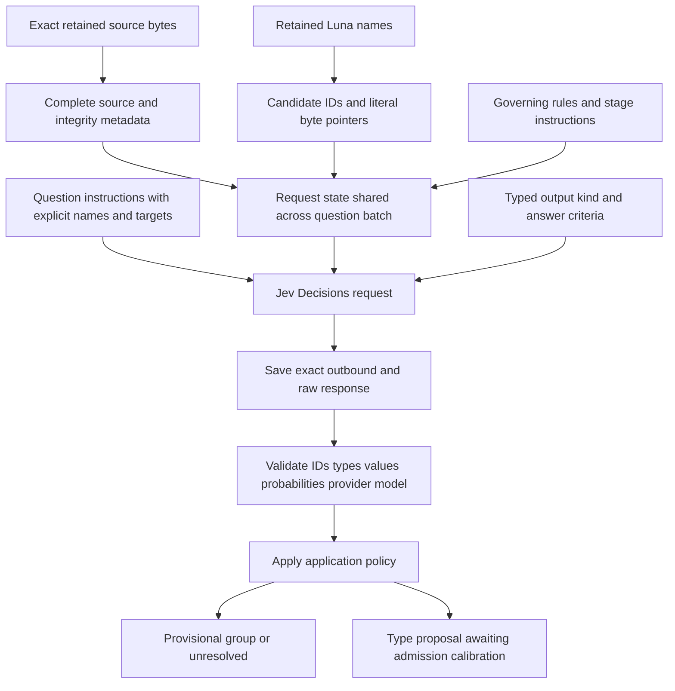

# Adventurers Pub: semantic question catalog and Jev request composition

Research date: 2026-10-04. Repository evidence was read directly. No model calls, application edits, ontology changes, or runtime actions were performed. Proposed wording below is a research recommendation, not an approved prompt change.

## What decisions belong at each pipeline stage?

### Takeaway

The implemented Jev stages are document-local pair identity and entity-type classification. Structural blocks and entity/block associations are design proposals; calibrated entity admission and downstream claim, relationship, canonical identity, and article support decisions are required future capabilities. The current workflow executes alias linking before classification. [Workflow](../../src/workflows/process-document.ts#L63), [scope ledger](../../Resources/entity-classification-scope-ledger.md#L5).

### Cited Findings

#### Stage map

| Stage | Current status | Work and decision boundary |
| --- | --- | --- |
| Candidate identification | Implemented Luna names-only pass | Propose exact names; do not decide aliases, types, facts, dates, or relationships. Jev evaluates supplied candidates and does not fill missing discovery. |
| Structural blocks and mechanical source pointers | Proposal | Markdown parsing handles obvious structure; Jev settles four ambiguous structural cases. Mention matching alone is not identity or subject association. |
| Document-local alias association | Implemented | One mutually exclusive identity judgment per unordered candidate-name pair; provisional groups preserve original candidates. |
| Entity verification | Type proposals implemented; admission calibration deferred | Choose a locked entity type or `not_an_entity`; route accept/reject/review only after calibrated policy. |
| Entity/block association | Proposal requiring policy reconciliation | Associate whole blocks/sections/documents with referents; multiple subjects are possible. Preserve literal pointers and unresolved associations. |
| Assertion, relationship, date, and passage support | Required future | Validate retained discovery proposals against complete sources and verified evidence; reuse compatible support decisions. |
| Canonical cross-document identity and reconciliation | Required future; final identity model unresolved | Compare against earlier accepted state using bounded candidates and complete supporting sources. |
| Article statement support | Required future; support model unresolved | Check finished statements against complete cited sources before publication. |

Sources: [names-only prompt](../../src/domains/document/discovery/v31/prompt.md#L21), [four structural questions](../../Resources/lore-to-blocks.md#L55), [association proposal](../../Resources/blocks-to-entity.md#L69), [classification outcome](../../src/domains/document/decisions/validation.ts#L43), [required passes](../../Resources/specification.md#L487), [identity state dependency](../../Resources/specification.md#L509), [unresolved model assignments](../../Resources/specification.md#L547), [article support](../../Resources/specification.md#L257).

#### Implemented Jev question A: document-local identity

Readable question: **“In this document, do ‘{left name}’ and ‘{right name}’ name the same referent?”** This wording restates the current instructions; the actual task says “Apply alias_instructions to these two names using complete_source. Decide identity independently of whether either referent belongs in an entity index.” [Request builder](../../src/domains/document/aliases/semantic-input.ts#L32).

| Field | What belongs here |
| --- | --- |
| Shared state | Exact complete source, hash, byte length, governing source/capture/ontology rules, shared alias instructions, candidate records used by this batch. |
| Question inputs | Both candidate IDs and exact names; optional initials clue. |
| Output | `choice`: `same_referent`, `different_referents`, `unclear`; per-option probabilities and confidence. |
| Same criterion | Source supports both names as names of the same referent. |
| Different criterion | Source supports different referents or distinct kinds of referent. |
| Unclear criterion | Source does not settle identity sufficiently, or a name has incompatible referents. |
| Preserved distinctions | Acronyms, short names, epithets, alternate spelling may link when supported. A group/member, place/occupant, religion/organization, or appearance/identity is not automatically one referent. |
| Downstream action | Supported pair links inform provisional groups; insufficient support remains unresolved. Identity is independent of entity validity and canonical merge. |

Source: [instructions, names, and answer criteria](../../src/domains/document/aliases/semantic-input.ts#L7), [choice contract](../../src/domains/document/decisions/contracts.ts#L30).

Current coverage is all unordered pairs, with no spelling/type filter: `n * (n - 1) / 2`; for 90 candidates this is `90 * 89 / 2 = 4005`. [Pair enumeration](../../src/domains/document/aliases/semantic-input.ts#L21).

Grouping requires every pair among members to have a supported provisional link. A candidate eligible for multiple separate groups remains separate; each group's display representative is its longest member name, with original-index tie breaking. This is a provisional display choice, not canonical naming. [Group algorithm](../../src/domains/document/aliases/groups.ts#L3).

Research recommendation for the acronym case: **“In this document, is ‘UCR’ used as a shortened name for ‘Unified Church of the Realms’?”** Include that full question and both targets in `instructions`. Matching initials remain a hint. This wording is more legible to a reviewer; no evidence here proves that it will change Jev's answer. [Current structural clue and rules](../../src/domains/document/aliases/semantic-input.ts#L9).

#### Implemented Jev question B: entity type

Readable question: **“Which approved entity type describes this document-local referent, or does it fail all seven definitions?”** The current task is a single choice combining qualification and type. [Classification builder](../../src/domains/document/decisions/semantic-input.ts#L61).

| Field | What belongs here |
| --- | --- |
| Shared state | Exact complete source and integrity metadata; governing source authority, broad capture, locked definitions; referent records with all retained member names and original byte occurrences. |
| Question inputs | Candidate/referral group ID, representative name, question version; member records are in shared state. |
| Output | `Creature`, `Location`, `Organization`, `Item`, `Event`, `Quest`, `Concept`, `not_an_entity`; probabilities and confidence. |
| Task constraints | Use all member contexts and full table/list/quotation framing; no external lore, additional identity merge, omitted name invention, or optional attribute extraction. |
| Uncertainty | An apparently conflated group should lower certainty; source-stated uncertainty alone is not a reason to reject. |
| Downstream action | Every current result is `awaiting_admission_calibration`; no type answer alone admits an entity. |

Sources: [criteria are loaded from locked specification](../../src/domains/document/decisions/semantic-input.ts#L25), [actual task](../../src/domains/document/decisions/semantic-input.ts#L72), [option list](../../src/domains/document/decisions/contracts.ts#L8), [admission thresholds null](../../src/domains/document/classification/operation.ts#L25).

Research option, pending calibration: make two reviewer-visible judgments, **“Does this proposal identify a specific referent qualifying under the locked definitions?”** and **“Which of the seven types describes it?”** This could improve diagnosis when specificity and type are uncertain, but adds a dependency and must be evaluated against the existing single choice. It is not automatically a better model design. Article-worthiness and additional significance questions must not be added. [Capture boundary](../../Resources/specification.md#L64), [inspectable calibrated routing](../../Resources/specification.md#L287).

#### Proposed structural questions

All four target document structure, not entity identity, significance, or truth. Shared state is the complete source with unambiguous pointers to the line, paragraph/list, or link and neighboring blocks. The proposal uses yes/no; a future implementation must define abstention from low-certainty outputs or use a mutually exclusive `unclear` option. That is a recommendation, not a present contract. [Proposal](../../Resources/lore-to-blocks.md#L55).

| Question | Target and required pointers | Meaning of yes; next action |
| --- | --- | --- |
| **“Is this line a title for the text that follows?”** | One-line paragraph, up to 12 words, entirely bold/italic; following text and section boundary. | Create a section label; otherwise retain the line as content. |
| **“Does this paragraph introduce the list immediately after it?”** | Paragraph and following list IDs/spans. | Join paragraph and whole list as one block. |
| **“Do these list numbers identify locations on a map or picture?”** | Numbered list, section, images/notes if present. | Split into map-entry blocks, retaining keys; do not auto-create entities. |
| **“Does this standalone link belong with the preceding block?”** | Link and both neighboring blocks. | Join preceding block; the proposal's no/default joins following block. Unclear/edge handling needs explicit policy. |

The proposal's clone agreement and repeated-call stability checks are proposed validation mechanisms, not evidence of correctness; measurements used the author's reading in place of live Jev answers. [Proposed checks](../../Resources/lore-to-blocks.md#L66), [measurement basis](../../Resources/lore-to-blocks.md#L80).

#### Proposed association questions

The proposal inputs are names, blocks, labelled sections, and complete source. For the recommended stage order, question targets would become provisional/verified referents with their original member names, rather than losing those names. Multiple subjects must be able to receive yes independently. `about` should mean topical subject, not merely literal occurrence or a supported historical action. [Input and scope](../../Resources/blocks-to-entity.md#L19), [question table](../../Resources/blocks-to-entity.md#L69).

| Question | Necessary target inputs | Output and downstream use |
| --- | --- | --- |
| **“Does this block continue the preceding block's subject?”** | Current/prior block IDs, labelled section limit, named subject(s) being considered. | Boolean per explicit subject is a research refinement if the prior block has multiple subjects; supports found section spans. |
| **“Is this block about this referent?”** | Block ID/span; referent ID and member names. | Independent boolean per referent; mark block association. |
| **“Is this section about this referent?”** | Section label, full extent, blocks; referent/member names. | Independent boolean; inherit whole section context. |
| **“Is this document about this referent?”** | Complete document; referent/member names and source labels. | Independent boolean; inherit document-level context. |
| **“Does this passage assert this proposed fact about this referent, preserving its example, hypothetical, quoted, and attributed framing?”** | A retained assertion proposal, referent and exact evidence pointer, complete source. | Research recommendation replacing an overloaded real-vs-made-up mention test; source support validates faithful meaning. |

The last question belongs to assertion support when a claim proposal exists. It avoids treating “e.g. Caine asks…” as proof that Caine acted historically while still preserving the passage and named referent for inspection. Example framing and entity identity are separate decisions. [Current proposal's example exclusion](../../Resources/blocks-to-entity.md#L48), [source qualifications](../../Resources/specification.md#L71).

The proposed imported-material question (“Is bN taken from another work, or does it introduce text that is?”) may annotate provenance if useful. It must not exclude supplied content from evidence or ask whether the campaign adopted it; the governing source-authority rule forbids that consequence. [Exclusion proposal](../../Resources/blocks-to-entity.md#L45), [governing authority](../../Resources/specification.md#L48).

### Inferences

- The discussed order can make structure available before alias/type decisions without requiring semantic entity-to-block associations before verification. This is a proposed dependency arrangement; current alias/type calls already use complete source. [Structure needs text only](../../Resources/lore-to-blocks.md#L13), [current call context](../../src/domains/document/decisions/semantic-input.ts#L65).
- For subject association, independent boolean questions express a many-to-many relation; a choice among entity names would force one selected subject. However, the proposal's claim that a choice favors the first-listed answer is not established by its author-substituted measurements. [Proposal statement](../../Resources/blocks-to-entity.md#L73).

### Gaps

- The structure and association proposal counts are not live Jev acceptance evidence. A calibrated uncertainty policy, quote/attribution handling, and marker/provenance contract are unresolved. [Author substitutions](../../Resources/blocks-to-entity.md#L88).
- Full assertion/relationship/date/passages discovery was not present in the latest names-only schema. Future questions cannot conjure these proposals from identity/type outputs. [Prompt restriction](../../src/domains/document/discovery/v31/prompt.md#L32), [required discovery materials](../../Resources/specification.md#L289).

## How are current requests composed and acted upon?

### Takeaway

The current SDK request has shared `state`, a map of typed `questions`, and a pinned model/provider. The outbound JSON uses snake_case provider settings after SDK serialization. The application stores exact wire input and raw response before interpreting decisions. [Builder](../../src/domains/document/aliases/semantic-input.ts#L32), [wire capture](../../src/domains/document/decisions/provider.ts#L21).

### Cited Findings



The diagram restates existing source validation, builders, capture, response validation, and grouping behavior. [Source guard](../../src/domains/document/decisions/semantic-input.ts#L78), [validation](../../src/domains/document/decisions/validation.ts#L4), [grouping](../../src/domains/document/aliases/groups.ts#L3).

Current wire skeleton, shown with placeholders for the full state and other 15 questions. This is an illustrative excerpt, not a complete replayable request:

```json
{
  "model": "typesafe/jev-1.13",
  "provider": { "allow_fallbacks": false, "only": ["typesafe"] },
  "state": {
    "complete_source": "<exact complete retained source, unabridged>",
    "source_sha256": "00ba537c8f992cc6008c5315baeebf46ccf4d5bea45e0449fba82b1b1936320d",
    "source_byte_length": "<retained integer>",
    "governing_rules": "<complete relevant approved rules>",
    "alias_instructions": "<shared document-alias-v2 instructions>",
    "candidates": ["<all candidate records used by this batch>"]
  },
  "questions": {
    "pair-0022-0056": {
      "type": "choice",
      "instructions": {
        "left_candidate_id": "candidate-e91c80087f43c197-0022",
        "right_candidate_id": "candidate-e91c80087f43c197-0056",
        "left_name": "Unified Church of the Realms",
        "right_name": "UCR",
        "structural_name_clues": [
          "\"UCR\" matches the non-function-word initials of \"Unified Church of the Realms\". Verify the referent using source context."
        ],
        "task": "Apply alias_instructions to these two names using complete_source. Decide identity independently of whether either referent belongs in an entity index."
      },
      "criteria": {
        "same_referent": "The source supports both names as names of the same referent.",
        "different_referents": "The source supports different referents or distinct kinds of referent.",
        "unclear": "The source does not sufficiently settle the identity link, or either name has incompatible referents."
      }
    }
  }
}
```

Source: [exact outbound request](../../data/runs/01-unified-church-of-the-realms/iterations/iteration-043/classifications/887be63b-d9bc-42a2-88bd-6d23756e6d19/aliases/batches/batch-107/attempt-1-15832227-7236-4b0a-97ef-8ce63f8ea801/outbound-request.json#L1).

#### UCR case: retained live answer

The transport began `2026-10-04T15:42:47.326Z` (11:42:47.326 a.m. EDT), returned HTTP 200, and served `typesafe/jev-1.13-20260917` from TypeSafe. The request contained 16 questions; its response usage reports 9,211 input tokens. These are retained-run facts, not a fresh test. [Transport start](../../data/runs/01-unified-church-of-the-realms/iterations/iteration-043/classifications/887be63b-d9bc-42a2-88bd-6d23756e6d19/aliases/batches/batch-107/attempt-1-15832227-7236-4b0a-97ef-8ce63f8ea801/transport-start.json#L2), [transport end](../../data/runs/01-unified-church-of-the-realms/iterations/iteration-043/classifications/887be63b-d9bc-42a2-88bd-6d23756e6d19/aliases/batches/batch-107/attempt-1-15832227-7236-4b0a-97ef-8ce63f8ea801/transport-end.json#L2), [response](../../data/runs/01-unified-church-of-the-realms/iterations/iteration-043/classifications/887be63b-d9bc-42a2-88bd-6d23756e6d19/aliases/batches/batch-107/attempt-1-15832227-7236-4b0a-97ef-8ce63f8ea801/response-body.txt#L1).

```json
{
  "type": "choice",
  "choice": "different_referents",
  "probabilities": {
    "different_referents": 0.41,
    "same_referent": 0.32,
    "unclear": 0.27
  },
  "confidence": 0.12
}
```

The raw answer contains no rationale. The application retained `outcome: "unresolved"`. It did not establish a confident distinct identity. [Raw answer](../../data/runs/01-unified-church-of-the-realms/iterations/iteration-043/classifications/887be63b-d9bc-42a2-88bd-6d23756e6d19/aliases/batches/batch-107/attempt-1-15832227-7236-4b0a-97ef-8ce63f8ea801/response-body.txt#L1), [validated decision](../../data/runs/01-unified-church-of-the-realms/iterations/iteration-043/classifications/887be63b-d9bc-42a2-88bd-6d23756e6d19/aliases/batches/batch-107/result.json#L463).

Current alias policy requires `answer.confidence >= 0.90` and `probabilities[answer.choice] >= 0.90`, plus at least one literal occurrence for each name. It routes supported `same_referent` to `provisional_link`, supported `different_referents` to `distinct`, all other cases to `unresolved`. Despite the configuration name `minimum_same_probability`, it checks the selected answer probability, including `different_referents`. [Gate](../../src/domains/document/decisions/validation.ts#L35), [settings](../../src/domains/document/aliases/operation.ts#L18).

Vendor confidence is normalized choice concentration: `(pmax - 1/n) / (1 - 1/n)`. Thus `(0.41 - 1/3) / (1 - 1/3) = 0.115`, rounded to 0.12. It is not an independent confidence assessment or second corroborating observation. For three options, confidence >= .90 implies `pmax >= 1/3 + .90 * (1 - 1/3) = .933333...`, ignoring rounding; therefore the .90 selected-probability gate is redundant relative to the confidence gate. [TypeSafe confidence documentation](https://docs.typesafe.ai/confidence), [actual raw response](../../data/runs/01-unified-church-of-the-realms/iterations/iteration-043/classifications/887be63b-d9bc-42a2-88bd-6d23756e6d19/aliases/batches/batch-107/attempt-1-15832227-7236-4b0a-97ef-8ce63f8ea801/response-body.txt#L1). The vendor documentation was verified by the companion API researcher, not fetched by this repository-focused researcher.

#### Operational composition

- Alias batches begin with maximum 50 questions; entity type batches begin with maximum 10. Actual count shrinks to fit the complete source. [Alias configuration](../../src/domains/document/aliases/operation.ts#L21), [type configuration](../../src/domains/document/classification/operation.ts#L23).
- The code computes a conservative input bound as `Buffer.byteLength(JSON.stringify(request)) + 2048`, compares it to endpoint metadata, and reduces question count; it throws if even one item cannot fit. The property named `input_upper_bound_tokens` is this byte-derived bound, not a tokenizer's actual count. [Batch planner](../../src/domains/document/decisions/batching.ts#L4), [endpoint bound](../../src/domains/document/decisions/provider.ts#L8).
- Hatchet limits active Jev batch tasks to four in one deployment and owns two retries with 30-second backoff. Dependent alias/classification stages remain sequential. [Batch workflow](../../src/workflows/jev-decision-batch.ts#L7), [stage parents](../../src/workflows/process-document.ts#L77).
- Compatible saved batch responses are hash checked, revalidated against the manifest, and reused without a new network request. [Reuse](../../src/domains/document/decisions/operation.ts#L16).
- Raw requests and responses are saved before application decoding; saved material excludes authorization headers. HTTP 200 error envelopes are still inspected by failure handling. [Transport capture and error handling](../../src/domains/document/decisions/provider.ts#L21).
- Response validation checks expected model/provider, exact requested IDs, required answer kinds/options, probability/confidence ranges, and probability sums within .02 rounding tolerance. It does not prove semantic correctness. [Validator](../../src/domains/document/decisions/validation.ts#L4), [live verification requirement](../../Resources/specification.md#L476).

### Inferences

- A useful inspection row should show the full readable question, targets, source pointers, selected answer, all probabilities, confidence formula meaning, application action, and deterministic reason for the action. This makes the UCR unresolved outcome intelligible without inventing a model explanation. [Current retained contract](../../src/domains/document/decisions/contracts.ts#L32).
- Structured instruction objects are valid; a direct `question` field could improve legibility. Question map keys should serve correlation, not carry task meaning: the companion API researcher found vendor instructions saying keys are not sent to the underlying model. [TypeSafe API](https://docs.typesafe.ai/api), [advanced primitives](https://docs.typesafe.ai/primitives/advanced). No claim that current task format caused the UCR result is justified.

### Gaps

- The single low-certainty UCR result cannot explain why Jev favored different referents, or establish whether batch wording/context affected it. No rationales or counterfactual experiments were present in that response. [Raw response](../../data/runs/01-unified-church-of-the-realms/iterations/iteration-043/classifications/887be63b-d9bc-42a2-88bd-6d23756e6d19/aliases/batches/batch-107/attempt-1-15832227-7236-4b0a-97ef-8ce63f8ea801/response-body.txt#L1).
- Actual request fidelity and syntax compatibility do not establish calibrated accuracy; current classification intentionally has no admission thresholds. [Null thresholds](../../src/domains/document/classification/operation.ts#L25).

## What must be preserved or resolved before future questions are implemented?

### Takeaway

The request guide should preserve complete-source authority, original UTF-8 provenance, broad capture, the locked ontology, and independent application routing. Proposed conveniences such as small context snippets, imported-text exclusion, automatic map entities, or significance gates must not silently alter these contracts. [Complete source](../../Resources/specification.md#L55), [source authority](../../Resources/specification.md#L48), [broad capture](../../Resources/specification.md#L64), [byte contract](../../Resources/specification.md#L536).

### Cited Findings

#### Provenance and mention interpretation

Occurrence finding currently uses `Buffer.indexOf` of each exact name's UTF-8 bytes, restarting at `offset + 1`. It therefore permits overlapping substring matches and does not apply word boundaries, lexical identity, or semantic mention disambiguation. Full-source context is needed to judge these matches. [Occurrence finder](../../src/domains/document/decisions/semantic-input.ts#L44).

Examples reproducibly observed in the retained source include `Church` inside `#UnifiedChurch`, `Hells` inside `Hellstrom`, `Apollo` inside `Apolloite`, `Lathander` inside `Lathanderan`, and `Satan` inside `Satana`. These illustrate candidate-pointer limits; substring occurrence is not proof of an independent mention. The raw manifest and source preserve these inputs. [Source](../../data/runs/01-unified-church-of-the-realms/iterations/iteration-043/classifications/887be63b-d9bc-42a2-88bd-6d23756e6d19/source.md#L1), [original candidates](../../data/runs/01-unified-church-of-the-realms/iterations/iteration-043/classifications/887be63b-d9bc-42a2-88bd-6d23756e6d19/manifest.json#L1).

Reproduce the raw substring cases without making a semantic assertion:

```python
from pathlib import Path
p = Path("data/runs/01-unified-church-of-the-realms/iterations/iteration-043/classifications/887be63b-d9bc-42a2-88bd-6d23756e6d19/source.md")
source = p.read_bytes()
for shorter, longer in [("Church", "UnifiedChurch"), ("Hells", "Hellstrom"),
                        ("Apollo", "Apolloite"), ("Lathander", "Lathanderan"),
                        ("Satan", "Satana")]:
    needle = longer.encode("utf-8")
    at = source.index(needle)
    print(shorter, longer, at, at + len(needle), source[at:at+len(needle)].decode())
```

All future block/mention pointers must use original zero-based half-open UTF-8 byte spans. The structural proposal's TypeScript offsets come from markdown parser string offsets, which cannot serve directly as byte coordinates. Marker labels must remain a transport layer separate from immutable source. [Original-byte contract](../../Resources/specification.md#L538), [proposal offsets](../../Resources/lore-to-blocks.md#L123).

#### Policy reconciliations

| Proposed behavior or ambiguity | Required treatment in the guide |
| --- | --- |
| Exclude imported quotations/excerpts and names | Do not adopt; supplied imported material remains authoritative source material. |
| Example mentions give nothing to referent | Preserve example framing; distinguish identity/mention association from support for an actually occurred action. |
| Table mentions only store names/headers and receive no block context | Preserve complete framing and all source material. A proposed row/header pointer supplements full source; it cannot suppress table evidence. |
| Every map entry creates a place, including generated fallback names | Treat missing entities as discovery proposals needing the existing discovery/verification process; do not invent canonical names or bypass ontology. |
| Name-size or article-worthiness significance | Do not ask; CAP-001 forbids a significance/page gate. Article eligibility is the later locked fields-or-quality rule. |
| Entity type choice confounds group identity ambiguity | Retain low-certainty/conflict findings and the original names; do not use type classification to silently change groups. |
| Continuing “the subject” when a block has several | Research recommendation: target an explicit subject per continuity question, or define unambiguous continuation semantics before implementation. |
| Agreement of cloned/repeated models proves correctness | Treat as stability/agreement diagnostics; product correctness still requires full-source independent review and live evidence. |

Sources: [imported exclusion and table behavior](../../Resources/blocks-to-entity.md#L41), [map rule](../../Resources/blocks-to-entity.md#L39), [spec discovery/admission](../../Resources/specification.md#L487), [source/capture/faithfulness](../../Resources/specification.md#L48), [article eligibility](../../Resources/specification.md#L209), [classification merge restraint](../../src/domains/document/decisions/semantic-input.ts#L72), [continuation and multiple subjects](../../Resources/blocks-to-entity.md#L73), [live/independent verification](../../Resources/specification.md#L301).

The current discovery prompt's phrase “significance is determined later” conflicts with treating significance as an additional admission criterion. The guide must follow CAP-001's explicit prohibition; no application edit was made in this research. [Prompt](../../src/domains/document/discovery/v31/prompt.md#L10), [governing rule](../../Resources/specification.md#L66).

#### Required future question families (research wording; not implemented)

| Decision family | Direct question | Necessary state / outputs |
| --- | --- | --- |
| Assertion source support | **“Does the complete source support this exact proposed assertion, including its subject, value/object, negation, qualification, attribution, and time?”** | Complete current source, proposed assertion/evidence, linked referents and relevant source framing. Support or unsupported/unclear assessment; deterministic exact-byte verification separately. |
| Relationship support | **“Does the source assert this proposed relationship from this subject to this object, with these qualifiers?”** | Retained relation proposal, typed endpoints, allowed predicate definition, full source. Support assessment; deterministic direction/type/predicate checks; negative assertions remain claims and undefined predicates remain review items. |
| Attribute interpretation | **“Does this source describe this proposed trait as identity, appearance, occupation, or a time-qualified change?”** | Retained proposed attribute and complete source. Disjoint semantic choice if needed; do not infer absent species traits or PC status. |
| Date interpretation | **“Does this proposed date describe the assertion's time or the event/period it discusses?”** | Retained date proposal, source phrase, linked assertion/event, complete source. Bounded semantic choice if needed; deterministic normalization only when unambiguous; retain relative/approximate wording. |
| Canonical identity | **“Do these incoming and stored referents identify the same entity?”** | Complete current source plus complete prior documents supporting bounded candidate identities, names, aliases, claims, dates. Same/different/unclear; final model assignment unresolved. |
| Reconciliation | **“Does this incoming assertion revise the same fact, add information, describe another period, or remain inconsistent with this retained assertion?”** | Relevant incoming/stored assertions and complete supporting sources, document precedence, dates/attribution. Mutually exclusive choices require carefully non-overlapping definitions; preserve older evidence. Luna or Jev assignment depends on final stage. |
| Article section placement | **“Which permitted section best fits this supported passage for this entity?”** | Retained passage/assertions and complete source, type-specific allowed sections including `Other`. A choice can assign section; uncertain assignment must not delete material. |
| Finished article statement support | **“Do these complete cited sources support this exact article statement with its subject, qualifications, attribution, and time?”** | Finished statement, citations, accepted claim/passage lineage, full cited documents. Support/revision assessment; support model unresolved. |

Sources: [faithful assertions](../../Resources/specification.md#L71), [relationship vocabulary and negative retention](../../Resources/specification.md#L135), [identity vs appearance](../../Resources/specification.md#L109), [dates](../../Resources/specification.md#L170), [complete prior identity sources](../../Resources/specification.md#L57), [reconciliation](../../Resources/specification.md#L186), [decision assignment](../../Resources/specification.md#L550), [article sections](../../Resources/specification.md#L233), [finished support](../../Resources/specification.md#L257).

### Inferences

- Claim support should evaluate faithful expression, not whether a DM assertion is believable or historically true in an outside setting. This follows source authority and qualification retention. [Source authority](../../Resources/specification.md#L48).
- Separating deterministic provenance checks, semantic judgments, and application accept/reject/review actions makes question design auditable and avoids reusing model scores as authorization to alter semantics. [Evidence contract](../../Resources/specification.md#L536), [routing contract](../../Resources/specification.md#L287).

### Gaps

- The approved specification leaves exact schemas/questions/calibration for later authorized stages; this catalog should not be mistaken for their completed implementation or finalized thresholds. [Open contract register](../../Resources/specification.md#L532).
- Final identity, writer, and article-support model selections remain unresolved; source-local Jev decisions do not authorize assigning all future verification to Jev. [D-003](../../Resources/specification.md#L547).
